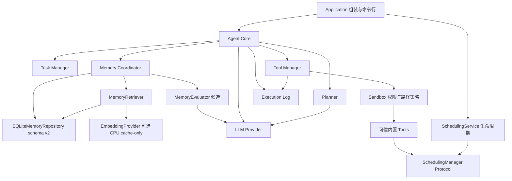

# Deskpal V0.3 后端架构

两份 `doc/` 交接文档描述长期愿景。当前交付 Python 3.11+ 本地后端：聊天、受控工具调用、任务、记忆、日志，以及 Calendar/Timer 持久化调度、Document 操作与授权截图。Qt/Live2D、人格、情绪、连续环境监控、第三方插件、独立向量数据库、聊天本地模型和完整 OS 沙箱不在当前实现范围。V0.3 已接入可选本地 embedding、来源化记忆和三字段用户画像，当前版本 0.3.0，最终发布门槛见 [V0.3 测试报告](docs/versions/v0.3/test-report.md)。记忆契约见 [V0.3 接口](docs/versions/v0.3/interfaces.md)，工具与调度契约见 [V0.2 接口](docs/versions/v0.2/interfaces.md)。

## 依赖与调用方向

图中 Sandbox → Tools 表示安全门顺序；实际由 Tool Manager 调用 Sandbox 检查，通过后才调用工具。Sandbox 无需导入工具具体实现。Agent 通过构造参数注入各个 Protocol，不根据模型返回值动态 import、执行代码或注册插件。

`models.py` 保存跨模块数据，`ports.py` 保存同步 Protocol；具体业务实现放在单独的 `providers.py`、`manager.py`、`core.py` 等文件。DTO 和接口仅依赖标准库及其他模块的 DTO，业务模块不能反向引用 Core/Application。Protocol 与具体类名称不同，避免导入歧义。当前契约见 [V0.2 接口](docs/versions/v0.2/interfaces.md)，未改变的基础接口可追溯到 [V0.1 契约](docs/versions/v0.1/interfaces.md)。

Application 的 `create_agent(config=None, *, planner=None, screenshot_backend=None, embedding=None, memory_evaluator=None)` 是实际组装入口：选择 Provider，组装 Planner、WorkspaceSandbox、19 个工具、任务、记忆、调度服务与 JSONL 日志。默认 LLMPlanner 负责模型规划；CLI 明确 `--tool` 时注入 DirectToolPlanner，仍经过 Core 和全部安全入口。数据为 `memory.sqlite3`、`scheduling.sqlite3`、`execution.jsonl` 与配置工作区；Agent Task 与 Waiting 缓存在进程内，日程、计时器、事件、记忆和审计持久化。ExitStack 在组装失败和 Core.close 时尝试释放所有拥有的资源，先关闭调度再关闭记忆；close 即使抛出清理错误，Core 也不再接受请求。

工厂返回的 AgentCore 可作为 context manager；`close()` 通过明确注入的回调关闭工厂拥有的 SQLite 连接。直接构造 AgentCore 不自动关闭外部传入依赖，资源所有权由调用方决定。一个 Core 同时只允许一个同步请求，拒绝并发或重入；close 拒绝运行中调用，关闭后不能继续 run。

## 模块所有权

| 路径 | 所有权与职责 |
| --- | --- |
| `src/deskpal/agent` | AgentResult、Agent 接口；编排生命周期、权限全量预检、工具执行、反馈与记忆保存 |
| `src/deskpal/planner` | Plan、Planner 接口；把请求、记忆和工具说明转换成有序 ToolCall，限制计划规模 |
| `src/deskpal/llm` | ChatMessage、LLMResponse、LLMProvider、LLMError；离线 demo 与 API 协议转换 |
| `src/deskpal/tools` | ToolSpec、ToolCall、ToolContext、ToolResult、Tool/ToolManager；注册、校验、派发内置工具 |
| `src/deskpal/sandbox` | Sandbox 接口和权限/路径异常；可信工具的权限与工作区路径边界 |
| `src/deskpal/tasks` | Task、TaskStatus、TaskManager；任务创建、状态转换、读取与取消 |
| `src/deskpal/memory` | 来源/断言/修订 DTO、MemoryCoordinator、schema v2 Repository、候选 Evaluator、Profile 投影、词法/语义 Retriever 和可选 FastEmbed adapter |
| `src/deskpal/scheduling` | SchedulingManager、Clock、Calendar/Timer/Event DTO；独立 SQLite 服务、可唤醒调度线程及轮询事件 |
| `src/deskpal/config` | TOML/env 配置、启动校验；配置读取不创建目录，不发送网络请求 |
| `src/deskpal/execution_log` | ExecutionLog、NullExecutionLog、JsonlExecutionLog；UTC JSONL 审计与凭据键脱敏 |
| `src/deskpal/application` | 组装具体实现、CLI 入口；未来 UI 也通过这里创建 Agent |

Python 使用 `src` 布局，包名 `deskpal`。HTTP、TOML、SQLite、日志使用标准库，本地 `.env` 解析依赖 `python-dotenv`。先安装项目开发依赖后运行 pytest；`pyproject.toml` 配置 `src` 导入路径。

## 单次请求流程

1. Observe：创建 Created 任务；显式“记住”先保存并返回，不调用 LLM。其他请求检索合资格完整证据及 revision/epoch，允许空结果，云模式过滤 local_only。
2. Think / Plan：进入 Planning；Planner 调用 LLM，生成回复和有序工具计划。
3. Preflight：检查计划数量、已注册工具及每个步骤所需权限。任何步骤缺授权则进入 Waiting，返回所需工具名、逐项参数与风险，以及全计划快照；此请求未执行任何工具。路径/schema 验证在授权执行入口进行，权限预检不承诺提前验证全部参数。
4. Act：进入 Running，按顺序通过 Tool Manager → Sandbox → Tool.execute 执行。一个步骤失败立即结束，不继续执行后续步骤，不承诺事务回滚。
5. Reflect：汇总工具结果，必要时发起独立的新 LLM 请求，把原始目标与显式工具结果作为普通文本生成用户反馈；不重放首轮 function_call/function_call_output 历史。V0.1 不执行总结阶段新提出的工具调用；计划只执行一轮并受 `max_tool_steps` 限制。
6. Memory：工具完成后可选保存有界 observed_event；candidate_review 模式独立提取候选。辅助模型/保存失败返回 warning，保留已完成工具结果；显式保存失败仍明确失败。普通聊天默认不保存，不保存模型内部推理。

V0.3 工厂使用 MemoryCoordinator，不再运行旧 V0.1 的最近五条 fallback。显式事实/工具事件保留来源原文、用途策略与时间；candidate_review 才发起独立无工具评估，主机严格校验 quote/schema/分数后保存候选。审核/更正使用 expected_revision，默认候选七天 TTL。当前画像仅 preferred_name、reply_language、verbosity，必须来自明确已确认用户偏好。

SQLite v1 先备份为 `.v1.bak` 再事务迁移 v2，旧数据 legacy 隔离。更正/删除更新 epoch 并失效旧向量与画像；忘记保守删除共享来源闭包及历史，Core 清理关联 Task。历史日志、迁移备份、导出和云端副本不保证擦除。检索只使用 local owner/global scope、当前有效 accepted，并在外发/执行边界验证依赖；变动或过期撤销 Waiting 私有计划与授权。

检索融合词法/语义名次，重要度和时间衰减用于相关性平分；完整证据最多五条/默认 8000 UTF-8 bytes。FastEmbed 仅在显式配置且缓存存在时加载，manifest 记录资产/维度/预处理。缺模型/坏索引退化词法并警告，不联网补模型；超 512 tokens 完整断言拒绝语义编码，不静默截断。as_of 历史查询仍受来源、用途、时效和删除过滤。详见 [V0.3 接口](docs/versions/v0.3/interfaces.md)。

V0.2 的 `confirm_task(task_id, authorized_tools=(), high_risk_authorized_tools=())` 确认同一 Core 内保存的 Waiting 原计划，不重新规划、不创建任务。原授权与新增授权只在此任务内累积，不足授权仍 Waiting；足够授权进入 Running。返回 DTO/Task 快照不共享私有参数，取消/终态/关闭清理缓存。记忆依赖被更正、删除或过期时旧计划也不可确认；重启无法确认内存旧计划。兼容的重新 run 仍创建新任务并重新规划。Agent 不执行任意后台工具；调度服务只生成可查询的本地到期事件。

## 工具与安全边界

保留 `echo/time/read_text/write_text`，新增日程 CRUD/events、计时 create/list/cancel/events、文件 search/classify/copy/move/delete 和 screenshot_capture。自动查询为 Level 0；日程/计时变更、文件写入/复制和截图为 Level 1，检查 `authorized_tools`；文件移动/删除为 Level 2，仅检查独立 `high_risk_authorized_tools`。普通授权不能放行高风险工具；模型仅提交名称和参数，权限取可信注册元数据。

文件工具统一调用工作区策略，拒绝 `..`、绝对路径、设备名、ADS 和所有符号链接/Junction 组件；规范化真实路径仍检查根归属。写入/复制/移动默认不覆盖，读取/写入受字节限额，移动/删除仅单个普通文件。写入暂存后发布；无覆盖发布使用 hardlink，不支持时明确失败。搜索不跟随链接，分类只根据扩展名。可信内置工具的应用层策略没有 OS 进程隔离、强制超时/内存隔离，不能防御恶意 Python 插件、管理员级路径变更或并发文件系统竞争。

截图后端通过 ScreenshotBackend 注入；MSS 作为可选依赖，在授权执行后惰性导入，region 使用物理屏幕相对坐标，捕获前检查像素上限。PNG 保存在工作区且受字节限额；ToolResult、日志、记忆和 Reflect 仅收到路径/尺寸等元数据，不自动上传图像。图像理解 DTO 尚未实现。

Scheduling 工具只依赖 Protocol，由 Application 启动/关闭独立服务。Calendar 输入 aware ISO 时间、UTC 持久化；IANA timezone 是经过验证的展示元数据。Timer 进程内使用 monotonic，重启从 UTC deadline 恢复。状态与唯一到期事件同 SQLite 事务，事件只读轮询、按来源维护游标。首次调度补记漏到期事件；程序退出期间无系统通知。工作线程故障向查询/关闭显式报告，不静默伪称健康。

## 配置、模型与数据

`config.example.toml` 默认 `provider = "offline"`，离线响应须明确显示 demo 标识，不能伪称真实模型或自然语言理解。API 模式必须显式配置 `provider = "openai"` 和 `model`，API key 从 `api_key_env` 指定的进程环境变量或本地 `.env` 获取，字段 `repr=False`；不能写入 TOML、日志或仓库。变量名称必须为可移植标识符，误填凭据会得到不包含原值的配置错误。

API 适配采用 OpenAI Responses API、`store: false`；外部接口仍是厂商无关的 `chat()/generate()`。云端模型模式会把请求、选中的记忆及必要工具结果发给配置的模型服务；本地持久化不意味着模型推理全在本地。服务端行为以其产品政策为准。

V0.1 支持首轮规划提出工具调用，并通过独立 Reflect 请求总结执行结果；不支持推理模型完整的 native 多轮工具续接。此类续接可能要求保留并回传 reasoning items，而当前 DTO 不含这些内部协议数据，适配器丢弃 reasoning 输出且不记录或持久化。未来若支持续接，应在 Provider 内处理不透明的内存续接状态并扩展专用契约，不能误用当前文本/ToolCall DTO 宣称完整支持。

配置优先级为进程环境变量 > 配置目录的 `.env` > TOML > 默认值。路径相对于配置文件所在目录解析；未指定文件时相对于当前目录。`.env` 按字面值解析，不改变进程环境；显式传入 `environ` 时完全跳过 `.env`，以隔离测试与真实凭据。`data/`、`workspace/`、真实配置、`.env`、SQLite、JSONL 默认忽略；仅提交无密钥的 `.env.example`，原始 `doc/` 文件保留。运行时数据路径由 Application 组装，不由领域模块自行选择。

日志包含请求、任务转换、计划、工具调用参数、权限判断、结果与错误；只记录显式业务输出，不记录模型内部推理、API headers 或原始请求/响应体。按凭据键递归脱敏只是补充保护，不能从普通自然语言内容中识别所有秘密，调用方仍需避免注入凭据。JSONL 锁覆盖同一日志实例的线程内追加，V0.1 单进程共享一个实例，不承诺跨进程锁。

正式 App/UI 的取消入口是 Core.cancel_task：合法取消前记录状态审计，支持不在运行中的 Waiting 任务。工厂的 TaskManager 使用空日志，由 Core 拥有请求生命周期审计，以便日志故障时仍能尝试保存 Failed 状态。`agent.tasks` 属于底层管理/检查接口，直接调用未注入日志的 manager 不承诺额外审计；Core 观察运行请求被底层取消时会记录 request_cancelled，并暴露取消审计失败。

工具执行、记忆写入、日志和任务状态不构成跨模块原子事务。磁盘或日志故障可能发生在工具已经产生副作用之后；Core 返回 Failed 并尝试记录失败状态，不能宣称已回滚。再次审计或任务存储也失败时，结果会显式包含失败持久化/审计缺失信息，不保证外部故障下存储终态成功。

## 实现顺序与验证

V0.1 基础实现顺序为 LLM → Tools/Sandbox → Tasks → Memory → Planner/Core/Application；V0.2 使用架构、服务、文件/截图与测试子 Agent 分工，由主 Agent 统一权限、接口、Application 装配和交付。计划见 [V0.2 开发计划](docs/versions/v0.2/development-plan.md)，V0.2 实测见 [历史报告](docs/versions/v0.2/test-report.md)；V0.3 采用来源/仓储、候选/画像、检索/模型、Core/验收分工，实际交付与最终证据见 [交付说明](docs/versions/v0.3/delivery.md)和[测试报告](docs/versions/v0.3/test-report.md)。

模块测试关注故障与边界：API 请求/响应与网络失败、工具权限与文件逃逸、任务非法状态、SQLite 重开持久化、Core Waiting 无副作用、工具失败停止、日志脱敏。最终离线端到端演示应覆盖基础聊天、工具运行、授权写文件、查询任务与记忆，并明确 API 模式的配置方法。UI 未来替换命令行入口时不更改上述模块契约。

