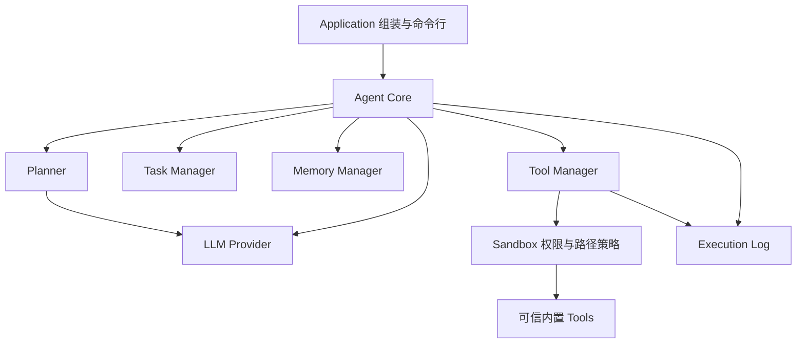

# Deskpal V0.1 后端架构

两份 `doc/` 交接文档描述的是长期愿景。本次只交付 Python 3.11+ 本地后端：聊天、受控工具调用、任务状态、基础记忆和执行日志。UI、Live2D、人格、情绪、环境感知、后台调度、第三方插件、向量数据库和本地模型均不在 V0.1 实现范围。

## 依赖与调用方向

图中 Sandbox → Tools 表示安全门顺序；实际由 Tool Manager 调用 Sandbox 检查，通过后才调用工具。Sandbox 无需导入工具具体实现。Agent 通过构造参数注入各个 Protocol，不根据模型返回值动态 import、执行代码或注册插件。

`models.py` 保存跨模块数据，`ports.py` 保存同步 Protocol；具体业务实现放在单独的 `providers.py`、`manager.py`、`core.py` 等文件。DTO 和接口仅依赖标准库及其他模块的 DTO，业务模块不能反向引用 Core/Application。Protocol 与具体类名称不同，避免导入歧义。稳定接口详见 [docs/interfaces.md](docs/interfaces.md)。

Application 的 `create_agent(config=None)` 是实际组装入口：选择 Provider，组装 LLMPlanner、WorkspaceSandbox、BuiltinToolManager、InMemoryTaskManager、SQLiteMemoryManager 和 JSONL 日志。运行数据分别为 `storage.data_dir/memory.sqlite3`、`storage.data_dir/execution.jsonl` 与配置工作区；任务是进程内状态，重启后不保留，基础记忆与审计持久化。组装失败会关闭已创建的 SQLite 连接。

工厂返回的 AgentCore 可作为 context manager；`close()` 通过明确注入的回调关闭工厂拥有的 SQLite 连接。直接构造 AgentCore 不自动关闭外部传入依赖，资源所有权由调用方决定。一个 Core 同时只允许一个同步请求，拒绝并发或重入；close 拒绝运行中调用，关闭后不能继续 run。

## 模块所有权

| 路径 | 所有权与职责 |
| --- | --- |
| `src/deskpal/agent` | AgentResult、Agent 接口；编排生命周期、权限全量预检、工具执行、反馈与记忆保存 |
| `src/deskpal/planner` | Plan、Planner 接口；把请求、记忆和工具说明转换成有序 ToolCall，限制计划规模 |
| `src/deskpal/llm` | ChatMessage、LLMResponse、LLMProvider、LLMError；离线 demo 与 API 协议转换 |
| `src/deskpal/tools` | ToolSpec、ToolCall、ToolContext、ToolResult、Tool/ToolManager；注册、校验、派发内置工具 |
| `src/deskpal/sandbox` | Sandbox 接口和权限/路径异常；可信工具的权限与工作区路径边界 |
| `src/deskpal/tasks` | Task、TaskStatus、TaskManager；任务创建、状态转换、读取与取消 |
| `src/deskpal/memory` | MemoryRecord、MemoryKind、MemoryManager；SQLite 基础记忆存取、文字搜索与删除 |
| `src/deskpal/config` | TOML/env 配置、启动校验；配置读取不创建目录，不发送网络请求 |
| `src/deskpal/execution_log` | ExecutionLog、NullExecutionLog、JsonlExecutionLog；UTC JSONL 审计与凭据键脱敏 |
| `src/deskpal/application` | 组装具体实现、CLI 入口；未来 UI 也通过这里创建 Agent |

Python 使用 `src` 布局，包名 `deskpal`。HTTP、TOML、SQLite、日志使用标准库，本地 `.env` 解析依赖 `python-dotenv`。先安装项目开发依赖后运行 pytest；`pyproject.toml` 配置 `src` 导入路径。

## 单次请求流程

1. Observe：创建 Created 任务并记录请求，读取相关基础记忆。
2. Think / Plan：进入 Planning；Planner 调用 LLM，生成回复和有序工具计划。
3. Preflight：检查计划数量、已注册工具及每个步骤所需权限。任何步骤缺授权则进入 Waiting，返回全部所需工具名；此请求未执行任何工具。
4. Act：进入 Running，按顺序通过 Tool Manager → Sandbox → Tool.execute 执行。一个步骤失败立即结束，不继续执行后续步骤，不承诺事务回滚。
5. Reflect：汇总工具结果，必要时发起独立的新 LLM 请求，把原始目标与显式工具结果作为普通文本生成用户反馈；不重放首轮 function_call/function_call_output 历史。V0.1 不执行总结阶段新提出的工具调用；计划只执行一轮并受 `max_tool_steps` 限制。
6. Memory：保存经过选择的请求/结果摘要或显式用户事实；无需复制全部对话，不保存模型内部推理。成功进入 Completed，错误进入 Failed。

实际 V0.1 记忆选择规则：`记住：内容`、`记住:内容` 或 `记住 内容` 的内容保存为 semantic（最多 2000 字符）；成功工具任务保存 bounded episodic 请求/结果文本摘要（最多 2000 字符），普通聊天不自动入库。Observe 先文字搜索当前请求，未匹配时取最近五条作背景。这里是确定规则，不是已实现 LLM Memory Evaluator、向量检索或自动用户画像。

V0.1 不提供自动重试、恢复或后台任务执行。Waiting 是已有任务的可观察状态；授权后调用者重新提交相同请求和 `authorized_tools`，创建新任务并重新规划。旧 Waiting 任务通过正式入口 `AgentCore.cancel_task(task_id)` 取消并审计。不得将未实现的 `resume()` 呈现为可用 API。新请求仍可能生成不同计划，白名单以外工具再次要求授权。

## 工具与安全边界

计划内置 `echo`、`time`、`read_text`、`write_text`。前三者权限 Level 0，写文件 Level 1，只有本次调用显式授权 `write_text` 才可执行。Level 2 预留：同样必须显式授权，不能由配置或模型自动提升。工具名、参数、权限以可信注册元数据为准，模型仅提交工具名和参数。

文件工具必须调用工作区路径策略，拒绝 `..`、绝对路径、符号链接或 Windows junction 引起的边界逃逸。边界按规范化实际路径判断，不能仅比较字符串前缀。写文件默认不覆盖，覆盖需显式参数；读取/写入受大小上限约束。这里仅是可信内置工具的应用层策略，不是操作系统完整沙箱：没有进程隔离、强制超时/内存限制，也无法防御恶意 Python 插件、管理员级路径变更或并发文件系统竞争。不要装载不可信工具。

## 配置、模型与数据

`config.example.toml` 默认 `provider = "offline"`，离线响应须明确显示 demo 标识，不能伪称真实模型或自然语言理解。API 模式必须显式配置 `provider = "openai"` 和 `model`，API key 从 `api_key_env` 指定的进程环境变量或本地 `.env` 获取，字段 `repr=False`；不能写入 TOML、日志或仓库。变量名称必须为可移植标识符，误填凭据会得到不包含原值的配置错误。

API 适配采用 OpenAI Responses API、`store: false`；外部接口仍是厂商无关的 `chat()/generate()`。云端模型模式会把请求、选中的记忆及必要工具结果发给配置的模型服务；本地持久化不意味着模型推理全在本地。服务端行为以其产品政策为准。

V0.1 支持首轮规划提出工具调用，并通过独立 Reflect 请求总结执行结果；不支持推理模型完整的 native 多轮工具续接。此类续接可能要求保留并回传 reasoning items，而当前 DTO 不含这些内部协议数据，适配器丢弃 reasoning 输出且不记录或持久化。未来若支持续接，应在 Provider 内处理不透明的内存续接状态并扩展专用契约，不能误用当前文本/ToolCall DTO 宣称完整支持。

配置优先级为进程环境变量 > 配置目录的 `.env` > TOML > 默认值。路径相对于配置文件所在目录解析；未指定文件时相对于当前目录。`.env` 按字面值解析，不改变进程环境；显式传入 `environ` 时完全跳过 `.env`，以隔离测试与真实凭据。`data/`、`workspace/`、真实配置、`.env`、SQLite、JSONL 默认忽略；仅提交无密钥的 `.env.example`，原始 `doc/` 文件保留。运行时数据路径由 Application 组装，不由领域模块自行选择。

日志包含请求、任务转换、计划、工具调用参数、权限判断、结果与错误；只记录显式业务输出，不记录模型内部推理、API headers 或原始请求/响应体。按凭据键递归脱敏只是补充保护，不能从普通自然语言内容中识别所有秘密，调用方仍需避免注入凭据。JSONL 锁覆盖同一日志实例的线程内追加，V0.1 单进程共享一个实例，不承诺跨进程锁。

正式 App/UI 的取消入口是 Core.cancel_task：合法取消前记录状态审计，支持不在运行中的 Waiting 任务。工厂的 TaskManager 使用空日志，由 Core 拥有请求生命周期审计，以便日志故障时仍能尝试保存 Failed 状态。`agent.tasks` 属于底层管理/检查接口，直接调用未注入日志的 manager 不承诺额外审计；Core 观察运行请求被底层取消时会记录 request_cancelled，并暴露取消审计失败。

工具执行、记忆写入、日志和任务状态不构成跨模块原子事务。磁盘或日志故障可能发生在工具已经产生副作用之后；Core 返回 Failed 并尝试记录失败状态，不能宣称已回滚。再次审计或任务存储也失败时，结果会显式包含失败持久化/审计缺失信息，不保证外部故障下存储终态成功。

## 实现顺序与验证

Phase 1 固定基础设施和本页契约，业务实现严格依次推进：LLM → Tools/Sandbox → Tasks → Memory → Planner/Core/Application。每步先通过模块测试再继续下个模块。

模块测试关注故障与边界：API 请求/响应与网络失败、工具权限与文件逃逸、任务非法状态、SQLite 重开持久化、Core Waiting 无副作用、工具失败停止、日志脱敏。最终离线端到端演示应覆盖基础聊天、工具运行、授权写文件、查询任务与记忆，并明确 API 模式的配置方法。UI 未来替换命令行入口时不更改上述模块契约。

