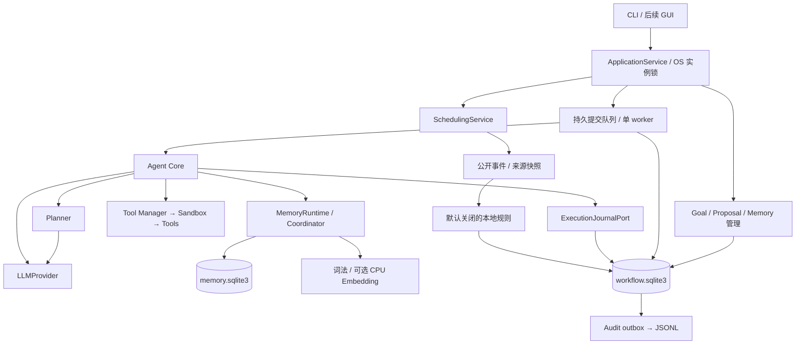

# Deskpal 架构

V0.4 以“显式目标 → 本地提议 → 持久任务 → 计划确认 → 步骤账本 → 审查恢复”为主线。当前验收状态见 [V0.4 进度](docs/versions/v0.4/development-status.md)，实际接口见 [接口契约](docs/versions/v0.4/interfaces.md)。Python 3.11+，Windows 单机、单数据目录运行实例。

## 调用方向

Core 依赖 DTO/Protocol，不访问 SQL、Goal 实现、调度私有连接或线程控制。Tool Manager 检查可信权限和 Sandbox 后执行工具；模型不能注册工具或提高权限。领域业务不能反向引用 Core/Application。

## 模块与生命周期

| 模块 | 职责 |
| --- | --- |
| application | 生产工厂、实例锁、单 worker、CLI、管理/恢复/删除/关闭协调 |
| agent / planner / llm | Observe/Think/Plan/Act/Reflect、有界静态 Plan、厂商无关 Provider |
| workflow / tasks | 单工作库、持久 Task/Submission/Plan/attempt、依赖索引、outbox、删除 job；兼容内存 TaskManager |
| goals | 显式 Goal/Milestone/SourceBinding、CAS、执行条件版本、完成证据 |
| proactive | 本地 Proposal、规则、独立 cursor、持久 inbox/continuation、原子接受 |
| memory | 来源/revision/用途、候选审核、三字段画像、词法和可选 FastEmbed |
| scheduling | 独立日程/计时库、到期事件、来源身份/快照/锚点 |
| tools / sandbox | 19 个可信工具、schema/契约版本、三级权限、工作区文件策略 |
| config / execution_log | TOML/.env/env、时区验证、JSONL 观察副本 |

`create_application(...)` 为生产 facade，`run/handle_request` 是 submit + wait。worker 调用 `Core.execute_task(task_id)`，不再次提交或创建重复 Task。取消直接写短事务，不排在执行队列后面。

`create_agent(...) -> AgentCore` 保留 V0.3 同步、进程内任务行为，供嵌入和旧测试使用，不具备生产实例锁/持久队列/恢复保证。直接构造 Core 不自动关闭外部依赖。生产 UI 经 Application，不直接修改底层 store、TaskManager 或 Core。

Application 在任何数据库初始化前取得规范 data_dir 的 OS 文件锁；Windows 持有 msvcrt fd，非 Windows 分支用 fcntl。第二工厂、路径别名、另一进程不能同时拥有目录；异常退出由 OS 释放锁，不依赖 PID 或时间租约接管。

关闭先停止提交/本地提议/领取，协作取消并等待 Core，join worker，再关闭 Core 拥有的 Scheduling/Memory/模型，最后关闭 workflow、释放实例锁。`close(timeout)` 超时返回 False，保留在用资源与锁，可查诊断并再次关闭；不强杀同步工具线程。

## 事务与权威

Goal/Milestone/Binding/Proposal、Task/Submission/Plan/attempt、依赖索引、inbox/cursor、删除 job 和 audit outbox 同属 workflow.sqlite3。接受提议与创建唯一 Task/Submission 同事务。SQLite WAL、foreign keys、FULL synchronous；嵌套事务复用连接，内部失败使外层回滚。未知 schema 拒绝打开，备份使用 SQLite online backup。

Memory 保留 schema v2 独立库，Scheduling 保留原库。跨库预检不是全局事务；接受、出队、规划/云出口、每步前重复复核来源。同库取消/版本/遗忘阻断与 Started 提交原子排序。外部查询、LLM、工具不占用工作库写事务。

Goal revision 每次写入递增，execution_version 只随状态/执行条件改变；备注不使兄弟工作全部失效。Milestone/Binding 独立作用域。Proposal Accepted、Task Completed、Goal Completed 是不同事实；Goal/Milestone 完成须用户证据，模型回复不改权威状态。

新 Goal/Binding 默认 local_only，派生用途取来源中最严格限制。云 key 或接受建议不构成出云许可；受限工作在云规划前阻断。使用明确离线模式，或修改原来源用途、产生新版本/新意图后再处理。

## 计划、授权与恢复

Plan 保存完整 canonical JSON 的 SHA-256，覆盖准确参数、reply、稳定 call ID、工具 contract_version/schema/权限、workspace、用途及依赖版本。工具行为改变须升级 contract_version。请求/计划超限在执行前拒绝；结果超限明确省略正文并保留 outcome。

全计划先预检权限，不足则 Waiting、零工具执行。Level 1/Level 2 分别检查普通/高危授权。grant 仅在进程内绑定 Task/原 Plan，重启全部清空，不能由审计重建。恢复未执行计划须复核 hash、契约、路径和依赖，再确认，不暗换参数。

每步先提交 Started，调用工具后提交 Succeeded/Failed。前置写入失败不调用工具；后置结果未知不重试。已知失败也不能推断没有部分效果。

| 重启证据 | 动作 |
| --- | --- |
| Queued/Planning/Waiting，没有 attempt | NeedsReview，零自动 LLM/工具；原计划可重新展示确认 |
| 部分成功，后续未开始 | NeedsReview；剩余意图另建任务，不重放旧完整 Plan |
| Started 无结果或账本不一致 | Uncertain；人工判断与证据不赋予原步骤执行资格 |
| 全部可靠成功，仅收尾中断 | 复核来源/取消后据账本收尾，零补云/重放；取消优先 |
| 可靠终态 | 历史查询，不再执行 |

运行中取消先持久 cancel_requested，在边界禁止后续步骤。Started 若先于取消提交，当前工具仍可能产生效果；未知仍为 Uncertain，不能伪称撤回。

## 本地提议与事件

主动默认关闭，无后台云建议生成器。首批规则只用显式 Goal 截止窗口、绑定日程/计时到期、关联 Task 完成后的里程碑复核。不扫描私人文件、采屏或从全部记忆猜测目标。

timer/calendar 独立 cursor；接收 inbox 与 cursor 同事务，处理另有持久 offset/outcome。每流每批最多 100、每轮新提议最多 10；剩余 inbox/扇出 continuation 跨轮继续。投递键含来源库身份/世代，业务键含执行版本和准确作用域。

首次开启默认 tail。显式 bounded_history 必须给该流 event ID/0 与条数上限。身份、ID 回退、锚点变化停止消费待人工复核，不自动 reset。历史 label 不是当前来源事实，标题/提醒版本/删除都查当前完整快照。

TTL 从 due_at 起算。静默窗口只约束命令边界展示，结束后重检 TTL/来源，不是后台执行授权。退出期间无系统通知。

## 遗忘与审计

遗忘先提交 job、永久 Memory 使用阻断和待执行计划失效，再幂等删 Memory 共享来源闭包，擦除明确依赖的请求/计划/结果/证据/未投递副本，最后完成 job。启动先续办再显示/派发；失败保持 Pending，不伪称全完成。独立 Goal/Calendar 不按相似文本删除；历史日志、备份、导出和云端副本有独立保留边界。

生产日志只投递结构化元数据，业务状态与 outbox 同事务。JSONL 失败不抹掉真实效果、不触发重放；同 event_id 可重复物理行。删除未完成时停止投递并清缓存。V0.3 低层日志行为见历史接口。

## 验证边界

以 [V0.4 验收矩阵](docs/planning/v0.4/acceptance-boundaries.md)和实际报告为准。双 Python/strict、旧权限/记忆/调度回归、真实进程崩溃、Windows 锁、安装与资源测量均须有证据。Qt/Live2D、人格情绪、自动 Goal DAG、后台云规划、系统通知、完整 WorkingContext/OS 隔离、多实例及外部效果 exactly-once 属于后续范围。

