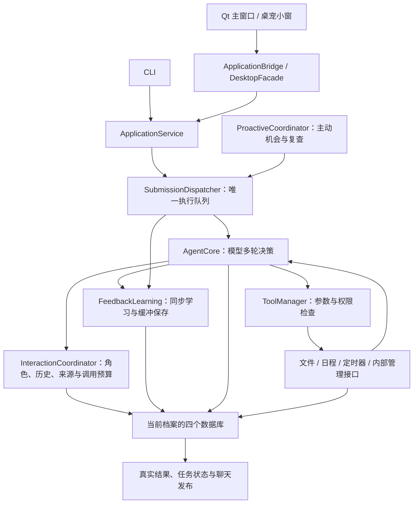

# 当前后端架构

2026-10-30，按 Phase 01–05 源码整理。旧版类调用表和机制审计见[历史审计](docs/archive/README.md)，更细的契约见[公共架构](docs/planning/companion-redesign/architecture-and-contracts.md)。

用户请求和普通主动聊天都经过同一个 Core。内部记忆复核由同一 Dispatcher 调用反馈服务；确定的日程提醒沿调度服务履约，不额外调用模型批准。协调器只发现和登记机会，不独立规划或执行工具。

角色卡、学到的习惯、当前情绪、用户状态理解、互动方式和表达调节共同准备为有范围、有来源的上下文。助手建议进入历史用于理解指代，但不自动成为事实或授权。模型观察每轮实际结果再判断下一步；程序维护参数、权限、预算、有效来源和持久记录。

暂停在下次模型判断前生效，不强行终止当前调用或已决定的步骤组。继续使用原任务和累计预算，重新读取当前有效状态；取消停止后续工作，已完成操作保留。生成最终回复后，先同步评估记忆并保存缓冲，再提交并发布；有限重试耗尽后仍如实保留实际工作结果。

| 数据/资源 | 归属 |
|---|---|
| workflow schema 5 | 任务、轮次、步骤、调用预算、追加要求、暂停与主动关注 |
| companion schema 4 | 开放角色卡、学习习惯、当前理解及其修订 |
| memory schema 3 | 长期理解、来源、学习缓冲、学习记录及相关索引 |
| scheduling schema 1 | 日程、计时器及提醒状态 |
| 受管头像、桌宠图片 | 当前角色档案 |
| 模型连接、API 凭据、外部工作区、模型缓存 | 应用级共用 |

全部业务库随角色整体切换，未激活角色没有运行后台。切换先关闭旧服务和连接，再创建新后台；旧结果不得进入新档案。数据库表和迁移集中在存储 schema 层，不能由业务服务临时建表。详见[数据库设计](docs/planning/companion-redesign/database-design.md)。

工具目前为可信进程内代码，工作区路径保护和必要授权继续有效；这不构成 OS 沙箱。高级隔离、Live2D、完整云端类别许可及快捷绕过规划属于[长期方向](docs/roadmap/post-release.md)。
