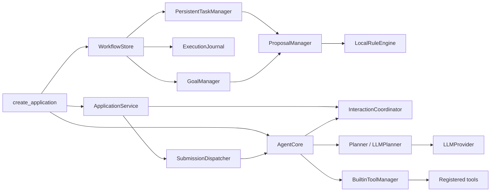
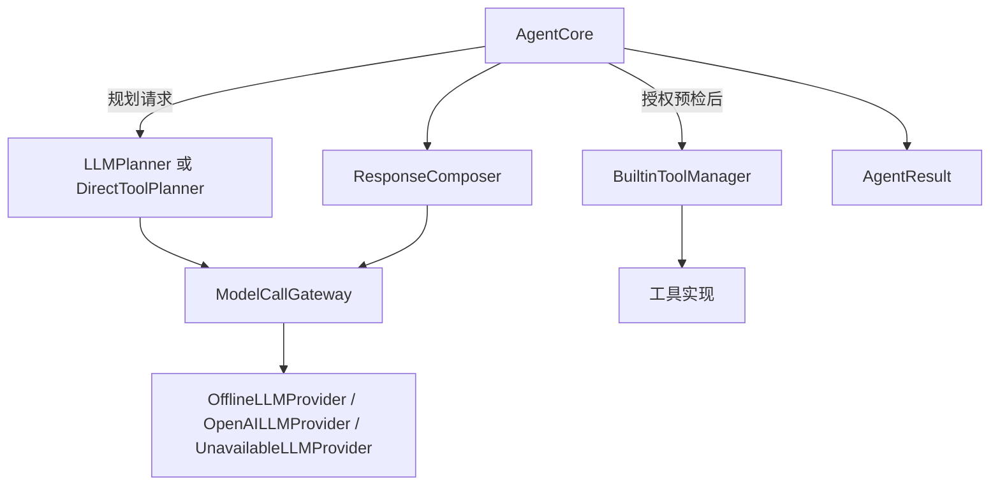
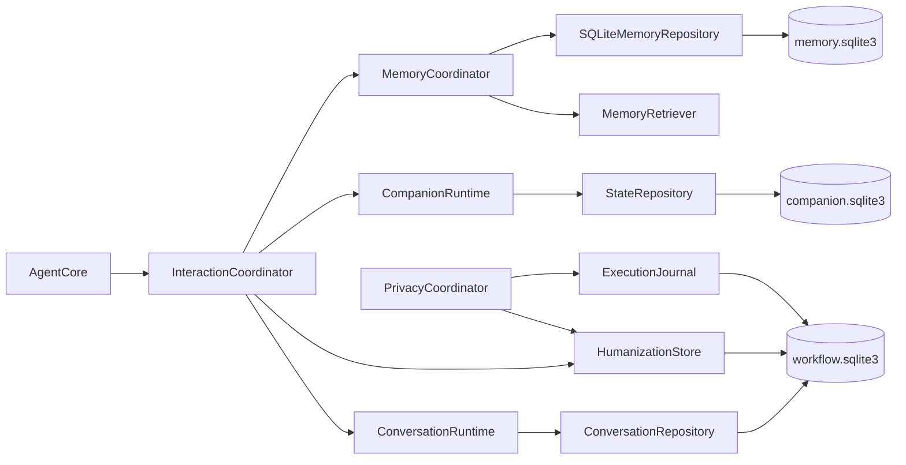
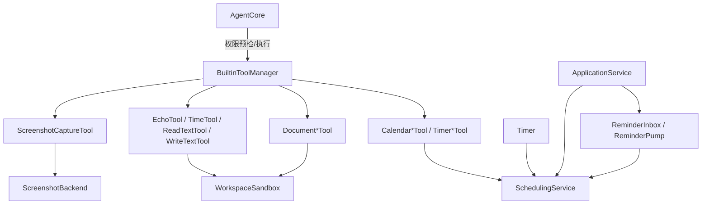

> 历史存档：保留当时的设计、失败与验收边界；不代表当前实现或新的执行授权。当前入口见 [文档导航](../../README.md)。

# Deskpal 后端类调用关系图

盘点日期：2026-10-28  
范围：`src/deskpal` 中除 `gui/` 外的 Python 后端代码。本文按模块列出生产类的主要调用、注入和存储关系。GUI 的 Qt 控件不属于本图；测试替身、脚本局部类也不在范围内。

## 如何读表

- **调用**：运行时某类的方法直接调用另一类的方法。
- **依赖/注入**：对象持有另一个对象或 Protocol，调用发生在接口边界，具体实现可以替换。
- **共用存储**：类在同一个 SQLite 工作流存储上读写，但不一定互相直接调用。
- DTO、枚举、异常和 Protocol 主要承载数据或约束接口，本身通常不会主动调用服务类；表中会标出它们与服务的联系。

## 1. 生产应用的装配和请求主链

生产组合根是 `application.factory.create_application()`。它创建存储、领域服务、Agent 和应用门面，最后启动服务。低层 `create_agent()` 是轻量工厂，不代表桌面应用完整的持久化运行方式。

| 类/组件 | 主要职责 | 主要调用关系 |
|---|---|---|
| `create_application`（工厂函数） | 建立桌面生产版的依赖图并转移资源所有权 | 创建 `WorkflowStore`、`PersistentTaskManager`、`ExecutionJournal`、`GoalManager`、`ProposalManager`、`LocalRuleEngine`，再调用 `_create_core`，最后创建并启动 `ApplicationService`。 |
| `ApplicationService` | 应用级统一门面和生命周期所有者 | 调用 `SubmissionDispatcher`、`ConversationService`、`TaskReviewService`、`ToolCatalog`、`ReminderInbox`、`PrivacyCoordinator`、`AssetService`；管理 `SchedulingService`、目标和主动建议；关停时释放资源。 |
| `SubmissionDispatcher` | 有界队列与单工作线程；把授权绑定在当前进程和任务上 | 从 `PersistentTaskManager` 取任务，调用 `AgentCore.run/execute_task/confirm_task`；使用 `ExecutionJournal` 做任务恢复和执行状态核对。 |
| `DispatcherFailed` | 后台执行线程已安全停下的可观察异常 | `SubmissionDispatcher` 在 worker 发生不可恢复错误时报告，ApplicationService/调用方读取其状态。 |
| `DesktopFacade` | 把界面请求映射成 JSON 兼容的应用操作 | 调用 `ApplicationService` 的查询、命令、会话、记忆、工具目录和外观接口；对参数/返回值做复制和格式约束。 |
| `InstanceLock` | 同一数据目录的单实例保护 | `create_application` 先获取锁；应用资源关闭时释放。 |
| `InstanceLockError` | 数据目录锁无法获取时的稳定错误 | `InstanceLock` 抛出，由应用启动入口阻止第二实例使用同一数据目录。 |

典型调用方向：`DesktopFacade → ApplicationService → SubmissionDispatcher → AgentCore`。UI 不直接调用 Planner、数据库或工具实现。

## 2. Agent、规划、模型与回复模块

| 类 | 主要职责 | 主要调用关系 |
|---|---|---|
| `AgentCore` | 单任务协调器：检索上下文、调用计划器、授权预检、运行工具、整理回复和记录终态 | 被 `SubmissionDispatcher` 调用；调用 `Planner`、`ToolManager`、`MemoryRuntime`、可选 `TurnInteractionPort`、`ExecutionJournalPort` 与 `ExecutionLog`；输出 `AgentResult`。 |
| `_Cancelled` | Agent 内部取消控制流 | 由边界检查抛出，在 `_run` 中转换为取消终态；不是业务数据对象。 |
| `LLMPlanner` | 把请求和允许的规划上下文转换成 `Plan` | 通过 `LLMProvider` 生成计划；不拥有工具执行权。 |
| `DirectToolPlanner` | 确定性/直接的计划器实现 | 按配置或请求构造 `Plan`，遵循 `Planner` Protocol；常用于非通用模型规划路径。 |
| `ModelCallGateway` / `_BoundProvider` | 为不同模型用途执行授权、预算与隐私检查 | `InteractionCoordinator` 创建 Gateway；它按 purpose 选择底层 `LLMProvider`，给 Planner、回复表达或记忆评估提供受限调用。 |
| `OfflineLLMProvider`、`OpenAILLMProvider`、`UnavailableLLMProvider` | 三种模型适配：本地规则响应、云 API、配置未就绪的拒绝适配 | 由 `_create_core` 按 `AppConfig` 选择；通过 `LLMProvider` 接口供 Planner、Gateway 和表达器调用。`_NoRedirect` 是 OpenAI 适配器内部的 HTTP 重定向控制器。 |
| `ResponseComposer` | 把计划草稿、工具事实、允许的历史和风格组织成用户回复 | `AgentCore` 在工具执行后调用；接收表达用途的 `LLMProvider`，产出 `ResponseDraft`。不会执行工具。 |
| `Plan` | 保存计划回复草稿和工具调用列表 | 由 Planner 生成，AgentCore 校验/复制，授权等待时由执行账本存快照。 |
| `AuthorizationRequest`、`AgentResult` | 面向应用/界面的授权预览和任务结果 DTO | AgentCore 创建，Dispatcher 缓存/返回，ApplicationService 再转换成界面 DTO。 |
| `ChatMessage`、`LLMResponse`、`ResponseDraft`、`ResponseDiagnostic` | 模型调用与回复阶段的数据对象 | 由 Provider、Gateway 和 ResponseComposer 传递；不负责发起调用。 |
| `Planner`、`LLMProvider`、`NativeJSONProvider`、`ResponseComposerPort`、`Agent` | 可替换实现的 Protocol | 规定输入输出边界；生产实现由工厂装配。 |
| `LLMError` | 模型层可识别错误 | Provider/Gateway 抛出，AgentCore 按任务阶段转换成失败结果。 |

## 3. 应用交互、会话、记忆与人格

| 类 | 主要职责 | 主要调用关系 |
|---|---|---|
| `InteractionCoordinator` | 为一轮请求准备、校验、冻结并发布上下文 | 被 `AgentCore` 通过 `TurnInteractionPort` 调用；内部调用 `ConversationRuntime`、`MemoryRuntime`、`CompanionPort`、`HumanizationStore`、`PrivacyCoordinator` 和 `ModelCallGateway`。 |
| `PreparedTurn` | 当前轮次不可变资料快照 | 由 InteractionCoordinator 创建，AgentCore 用它分离规划输入、表达输入和最终发布信息。 |
| `ConversationRuntime` | 管理热窗口和有限对话上下文 | 通过 `ConversationRepository` 读取/写入持久会话；InteractionCoordinator 冻结规划历史和表达历史。 |
| `InteractionState` | Companion 侧的进程内会话偏好/cue 状态 | `InteractionOperations` 使用它管理短时状态；它与持久 Companion 配置及长期 Memory 分开。 |
| `ConversationRepository` | 会话目录、消息和轮次的工作流存储适配 | 被 `ConversationRuntime`、`ConversationService` 使用；底层共用 `WorkflowStore`。 |
| `ConversationService` | 创建、切换、清理或删除会话并处理受影响任务 | ApplicationService 调用；协调 `ConversationRepository`、`ConversationRuntime`、`PrivacyCoordinator`、`SubmissionDispatcher`，并要求 Agent 撤销/丢弃旧上下文。 |
| `MemoryCoordinator` | 长期记忆的统一读写入口 | 同时提供 `MemoryRuntime`/旧式管理接口；调用 `SQLiteMemoryRepository`、`MemoryRetriever`、可选 `MemoryEvaluator`。 |
| `MemoryRetriever` | 检查记忆资格、执行词法/可选向量检索并控制上下文预算 | 被 MemoryCoordinator 调用；从 `SQLiteMemoryRepository` 取候选；可注入 `EmbeddingProvider`。 |
| `_Retriever` | MemoryCoordinator 内部使用的检索接口 | 供 MemoryCoordinator 接受替换式检索实现，不是面向应用的公共服务。 |
| `SQLiteMemoryRepository` | 记忆版本、候选、画像、来源、向量等 SQLite 持久化 | 被 MemoryCoordinator / MemoryRetriever 调用；数据在 `memory.sqlite3`。 |
| `SQLiteMemoryManager` | 旧版兼容记忆存取实现 | 依赖 `MemoryManager` 接口；与当前生产 `MemoryCoordinator` 路径并存，不能将其方法直接等同于主流程功能。 |
| `LLMMemoryEvaluator` | 把符合条件的对话评估成待审核候选 | 作为可选 `MemoryEvaluator` 注入 MemoryCoordinator；受 InteractionCoordinator 的 `memory_evaluation` 模型用途控制。 |
| `FastEmbedProvider` | 可选本地向量嵌入 | 被 MemoryRetriever 调用；工厂可能因模型不可用而退回词法检索。 |
| `CompanionRuntime` | 对外提供人格配置、偏好、cue 和有限 affect 管理 | 由 Application 工厂创建；InteractionCoordinator/AgentCore 通过 `CompanionPort` 调用；继承 `InteractionOperations`。 |
| `InteractionOperations`、`StateRepository` | Companion 状态操作和 SQLite 读写基类 | `CompanionRuntime → InteractionOperations → StateRepository`；最终数据在 `companion.sqlite3`。 |
| `ConstraintParser`、`PreferenceReview` | 校验短时限制和偏好候选信号 | Companion 信号处理路径调用；只产出结构化候选/约束，不直接授权工具。 |
| `ConversationRef`、`ConversationTurn`、`ConversationWindow`、`InteractionConstraint`、`CueSignal`、`PreferenceSignal`、`MemorySource`、`MemoryDraft`、`MemoryItem`、`MemoryRecord`、`MemoryPage`、`ProfileEntry`、`RetrievalBundle`、`DeletionReceipt`、`EmbeddingManifest` | 会话、陪伴、记忆和嵌入领域数据结构 | 在 repository、runtime、coordinator、retriever 之间传递；不主动调用服务。 |
| `MemoryStatus`、`ClaimType`、`UsePolicy`、`MemoryKind` | 记忆状态、来源主张、用途和兼容种类枚举 | 被记忆服务用于校验和筛选。 |
| `GoalStatus`、`MilestoneStatus`、`BindingStatus` | 目标、里程碑和来源绑定的生命周期枚举 | 被 GoalManager、ProposalManager 和 LocalRuleEngine 校验状态。 |
| `MemoryRepository`、`MemoryRuntime`、`MemoryEvaluator`、`EmbeddingProvider`、`MemoryManager`、`ConversationRepository` Protocol | 记忆/会话适配接口 | 让服务依赖契约而非 SQLite 或特定模型实现。 |
| `CompanionError`、`CompanionValidationError`、`CompanionRevisionConflict`、`CompanionStorageError`、`CompanionClosedError`、`MemoryError`、`RevisionConflict`、`MemoryNotFound`、`EmbeddingError`、`ConversationConflict`、`ConversationCapacity` | 各领域错误类型 | 被相应运行时/存储抛出，由应用层决定向 UI 显示或转成稳定错误码。 |

## 4. 工具、沙箱、日历与提醒

| 类 | 主要职责 | 主要调用关系 |
|---|---|---|
| `BuiltinToolManager` / `_Registered` | 注册工具、列目录、检查权限、统一调用工具并记录结果 | AgentCore 执行前调用权限检查、执行时调用工具；manager 持有各工具实例和 Sandbox。 |
| `EchoTool`、`TimeTool` | 示例/基础工具 | 由 BuiltinToolManager 注册；不访问外部状态。 |
| `ReadTextTool`、`WriteTextTool` | 工作区内文本读取/写入 | 由 ToolManager 调用并使用 `WorkspaceSandbox` 校验路径与读写边界。 |
| `CalendarCreateTool`、`CalendarListTool`、`CalendarUpdateTool`、`CalendarDeleteTool`、`CalendarEventsTool` | 日历操作适配器 | 通过 `_SchedulingTool` 共用 `SchedulingService`；由 ToolManager 执行。 |
| `TimerCreateTool`、`TimerListTool`、`TimerCancelTool`、`TimerEventsTool` | 定时任务工具适配器 | 通过 `_SchedulingTool` 调用 SchedulingService。 |
| `DocumentSearchTool`、`DocumentClassifyTool`、`DocumentCopyTool`、`DocumentMoveTool`、`DocumentDeleteTool` | 工作区文档搜索/分类/文件操作 | 由 ToolManager 执行；读写前经过 WorkspaceSandbox。`DocumentClassifyTool` 复用搜索能力。 |
| `ScreenshotCaptureTool` | 截图工具 | 调用注入的 `ScreenshotBackend`；生成结果受像素上限控制。 |
| `MSSScreenshotBackend`、`Monitor`、`ScreenshotUnavailable` | 默认截图适配器、显示器描述和截图错误 | `ScreenshotCaptureTool → ScreenshotBackend`；后台不可用时由工具错误通道返回。 |
| `WorkspaceSandbox` | 工作区路径边界与文件访问策略 | 被文件工具调用；拒绝越界路径，并与 ToolManager 的权限检查协作。 |
| `SchedulingService` / `SystemClock` | 日历/计时器存储、时间读取和调度线程 | 工具适配器与 ReminderInbox 调用；底层数据在 `scheduling.sqlite3`。 |
| `ReminderInbox`、`ReminderPump` | 把到期定时事件登记为提醒并驱动提醒轮询 | ApplicationService 创建并启动；ReminderInbox 查询 SchedulingService 并写 WorkflowStore，Pump 周期性驱动 inbox。 |
| `ToolSpec`、`ToolCall`、`ToolContext`、`ToolResult`、`PermissionLevel`、`CalendarEntry`、`TimerEntry`、`ScheduleEvent`、`ScheduleStoreIdentity`、`SourceSnapshot`、`EventCursorState`、`Monitor` | 工具/调度/截图数据模型 | 在工具、权限、调度和审计边界间传递，不负责调度调用。 |
| `Tool`、`ToolManager`、`Sandbox`、`SchedulingManager`、`Clock`、`ScreenshotBackend` Protocol | 可替换的工具、沙箱、时间和调度接口 | 被工厂装配为具体实现，便于替换外部适配器。 |
| `PermissionDenied`、`PathViolation`、`ToolNotFound`、`ArgumentError` | 工具权限、路径和参数错误 | 工具/沙箱抛出；AgentCore 在执行阶段映射为稳定任务错误。 |

## 5. 工作流、任务、授权计划、目标与主动建议

| 类 | 主要职责 | 主要调用关系 |
|---|---|---|
| `WorkflowStore` | SQLite 事务、事件、隐私屏障和依赖版本的公共底座 | 被 PersistentTaskManager、ExecutionJournal、ConversationRepository、GoalManager、ProposalManager、HumanizationStore、PrivacyCoordinator 等共用。 |
| `PersistentTaskManager` | 持久任务队列、状态、分页和命令幂等 | SubmissionDispatcher 调用；依赖 WorkflowStore；创建的任务交给 AgentCore 执行。 |
| `InMemoryTaskManager` | 低层/测试路径的进程内任务实现 | `create_agent` 可用；不用于 `create_application` 的生产持久任务队列。 |
| `ExecutionJournal` | 计划快照、分步调用账本、恢复和不确定结果处理 | Dispatcher 负责恢复/领取；AgentCore 写入步骤开始/完成；ApplicationService 添加记忆和提议依赖校验器。 |
| `HumanizationStore` | 交互上下文版本、outbox 与模型调用预算等持久数据 | InteractionCoordinator、PrivacyCoordinator、CompanionEffects 共用；使用 WorkflowStore。 |
| `PrivacyCoordinator` | 遗忘屏障、epoch、相关上下文阻断和清理协调 | ApplicationService 和 InteractionCoordinator 调用；关联 HumanizationStore、ExecutionJournal、任务/会话清理。 |
| `CompanionEffects` | 把任务终态转成可去重、可恢复的 Companion 效果 | ApplicationService/Dispatcher idle maintenance 调用；写 HumanizationStore，再调用 CompanionRuntime。 |
| `GoalManager` | 目标、里程碑、来源绑定及版本校验 | ApplicationService 读写；LocalRuleEngine/ProposalManager 用于生成和预检建议；持久化到 WorkflowStore。 |
| `ProposalManager` | 保存建议，预检目标/调度依赖，用户接受后创建任务 | LocalRuleEngine 生成建议；用户操作经 ApplicationService 调用；接受时调用 GoalManager、SchedulingManager 和 PersistentTaskManager。 |
| `LocalRuleEngine` | 消费持久事件并按本地规则生成有界建议 | ApplicationService 定时 poll；读取 GoalManager/SchedulingManager，调用 ProposalManager；无模型或文件扫描调用。 |
| `TaskReviewService` | 生成计划详情和授权需求，确认/拒绝/取消审核命令 | ApplicationService 把任务审核请求委托给它；它检查 ExecutionJournal 和 ToolCatalog，并调用 Dispatcher。 |
| `ToolCatalog` | 给界面提供受限工具目录及单项详情 | ApplicationService 构造；读取 ToolManager 的工具规格，不执行工具。 |
| `WorkflowExecutionLog`、`JsonlExecutionLog`、`NullExecutionLog` | 工作流事件审计、JSONL 文件审计或空日志适配 | AgentCore/ToolManager 接收 ExecutionLog；生产 Application 同时将工作流审计与 JSONL sink 分开使用。 |
| `Task`、`TaskStatus`、`DependencyRef`、`PlanSnapshot`、`StepAttempt`、`AuditEvent`、`DeletionJob`、`QueueFull`、`WorkflowBlocked`、`TaskCancellationRequested` | 任务/账本/依赖/删除状态模型与控制流异常 | TaskManager、Journal、WorkflowStore 和 Application 层之间传递。 |
| `Goal`、`Milestone`、`SourceBinding`、相应 `*Status`、`GoalConflict` | 目标域实体、状态和冲突 | GoalManager 创建/校验/保存；ProposalManager 与 LocalRuleEngine 读取。 |
| `Proposal`、`ProposalStatus`、`ProposalConflict` | 建议实体、生命周期状态和冲突 | ProposalManager 持有/变更；LocalRuleEngine 生成；ApplicationService 返回界面。 |
| `ExecutionJournalPort`、`HumanizationPort`、`TaskManager`、`GoalRepository`、`ProposalRepository` | 工作流和领域边界协议 | 分别由具体持久化实现适配；Port 本身不保存数据。 |

## 6. 配置、凭据、资源文件、维护和执行隔离

| 类 | 主要职责 | 主要调用关系 |
|---|---|---|
| `AppConfig` 与 `LLMConfig`、`SandboxConfig`、`StorageConfig`、`AgentConfig`、`SchedulingConfig`、`ScreenshotConfig`、`MemoryConfig`、`WorkflowConfig`、`ProactiveConfig` | 启动配置及分域配置数据类 | `load_config` 解析后供工厂、维护服务使用；不是运行时服务调用方。 |
| `ConfigError` | 配置读取/校验错误 | `load_config` 和工厂抛出；UI/CLI 显示稳定诊断。 |
| `WindowsCredentialStore` / `_Credential` / `CredentialStoreError` | Windows 凭据管理器适配及其结构/错误 | 配置和 MaintenanceService 在保存/读取密钥时调用；密钥不作为普通配置文本持久化。 |
| `AssetService` / `_Pending` | 静态头像/桌宠图片导入、预览、应用、重置和资源回收 | ApplicationService 持有并调用；使用 `AssetRepository`、`AssetDecoder`，资源存储在数据目录 assets 下，元信息与版本在 WorkflowStore。 |
| `AssetError`、`NormalizedImage`、`AssetMetadata`、`AppearanceProfile`、`PreparedImport`、`AssetPreview`、`CollectionResult` | 资源处理的错误、图像/版本/预览 DTO | AssetService 与 DesktopFacade 间传递。 |
| `AssetRepository`、`AssetDecoder` | 资源元数据和图片解码边界 | AssetService 注入；Qt 图片解码由 GUI 适配器提供，不属于后端核心。 |
| `MaintenanceService`、`SetupService` | 配置检查、修复、维护操作和初始化流程 | CLI/GUI 维护桥接调用；维护流程使用配置、凭据、归档检查，不创建正常聊天 Agent。 |
| `ModelCacheManager`、`CacheLease`、`_LeaseState`、`_WindowsLock`、`CacheLeaseError`、`_Offset`、`_Position`、`_Overlapped` | 本地模型缓存引用及跨进程租约锁 | 维护/模型缓存使用；Windows 结构服务于文件锁实现。 |
| `MaintenanceError` | 维护域稳定错误 | MaintenanceService/SetupService 抛出并由入口转换成诊断。 |
| `PresentationSnapshot` | 将持久工作流状态投影为界面可读快照的数据类 | presentation 投影层生成；应用/界面读取，不负责执行任务。 |
| `RuntimeFile`、`RuntimeManifest`、`ProbeProfile`、`stage_runtime` 相关检查函数 | **阶段 0 实验**用 Python runtime 清单和暂存 | 当前实验模块职责明确，不是生产 Agent 沙箱或默认启动链。 |
| `FrameLimits`、`FrameDecoder`、`ProtocolViolation` | 受限执行协议的帧限制、解码和错误 | Windows worker 通信原型/实验适配使用。 |
| `WindowsLauncher`、`RunningWorker`、`LaunchSpec`、`JobLimits`、`WorkerIdentity`、`WorkerResult`、`CleanupOwner`、`LaunchRejected`、`PendingLaunchCleanup` | Windows 子进程隔离启动/生命周期适配 | 使用 execution protocol 和 `_win32.Api`/`NativeWorker`；源码当前将其描述为阶段 0 实验，不应画成 ToolManager 已默认使用的生产路径。 |
| `Api`、`NativeWorker`、`PendingLaunchCleanup`、`SECURITY_ATTRIBUTES`、`STARTUPINFO`、`STARTUPINFOEX`、`PROCESS_INFORMATION`、`SECURITY_CAPABILITIES`、`JOB_BASIC_LIMIT`、`IO_COUNTERS`、`JOB_EXTENDED_LIMIT`、`JOB_CPU`、`JOB_ACCOUNTING`、`_DiagnosticApi` | Win32 原生结构与 API 封装/诊断 | 由 WindowsLauncher 调用；均处于实验执行子系统。 |

## 7. 后端公共接口和数据类索引

以下 Protocol 表示“可以由谁提供能力”，不是运行时服务本身。它们连接模块，但不会自动触发具体调用：

| 模块 | Protocol / 接口类 | 主要实现或使用者 |
|---|---|---|
| agent | `Agent`、`CompanionPort`、`TurnInteractionPort` | AgentCore 实现 Agent；Application InteractionCoordinator 实现单轮交互端口；CompanionRuntime 适配 CompanionPort。 |
| application/assets | `AssetRepository`、`AssetDecoder` | AssetService 使用；WorkflowStore/GUI 解码适配器提供具体实现。 |
| execution log | `ExecutionLog` | JsonlExecutionLog、WorkflowExecutionLog、NullExecutionLog。 |
| goals/proactive | `GoalRepository`、`ProposalRepository`、`RuleConfig` | GoalManager、ProposalManager、LocalRuleEngine 的存储/配置边界。 |
| LLM/planner/response | `LLMProvider`、`NativeJSONProvider`、`Planner`、`ResponseComposerPort` | Provider、Planner 与回复组件实现/使用。 |
| memory | `MemoryRepository`、`MemoryRuntime`、`MemoryEvaluator`、`EmbeddingProvider`、`MemoryManager` | SQLiteMemoryRepository、MemoryCoordinator、LLMMemoryEvaluator、FastEmbedProvider、兼容管理器。 |
| scheduling/tools/sandbox | `Clock`、`SchedulingManager`、`Tool`、`ToolManager`、`ScreenshotBackend`、`Sandbox` | SystemClock、SchedulingService、各工具、BuiltinToolManager、截图适配器、WorkspaceSandbox。 |
| workflow | `ExecutionJournalPort`、`HumanizationPort`、`TaskManager` | ExecutionJournal、HumanizationStore、PersistentTaskManager/InMemoryTaskManager。 |

## 8. 持久化归属速查

| 存储 | 主要类 | 内容职责 |
|---|---|---|
| `workflow.sqlite3` | WorkflowStore、PersistentTaskManager、ExecutionJournal、ConversationRepository、HumanizationStore、GoalManager、ProposalManager、ReminderInbox | 任务与计划、分步账本、会话时间线、隐私/交互 outbox、目标、主动建议、提醒收件箱。 |
| `memory.sqlite3` | SQLiteMemoryRepository、MemoryCoordinator、MemoryRetriever | 来源化记忆修订、审核状态、画像、有效期和检索索引。 |
| `companion.sqlite3` | CompanionRuntime、InteractionOperations、StateRepository | 人格配置、版本、有限偏好和模拟 affect。 |
| `scheduling.sqlite3` | SchedulingService | 日历和定时任务。 |
| `execution.jsonl` | JsonlExecutionLog | 面向运维/审计的追加式执行记录；与 workflow 执行账本职责不同。 |
| `assets/` + workflow profile | AssetService | 图片二进制资源与外观槽位/修订元数据。 |

## 9. 关键边界

1. **工具不会由 LLM 直接执行。** Planner 产出 `Plan`，AgentCore 先逐项做权限预检；授权满足后，才调用 ToolManager。
2. **人格不会授予工具权限。** Companion 状态通过 InteractionCoordinator 参与允许的表达上下文，不进入 Planner 的授权集合。
3. **记忆、会话和人格分库存储。** 它们通过 InteractionCoordinator、PrivacyCoordinator 和任务来源引用协调，不是一个可互换的 JSON prompt。
4. **目标/主动建议不等同记忆。** GoalManager、ProposalManager 和 LocalRuleEngine 是独立领域；建议被接受后才经 PersistentTaskManager 排队。
5. **执行隔离原型不是当前工具主链。** `execution/` 中阶段 0 的 Windows worker 类单独列出，避免误认为生产 ToolManager 当前默认经它启动每个工具。

## 10. 源码入口

- 生产装配：[src/deskpal/application/factory.py](../../../src/deskpal/application/factory.py)
- 应用门面：[src/deskpal/application/service.py](../../../src/deskpal/application/service.py)
- 后台分发：[src/deskpal/application/dispatcher.py](../../../src/deskpal/application/dispatcher.py)
- Agent 协调：[src/deskpal/agent/core.py](../../../src/deskpal/agent/core.py)
- 交互上下文：[src/deskpal/application/interaction.py](../../../src/deskpal/application/interaction.py)
- 工作流存储：[src/deskpal/workflow/store.py](../../../src/deskpal/workflow/store.py)
- 工具注册：[src/deskpal/tools/manager.py](../../../src/deskpal/tools/manager.py)
