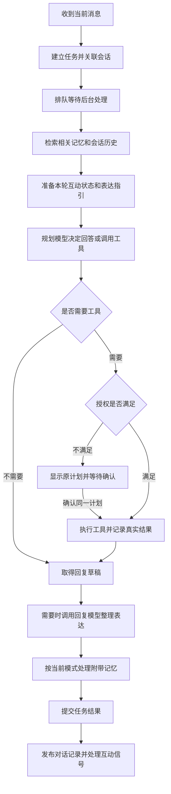

> 历史存档：保留当时的设计、失败与验收边界；不代表当前实现或新的执行授权。当前入口见 [文档导航](../../README.md)。

# 发出一条消息后，应用做了什么：对话流程与互动状态说明

日期：2026-10-28。依据当前源码阅读整理，没有运行应用或测试，没有修改代码、配置或数据库。

本文先解释当前实现，再说明我们已经讨论过但尚未实现的变化。这里的“一轮对话”指你发一条消息，应用处理后给出一次回复；整个聊天窗口由许多轮对话组成。

协作约定：除非用户明确要求修改代码或开始测试，默认只进行思路讨论和文档编写。

## 先分清四样东西

| 名称 | 可以怎样理解 | 例子 |
|---|---|---|
| 人格 | 角色惯常是什么样、怎样表达。 | 目前的预设、风格参数与有限身份设置。开放角色卡和自学习还属于待实施设计。 |
| 记忆 | 以后仍可能需要知道的内容。 | 用户明确保存的事实、目前记录的有限工具事件。 |
| 对话上下文 | 为理解这条消息，临时拿出来看的资料。 | 当前消息、最近几轮聊天、相关记忆和已有工具事实。 |
| 互动状态 | 后台当前记着的互动约定、短时模式及处理进度。 | 这次简短回答、当天不要开玩笑、当前有一条待确认偏好。 |

它们会一起影响回复，但作用不同。“这次简短一点”不是把角色永久改成寡言，也不是必须新增一条长期用户记忆。

目前的互动状态也不是另一个大模型。它主要是程序保存和读取的一组记录，模型在部分阶段提供建议。

## 用一句话贯穿流程

假设你说：**“这次简短一点，帮我看看有没有日程。”**

在连接、权限和相关功能可用的情况下，大致会经过下面的处理：

这是普通请求主线。当前还有“记住：……”的快捷保存等例外，后面单独说明。失败、取消和来源变化也会让处理提前结束，不是每条消息都完整走完所有步骤。

其中，“记住：……”在具备相应记忆运行时且命中当前规则时，可能直接保存并提交任务，不走普通请求完整的模型规划、互动准备与对话发布链。它现在仍在代码里，删除快捷分支只是已经记录的待实施方向。本说明按当前实际路径解释，没有执行该改造。

## 第一步：把消息接住，记清它属于哪里

应用先检查能否接收请求，例如模型是否配置好、应用是否正在退出，然后建立一项持久任务，把它关联到当前会话和本轮顺序。

此时记下的是“用户要求处理这件事”，还没有调用工具，也没有完成事情。重复提交同一个命令时，后台会识别已有记录，尽量避免因为界面重复发送而创建两份相同工作。

任务随后进入队列。当前由一个后台执行工作线程协调 Agent 请求，界面可以继续显示、滚动和接收操作。这不表示整个应用只有一个线程，提醒和其他维护仍有各自的处理。

当前还没有完整的多角色归属体系。按角色隔离人格、聊天和情景记忆，是我们已经讨论的重构方向，不能把现有会话编号直接当成已经实现了角色编号。

## 第二步：准备理解这条消息需要的资料

后台会检索与当前问题相关的长期记忆，并从当前会话取有限的最近聊天及工具事实。它不会每次把全部数据库和全部聊天交给模型。

例如，询问日程时，最近是否提到某个对象可能有帮助；但日程现在到底有哪些，应该由实际查询确定，不能因为记忆里曾经说过“没有安排”，就一直回答没有。

当前给规划模型和回复模型的历史资料并不完全相同：

| 阶段 | 主要拿到什么 | 为什么这样处理 |
|---|---|---|
| 理解与规划 | 当前请求、合格记忆、历史用户引用和工具事实。 | 帮助找到当前目标，但不把过去的要求自动重新执行。 |
| 组织最终回复 | 还可以拿到允许使用的历史回复、表达风格等资料。 | 让措辞连贯、避免重复，并结合实际工具结果回答。 |

目前的云端历史许可也会影响上述历史能否进入请求；它不只是控制界面是否显示聊天。记忆、人格等又有各自的现有用途限制。因此，“数据库里有记录”不一定等于“本轮模型实际看到了它”。

## 第三步：读取和更新互动状态

这一步最容易与“模型思考”混淆。后台是在整理当前互动约定，还没有因此替代模型对整条请求的理解。

在例子里，现有规则可能从“这次简短一点”提取出：**篇幅简短，仅对本次回复生效。** 如果当前人格机制未启用，这套附加互动处理不会像启用时一样工作；模型仍能直接读到原句，可能自行遵从。

其他说法可能产生不同范围：

| 表达 | 当前希望记录的约定 | 后面怎样读取 |
|---|---|---|
| “这次简短一点。” | 本轮约定。 | 生成这一轮的表达指引时使用，不作为长期习惯保存。 |
| “这个会话先简短回答。” | 当前会话约定。 | 当前进程内，该会话的后续轮次可以读取；不是永久人格变化。 |
| “今天别开玩笑。” | 有到期时间的当天约定。 | 后续表达读取时检查是否仍有效，到期后不再按这项约定处理。 |
| “以后默认少追问。” | 持久的互动偏好。 | 当前实现只对能识别的有限表达形成相应记录，不代表已经有开放式人格学习。 |

当前范围识别主要依靠有限规则，并不是任何自然说法都能正确覆盖；表中描述的是这些表达对应的用途，不是每句话在任何配置下都保证生效。新方案会把理解意思和期限交给模型。

这些互动约定当前主要影响说话方式。切到“专注”模式不会因此自动暂停系统通知或取消计时器。通过聊天管理通知是另一项已讨论的设计，需要把理解结果落实到通知/调度服务，不能只改表达状态就声称已经停止打扰。

### “互动状态”具体装了哪些记录

| 内容 | 通俗解释 | 目前怎样变化 |
|---|---|---|
| 会话内约定 | 这段交流暂时怎样说话。 | 处理当前输入时可能加入；在进程内保存，清理或重启后不会按原样持续。 |
| 短时模式，也叫 cue | 例如暂时采用支持、专注等表达方式。 | 可以由明确设置建立，也可从模型返回的信号中形成，带有效期。 |
| 偏好候选 | 模型觉得可能适合长期或指定范围采用的习惯。 | 当前仍有待确认记录；我们讨论的新缓冲区和模型复核还没有实现。 |
| 本轮处理记录 | 这次处理对应哪条消息、哪个会话、哪些来源。 | 用来校验晚到的结果是否仍属于这次处理，避免重复或过时更新。 |
| 最近见过哪些会话、哪些建议已处理 | 帮助识别是否首次交流、是否已处理同一建议。 | 有界保存，用于后续表达和去重，不是角色对用户的情感评分。 |

当天和持久偏好有数据库中的保存部分；会话内约定、cue 和 Companion 偏好候选主要在内存中。也就是说，泛称的“互动状态”并不是一张全都永久保存或全都临时消失的表。

这里还有一个当前实现的细节：**能直接识别的明确约定，可能在规划模型调用之前就被保存。** 如果后面的模型调用失败，这种已经保存的约定不一定随任务失败一起撤销。它与回复完成后才接纳的模型建议，发生时机不同。

## 第四步：把资料交给规划模型

规划模型看到当前问题、允许使用的背景资料，以及工具目录，决定直接回答还是提出工具调用。

对于“帮我看看有没有日程”，模型可以提出日程查询。对于无需工具的闲聊，则可以直接给回复草稿。这里的“计划”只是准备做什么，不是已经完成的结果。

当前人格风格主要用于后面的表达阶段，没有按我们新讨论的方向完整参与规划。因此现阶段即便把“简短”整理好了，也不能理解为已经让开放角色卡参与整个思考。

当前计划主要一次生成，然后顺序执行。根据工具中间结果再交回模型继续思考的循环，仍是待实施方案。

## 第五步：需要工具时，先检查，再执行

程序先检查整份计划是否具备所需授权。缺少授权时，任务停在“等待确认”，把具体操作展示出来；这时不会为了预览就先执行计划里的部分工具。

你确认后，执行的是已经展示的那份计划，不是临时让模型重新想一份、再把新内容偷偷当作原计划执行。

授权满足后，工具逐项执行。每项开始、返回和结果都会被记录。日程有没有内容，以日历查询的真实返回为准；不能把模型原先的猜测当作查询结果。

在阶段边界还会检查任务是否被取消、使用的记忆是否已经更正或遗忘、上下文是否仍有效。取消通常是协作式停止；正式版后的完整工具沙箱和强制停止能力尚未交付。

## 第六步：组织最终回复，“简短”在这里实际参与表达

如果存在工具结果、可用风格或历史等需要整理的资料，后台会调用回复模型。否则，一些普通请求可以直接使用规划阶段已有的回复。

这时输入大致包括：你原来的问题、回复草稿、实际工具结果、允许使用的记忆和历史，以及整理好的表达指引。

例如后台会把本轮约定转换成接近下面意思的要求：

> 这次回答简短一些，不必展开；具体事实按工具查询结果回答。

模型因此可以在查询没有日程时回答“目前没有安排的日程”，而不是把工具调用明细全部贴进聊天。工具明细仍保存在执行记录中，供需要时查看。

这正是“提取表达要求后，带入后续处理”的具体含义：**它成为生成回复时的约束和背景，不是一段提前生成的答复，也没有省掉前面的规划调用。** 现有云端类别许可可能过滤这段附加指引，原始当前问题本身则仍是模型输入。

回复模型也可能额外返回两类信号：暂时采用某种表达模式，或建议一项偏好。当前只有启用相应结构化表达等条件时才可能得到这些信号，而且后台要检查来源和内容，并不是它随口说了什么都会写进状态。

这类信号通常要等本轮成功提交后才接纳，主要影响后续交流。它们不是本轮开始时就已经存在的状态；当前这一轮仍可能仅凭你原话表达得合适。

如果回复整理失败，应用可以保留已完成的工具事实并给出简短回退说明，不应为了重新生成一句话而再执行一遍工具。

## 第七步：按当前模式处理附带记忆

当前逻辑会在普通成功主线的收尾阶段，视条件记录工具事件，并尝试普通聊天记忆评估。

- 工具事件目前主要保存工具名、调用标识和成功状态，不是我们计划中的完整共同经历。
- 普通聊天默认不自动提炼长期记忆；需要相应模式、评估器和现有用途条件满足，才生成待审核候选。
- 用户画像及表达偏好也可能从回复信号走到各自的候选处理入口，与普通聊天评估并不完全是一条流程。

这解释了为什么“聊完一件事”和“系统以后真的记住了这件事”在当前实现里不能画等号。自动缓冲、模型二次复核、长期保留不确定状态及清理，已经写入新设计，但还没有接入代码。

附带记忆处理出错通常只增加警告，不把已经成功的工具操作改成失败。取消、遗忘等边界变化则仍需要中止后续使用，不能全部当作可忽略的小问题。

## 第八步：提交结果，发布本轮聊天，再处理后续状态

应用先可靠保存任务结果，再发布本轮对话及关联工具事实。发布后的会话记录可在以后被重新加载，作为有限上下文的一部分；它不等于把整轮内容自动复制成长期记忆。

发布时还会检查这段交流是否已被清理或失效，避免一个处理很慢的旧回复，在你已经清空会话后又把原内容写回来。

随后处理经过校验的互动信号：短时模式可能更新；偏好可能进入当前的候选流程。这里不会根据一次回复自动重写角色身份或人格参数。

工具任务的真实终态，还可能进入后台的模拟情绪处理。它有自己的去重、时间和启用条件，更新的也是有限模拟状态。普通闲聊并不会因为“成功回复一次”就自动给角色增加愉快值；当前也没有完整实现模型根据聊天经历产生人格成长。

提醒与主动行为是另一条后台工作线。聊天中实际创建的定时器，会由调度系统到时触发；不是必须再发一条消息它才检查。当前基于目标和事件的主动建议主要由本地规则处理，不等于已经有完整的模型主动关心机制。

## 下次聊天时，会接着使用什么

| 这轮产生的内容 | 下次可能怎样使用 |
|---|---|
| 已发布的聊天记录 | 在同一会话的有限历史中读取，受预算和当前用途条件影响。 |
| 仅本轮的简短要求 | 不再作为独立约定继续生效。 |
| 当天或会话内约定 | 仍有效且相应机制可用时，继续影响表达。 |
| 已保存的长期记忆 | 与新问题相关、仍有效且允许使用时才检索出来。 |
| 尚未采用的候选 | 当前不会直接等同已采用事实；新设计以后由模型复核。 |
| 短时模式 | 没有过期或失效时可能继续用；不会因此自动变成人格。 |
| 工具任务与日程 | 维持实际状态，日程由独立调度继续处理。 |

一条约定到期，只表示后台不再把它作为当前有效约定使用。如果模型仍能看到历史中的原话，它也可能受到上下文影响；“约定到期”不是删除原聊天或让模型失去这段上下文。

当前的会话目录和消息时间线有持久存储，可以重载；会话内互动约定和 cue 等进程状态不按同样方式跨重启恢复。不能把“聊天历史能恢复”理解为“所有临时互动状态也都能恢复”。

## 这一轮到底用了几次模型

次数取决于走了哪条路径，不是固定一次，也不是每更新一个状态就调用一次。

| 情况 | 当前可能的调用情况 |
|---|---|
| 普通闲聊，没有需要额外整理的风格、历史或工具结果 | 可能只调用一次规划模型，直接使用其回复。 |
| 有工具查询或需要结合人格/历史整理回复 | 常见为规划一次、回复整理一次。 |
| 还启用了普通聊天候选抽取 | 可能再增加一次记忆评估。 |
| 规则提取“这次简短一点” | 规则本身不调用模型，但普通请求仍继续走模型主线。 |
| 等待确认后执行原计划 | 不重新调用规划模型更换原计划，后续表达等阶段仍可能调用模型。 |
| 命中当前“记住：……”快捷分支 | 请求具备运行条件时，可以直接保存而不调用模型。这条快捷路径仍在，删除它目前只是文档中的待实施方案。 |

这里说的是调用同一模型服务的不同用途，不要求安装三个不同模型。离线演示虽也遵循 Provider 接口，但其固定规则响应不等于真实大模型理解。

## 哪些会写入数据库，哪些只留在本轮

| 保存位置 | 常见内容 | 不是每轮都会发生的事 |
|---|---|---|
| 工作流库 `workflow.sqlite3` | 请求、任务、计划、执行结果、会话关联、消息时间线和必要交互处理记录。 | 闲聊没有工具时，不会凭空出现工具执行账本。 |
| 记忆库 `memory.sqlite3` | 明确保存的事实、允许的工具事件、候选及来源。 | 不默认把每条聊天都变成长期记忆。 |
| 人格/互动状态库 `companion.sqlite3`（当前共用） | 当前有限人格配置、当天/持久偏好及模拟状态等。 | 每次回复不会自动产生新的人格版本。 |
| 调度库 `scheduling.sqlite3` | 实际创建或修改的日程与定时器。 | 查询日程不等于新增日程。 |
| 内存 | 本轮快照、热上下文、会话内互动约定、短时模式和部分候选。 | 这部分不保证在退出或重启后保持。 |
| 执行审计文件 | 请求与执行相关事件的观察记录。 | 这份日志不应被当成供角色全文阅读的长期记忆。 |

“准备一份本轮资料快照”只是为了本次处理前后一致，不是给用户创建一个可切换的人格版本。保存记录也不表示重新训练了大模型参数。

## 当前流程与已讨论方案的差别

| 方面 | 当前实现 | 已讨论、待实施方向 |
|---|---|---|
| 短时需求理解 | 有限规则提取，形成互动约定。 | 模型理解语义、范围和期限，后台落实。 |
| 人格作用范围 | 主要影响回复表达。 | 角色卡参与理解、选择建议、规划与表达。 |
| 多步工具任务 | 一份静态计划顺序执行。 | 结合中间结果重新思考并继续规划。 |
| 普通学习 | 默认不启用完整自动提炼，并存在候选审核。 | 自动提炼、模型复核，可长期保留不确定状态并清理。 |
| 多角色 | 仍缺完整角色归属。 | 工具和安排共享，角色人格、聊天和情景记忆隔离。 |
| 快捷处理 | “记住”前缀和 CLI 固定工具规划等路径仍存在。 | 近期统一模型理解；正式版后再单独研究快速处理优化。 |

这些方向的记录见[人格与记忆重构讨论](../companion-model/2026-10-28-character-memory-redesign-discussion.md)和[正式版后规划](../../roadmap/post-release.md)。本说明没有把它们计为已实现。

## 对应源码

只想理解流程，读正文即可；需要查具体实现时再看这些文件。

- 接收请求与生命周期：[application/service.py](../../../src/deskpal/application/service.py)、[application/dispatcher.py](../../../src/deskpal/application/dispatcher.py)。
- 单轮协调：[agent/core.py](../../../src/deskpal/agent/core.py)、[agent/context.py](../../../src/deskpal/agent/context.py)。
- 准备上下文与发布回复：[application/interaction.py](../../../src/deskpal/application/interaction.py)、[conversation/runtime.py](../../../src/deskpal/conversation/runtime.py)、[conversation/repository.py](../../../src/deskpal/conversation/repository.py)。
- 互动状态和表达约定：`companion/interaction.py`（旧模块已退役）、`companion/interaction_runtime.py`（旧模块已退役）、`companion/signals.py`（已退役）、`companion/policy.py`（已退役）。
- 规划和回复：[planner/llm_planner.py](../../../src/deskpal/planner/llm_planner.py)、[response/composer.py](../../../src/deskpal/response/composer.py)。
- 附带记忆与模拟状态更新：[memory/coordinator.py](../../../src/deskpal/memory/coordinator.py)、`application/effects.py`（已退役）、[companion/runtime.py](../../../src/deskpal/companion/runtime.py)。
