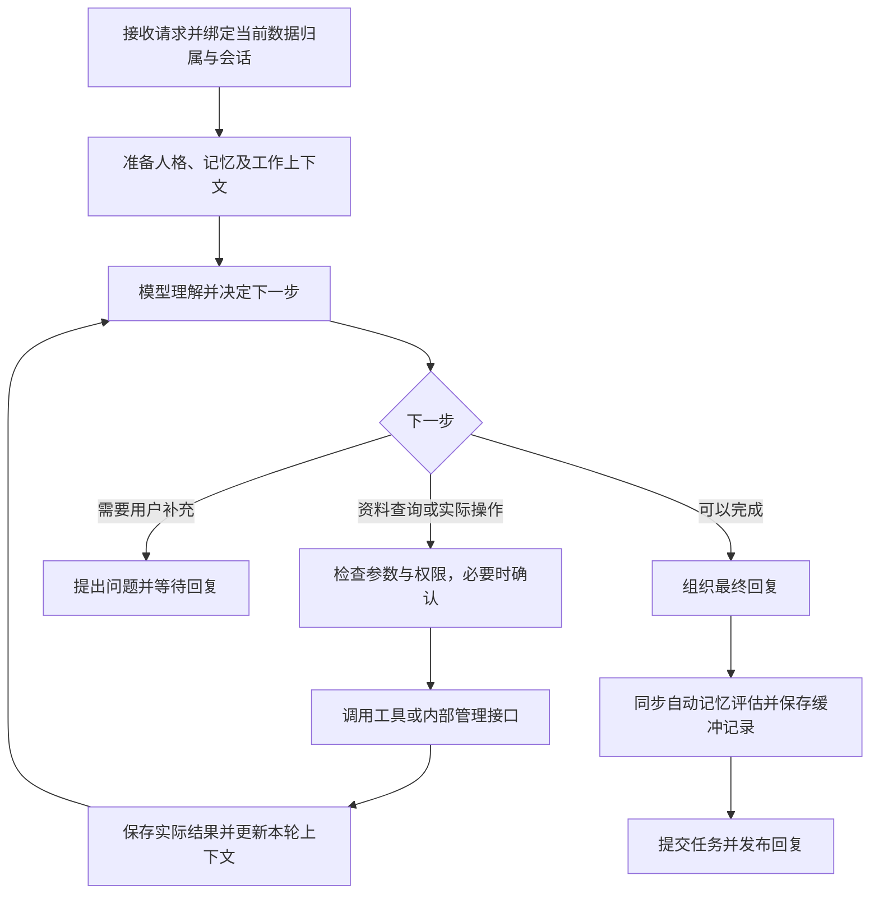

> 历史存档：保留当时的设计、失败与验收边界；不代表当前实现或新的执行授权。当前入口见 [文档导航](../../README.md)。

# 人格与记忆重设计：十项补充问题的确认结论

创建日期：2026-10-29。

本文承接[人格与记忆重构讨论](2026-10-28-character-memory-redesign-discussion.md)，统一记录随后十项补充问题已经确认的结论。只记录结论，不记录讨论过程；尚未确定的事项暂不写入，后续逐项补充。

状态：以下为已采纳、待实施的设计，不表示当前代码已经完成。除非用户明确要求修改代码或开始测试，仍只进行讨论与文档编写。

分阶段开发与验收详见[实施文档目录](../../planning/companion-redesign/README.md)：依照第十节的六阶段顺序细化，包含公共契约、每阶段开发与验收及记录模板。具体实施保持本文确认边界，不以细化文档恢复已取消的复杂设计。

## 一、完善现有工作上下文，支持连续对话与规划

“当前正在讨论和处理的内容”继续归入已有规划中的当前会话工作上下文，不新增记忆类别或独立业务模块。

工作上下文整理当前讨论所需的双方交流、已有决定、助手提出的相关方案和未解决事项，并在理解与规划阶段提供必要内容。不能只让最终回复阶段看到助手历史，而让规划阶段缺少理解当前指代所需的信息。

例如，助手上一轮提出甲、乙两种方案，用户随后说“采用第二种”，规划模型应能根据工作上下文确定乙方案的内容，再结合当前请求决定如何处理。

上下文应区分：用户要求、助手建议、用户已经采纳的决定，以及实际工具结果。助手说过的建议不自动成为事实或执行授权，历史要求也不因再次进入上下文而自动重新执行。实际操作仍按当前请求和对应执行权限落实。

## 二、依照新版记忆模型优化检索与上下文整理

检索以第四节最终确认的完整档案方案为基础：事实、知识、情景记忆均属于当前角色档案，各会话按相关性使用其中的长期记忆。切换角色时整体切换数据库及后台，不建设跨角色共享记忆层，也不读取未激活档案的数据。

本轮资料按用途组织：

| 内容 | 准备与使用方式 |
|---|---|
| 当前角色卡与有效的互动要求 | 按角色、适用会话和期限准备，作为必要背景；不依赖与当前消息的字词相似度碰巧命中。相关信息仍由各自模块管理，不恢复旧的独立互动状态模型。 |
| 当前会话进展 | 结合近期双方交流与可更新的摘要，保留正在讨论什么、已经决定什么、尚未解决什么。摘要关联原始消息，保留假设、未确认和不确定性质，支持后续纠正。 |
| 相关长期记忆 | 结合词法与语义检索选择候选；必要时由模型改写查询、补查有权访问的来源或判断相关性，支持换一种说法、跨会话及时间变化下的召回。 |

模型负责理解含义和相关性，程序负责资料归属、有效性、检索范围与上下文预算。相似度只表示相关性，不表示真实性；现有数字、否定词等语义硬过滤应按新版场景重新评估，避免排除本来相关的资料，不机械取消必要的数据有效性检查。

摘要是对当前会话进展的整理，不直接变成新的长期事实。被纠正、遗忘或失效的来源，在摘要和检索结果中也应相应更新，不能依靠旧摘要恢复已清除的内容。

控制提供给模型的数量和长度，优先保证当前问题所需的信息；不把全部聊天和全部长期记忆一次塞入请求。完善召回和长对话延续能力，复用已有工作上下文与记忆服务，不另建重复的记忆库。

## 三、补齐聊天操作接口，并调整请求到回复的执行链路

复用已有的模型操作机制，把尚未接入聊天的内部管理能力补齐，并统一现有零散入口。记忆保存、更正与遗忘，人格及相处要求调整，主动行为和通知暂停、恢复等能力，通过明确的内部操作接口接入聊天流程。具体数据仍由对应服务负责，不另建重复管理模块。

模型理解用户意图并提出具体操作，程序检查参数、适用范围与执行权限，由相应服务落实，返回实际结果后再组织回复。不能只在回复中答应，而未保存或执行。明确的用户要求在本轮处理；后台推测出的长期习惯按学习缓冲与模型复核流程处理。

主链路采用根据中间结果继续思考的方式：

一次可以提出一个步骤或一组互不依赖的步骤，依赖结果时再返回模型判断。普通聊天可以直接回复，不强制额外调用回复模型。角色资料和工作上下文贯穿理解、规划与表达，工具事实与未执行建议保持区分。

任务队列、工具管理、权限检查和执行账本继续复用。模型调用管理要支持预算内的多次思考，每一步独立记录；重新思考、模型重试和工具重做分别处理，不能重放已经完成的副作用。失败结果交回模型判断是否换方法、询问或结束，结果不明的操作不能盲目重试。程序落实取消、时间、调用次数和权限边界，最终回复如实说明部分完成、失败或未知结果。

### 执行过程中追加要求

提供独立的追加要求接收入口，将用户的修改及时关联到当前任务并按顺序保存，不作为普通新任务排在原任务后面，也不同时启动第二个 Agent。下一次模型判断行动时，读取尚未采用的追加要求，结合原目标和已执行结果调整后续步骤，或说明哪些要求已无法追溯生效。

不增加“每执行一项工具前检查追加要求并重新规划”的机制。若新要求恰好错过本次模型判断，允许已经决定的步骤或步骤组继续执行，等下次模型判断时再采用；不承诺即时中断，也不自动撤销已完成的外部影响。该取舍仅针对自然语言追加要求，原有权限、参数、取消和数据有效性检查继续履行职责。若追加要求改变待确认操作的实际内容，仍需按修改后的操作落实权限。

### 多步任务的暂停与继续（2026-10-30 补充，Phase 05 实施）

允许用户主动暂停正在进行的多步任务，随后继续同一个任务。复用追加要求的独立接收方式和任务归属，不将暂停排成原任务之后的新任务，也不启动第二个 Agent。暂停由程序执行，不额外调用模型决定是否应当暂停。

收到暂停请求时立即持久记录，显示“正在暂停”。已开始的模型或工具调用先完成，已经决定执行的一组步骤也允许按原约定完成；在下一次模型判断行动之前，程序检查暂停标记，保存已完成结果、进度及待处理要求，转为“已暂停”并释放执行线程。不是强行中断工具，也不增加逐工具的暂停抢占。若任务在到达该边界前已经正常结束，应如实返回已结束状态，不能把终态改报为已暂停。

用户明确恢复后，通过原调度器继续同一个任务。模型结合原目标、已完成结果、暂停期间的追加要求和最新有效状态决定下一步，不直接重放旧工具列表；已完成的操作不得重做。原有参数、来源修订、权限和累计执行预算继续有效，恢复不自动获得新许可或重置预算。等待授权与用户暂停分开记录，恢复本身不等于同意操作。

暂停期间可以追加要求，但追加要求不自动恢复；取消仍可终止暂停中的任务，取消后不能再按暂停恢复。暂停状态在重启或重新激活原档案后保留，不自行续跑；仍须遵守档案归属、清空／遗忘及来源有效性检查。只保存必要执行状态与结果，不保存模型私有思考。

任务暂停与“暂停主动聊天／提醒”是两种独立控制，不能互相替代。此功能是本次新增确认、安排在 Phase 05 的工作，不表示 Phase 03 已交付暂停续跑，也不改变第六节“不自动让位”的边界：不因收到新聊天自动暂停任务或内部整理，不改变同步学习收尾顺序。

## 四、完整档案切换、会话适用范围与后台修订检查

### 角色采用完整独立档案

每个角色独立保存所有数据库信息，包括人格、情绪、事实与知识、情景记忆、学习记录与缓冲、聊天、任务、日程、定时器及工具执行记录。此决定替代此前部分共享、部分按角色隔离的方案；角色之间不自动共用日程、事实或执行记录。

Phase 01 实施时进一步确认：模型连接、API 凭据、外部文件工作区和模型缓存继续应用级共用；角色业务数据库与受管头像、桌宠资源独立。切换不复制密钥或改写共用连接配置。

只运行当前激活档案。切换采用关闭旧后台、重新打开新后台：停止旧档案的新工作，等待活动操作安全结束或停止，保存状态并关闭旧服务、调度器和数据库连接，再打开目标档案。上下文、缓存、队列及晚到结果的接收边界一起切换；旧后台未安全关闭时不完成切换，旧结果不写入新档案。无需复制数据库文件，也不通过逐条共享标记实现角色隔离。

未激活角色的后台不运行，不执行任务、不整理学习、不主动联系，也不实时触发提醒。其数据保留，重新激活时核对待办、过期关注和逾期提醒，不补发全部积压通知，不自动重做结果未知的操作。切换数据库不撤销已发生的外部操作。

### 保持会话内要求的适用范围

当前会话工作上下文和互动要求仍关联具体会话。“这个会话先让我倾诉”不影响另一会话的代码任务；明确的当天或长期要求，由模型理解后保存到相应范围。同档案长期记忆可以跨会话召回，不等于临时互动方式跨会话生效。

不依赖每个请求独立启动进程或线程实现隔离。五层业务含义和旧独立互动状态模型的撤除保持不变，范围信息由对应模块及上下文读取落实。

### 后台整理采用模型复核与程序修订检查

后台整理使用的来源和目标状态保留必要的修订信息。整理结果提交前，程序检查来源是否被删除、更正，目标是否已有新修改；这类确定性检查不交给模型猜测。

出现变化后，由模型结合最新有效来源和当前状态，判断旧提炼是否仍适用、是否需要合并或重做，不能仅因后台结果较晚返回就覆盖用户的新要求。来源已删除或操作归属不符时，程序直接阻止旧结果回写。模型判断负责含义与适用性，程序负责修订核对和保存时防止覆盖，二者共同完成闭环。

## 五、缓冲区采用简洁结构，与新版记忆对接

缓冲区是同一套记忆体系中尚在整理、复核的记录，采用与新版记忆兼容的内容结构，不另建互不兼容的事实库。复核后按去向更新状态或归入事实与知识、情景记忆；涉及角色相处习惯时交给人格模块落实。采用不等于确认客观真实，不确定的理解可以长期保留。

每条缓冲记录的业务内容收敛到以下程度：

| 内容 | 例子 |
|---|---|
| 当前理解 | 用户在疲惫时，可能更希望先被倾听。 |
| 预期去向 | 用户偏好，或角色的相处习惯。 |
| 来源／理由 | 用户今天明确说累了、暂时不要建议；目前不足以推广到所有场景。 |
| 不确定性与适用范围 | 暂时推测，仅适用于类似情境。 |
| 整理状态与时间 | 继续保留，出现相关新交流时复核。 |

采用“理由由模型写，原消息的关联由程序保存”。模型结合真实交流维护自然语言理由，后续出现支持、反驳或范围变化时，直接修正理解和理由，不建立专门的支持／反驳证据节点或复杂关系网。

程序保存对应的真实会话、消息关联及必要修订信息，简单的来源引用列表即可；不能只靠理由文本寻找原话，也不把模型编写的编号当成真实关联。这些引用用于读取依据、检查更正或删除，以及防止晚到结果覆盖新状态，不必作为复杂字段展示给用户。

复核读取原始有效依据与模型维护的理由。来源发生变化时按第四节处理；明确遗忘时，相关缓冲与派生内容按遗忘机制失效，不能因旧理由或摘要再次恢复。以上均为已采纳、待实施设计。

## 六、当前阶段不设计自动让位机制

当前阶段不设计或实现后台学习的自动让位、抢占或中断后续跑机制，不为用户新请求自动暂停正在进行的整理调用。后续如有实际等待问题，再评估是否需要增加该能力。

### 保持同步记忆整理顺序

当前请求采用“生成回复内容 → 自动记忆评估与保存缓冲记录 → 提交任务并发布回复”的同步顺序。记忆整理结束后再完成本轮回复发布，接受因此增加的等待时间；本阶段不把这项工作改成回复发布后与下一次聊天并行执行。

此处“候选”仅指第五节中的待复核缓冲记录，不新增独立候选池，也不恢复人工逐条审批。同步流程完成本轮提炼与保存，不要求缓冲中的每条不确定理解在发布回复前都复核为确定事实。主动整理和后续被动复核仍可按原设计进行，不等于把所有长期回顾塞入每轮收尾。

### 有限失败重试与独立完成记录

记忆评估工作分别记录发起与完成，不再把调用前登记领取机会当成成功完成。采用简单的待处理、处理中、已完成、失败状态，记录必要的尝试次数和结果；这些是整理工作的执行状态，与第五节中记忆内容的确定程度分开。

超时、临时网络故障等允许有限次数重试，密钥或连接配置错误等不作无意义重复。只重试记忆整理调用，不重新执行原任务的文件、日程等工具操作。模型判断没有值得提取的内容，也属于整理完成。

结果保存需去重，尽量把保存本批缓冲记录与标记本次整理完成放在同一数据库事务中；防止已保存却未记完成时重复写入。恢复或重试前检查来源及修订是否仍有效，已遗忘的内容不能因重试恢复。重试耗尽则记录整理失败并给出必要提示，继续提交本轮实际任务结果和回复，不把已完成的工具操作改判为失败或无限等待。

## 七、清空聊天、遗忘、删除角色与取消安排的边界

| 操作 | 确认效果与实现方式 |
|---|---|
| 清空聊天记录 | 只清除该会话的聊天内容和工作上下文，包括会话摘要及该会话的临时互动要求，不删除或改写已形成的长期记忆，不连带删除角色人格、日程、任务或工具执行记录。 |
| 遗忘某件事 | 模型理解所指内容及范围，复用现有记忆管理能力进行相应修改、删除或失效处理，不新增一套遗忘业务模块。按已有要求处理相关缓冲与派生理解，避免再次恢复已要求遗忘的内容。 |
| 删除角色 | 删除该角色档案下的全部数据；角色之间数据库完整独立，不涉及跨角色共享数据的拆分，也不影响其他角色档案。若当前档案正在运行，先按既定生命周期安全停止并关闭后台，再删除其数据。 |
| 取消日程或任务 | 模型调用对应管理工具或接口落实；涉及需要许可的操作时再向用户请求同意，以实际执行结果反馈是否取消成功。不能仅回复同意就视为已取消。 |

清空聊天与主动遗忘的语义不同。已有长期记忆不因其来源会话被清空而自动失效；来源引用可以标记为原消息已清除，不伪造仍可读取的原话。与第四、五节的来源检查衔接时，应区分清除聊天原文与明确遗忘或更正记忆，不能使用同一条级联删除规则。尚未提交的旧会话整理或回复结果不得重新填回已清空的会话。

取消正在执行的任务由任务调度与执行流程负责停止后续步骤，不要求每个工具提供统一的取消、强制中断或撤销接口。已开始且不支持中断的工具允许返回结果后，再停止任务的后续步骤；已经完成的操作保留，不自动回滚。实际取消状态和已完成结果由任务服务与执行账本记录，不把“已提出停止”误报为“所有操作都已停止”。

需要回撤时，由用户另行请求模型帮助，模型根据执行记录和当前实际状态，调用已有工具尝试恢复或补偿，并按实际操作的权限要求处理。回撤是新的明确任务，不保证所有操作都可恢复，不为此要求每个工具建设对称的撤销能力。取消尚未到期的日程或定时器仍调用其已有管理能力，与中断一个正在运行的工具调用分开。删除档案也不自动撤销工具已对外部文件或系统产生的影响。

## 八、新版链路的配套实施要求

第八项由已确认的多轮工作链路覆盖，不新增业务模块。实施主链路时同步完成下列配套改造，不能只在 AgentCore 外增加循环而保留旧的单次调用限制：

| 部分 | 配套要求 |
|---|---|
| 模型调用网关及持久记录 | 支持同一任务在预算内多次规划，区分任务、思考轮次及具体调用，调整现有每任务每用途仅一次调用的限制。 |
| 工作上下文与调用关联 | 每轮关联实际输入、已完成步骤和真实工具结果，供下一次判断使用，始终保留当前档案与会话归属。 |
| 执行账本与重试 | 区分模型重试、重新规划和工具重做，不重复执行已完成的副作用；沿用已确认的有限重试、取消及权限规则。 |
| 模型输出协议及接收入口 | 规划阶段支持下一步操作、需要用户补充或完成回答；同步移除旧 `cues` 与独立 `preference_candidates` 状态处理协议。记忆整理对接第五节的统一缓冲结构，不恢复旧互动状态模型或另一套候选池。 |

以上为已采纳、待实施要求，不代表现有调用网关、数据记录或回复协议已经完成修改。

普通主动聊天也统一经主动协调器、Dispatcher 进入 AgentCore，复用上下文、多轮判断、工具权限及同步反馈收尾；协调器不直接调用模型生成后发布。主动任务标明来源和目标，不伪装用户要求，可安静结束且不制造空聊天。纯内部整理仍走反馈模块，已约定提醒仍走调度履约；发布前核对暂停和当前档案状态。该路径已同步至分阶段架构、P3 契约及 P5 开发验收。

## 九、角色生命周期与旧数据迁移的实施收口

完整独立档案方案已覆盖第九项的主要设计问题，不再建设共享层与角色私有层的复杂迁移。以下作为该方案的配套实施内容：

- 每个档案有稳定标识，改名只修改显示名称，不改变数据归属。每个档案各自有不可单独删除的“日常聊天”入口，允许清空记录；删除整个角色则按第七节清除完整档案。
- 新建角色从自身角色卡开始，不自动继承另一档案的聊天、记忆、学习结果、任务或日程。
- Phase 01 实施时用户更新决定：旧版现有数据库数据无需迁移，直接清理并新建默认独立档案。不继承旧聊天、记忆、人格和安排，不生成迁移快照；共用配置、模型缓存、外部工作区及已有新版档案不在清理范围内。
- 首次清理与初始化需可重入，完成后不得重复删除新版数据；失败不能把半份注册当成功使用。显式导入的备份仍沿既有格式与用途限制处理，不将导入理解为解除旧限制。
- 备份恢复以完整档案为边界，覆盖该档案所有数据库及应用管理的必要配套文件，其他档案不受影响。恢复不撤销外部操作，重新打开时核对任务执行账本、逾期提醒与过期关注，避免重放已完成的副作用。

第九项在规划层面已收口，以上均待开发和验收，不代表迁移、创建、改名或恢复能力已经交付。

## 十、开发顺序与验收标准

### 开发顺序

按依赖逐步替换旧实现，各阶段做对应验证。下面是实施安排，不是新增业务模块清单；无需为了每一行分别建设独立服务。

| 顺序 | 工作 | 完成边界 |
|---|---|---|
| 1. 档案与数据基础 | 完整档案创建、默认会话、后台关闭与重开、按最新指令清理旧角色数据并初始化、备份恢复，以及数据结构和来源修订的基础调整。 | 后续读写属于当前档案；共用配置／工作区／缓存保留，旧角色数据不迁移，未激活档案不运行。 |
| 2. 统一上下文与角色建模 | 开放角色卡、五层业务含义、双方对话与会话进展、有效互动要求，接入规划与表达。同步完善旧用途配置的迁移和模型适配边界。 | 角色参与理解与规划，会话范围明确；对应调用方转接完成后删除旧独立互动状态、cue 和重复偏好处理。 |
| 3. 多轮执行与内部管理接口 | 连同第八节改造调用网关、持久记录、输出协议和执行账本；接入记忆、人格、安排等已有管理能力，补充追加要求入口与任务层取消。 | 能根据实际结果继续判断，内部操作真正落地，重试不重放工具；本轮收尾次序遵守第六节。 |
| 4. 记忆与自学习闭环 | 实现第五节简洁缓冲结构、事实和情景记忆对接、去重纠错、遗忘、检索与会话摘要；接入同步提炼、有限重试、情绪四项记录、学习记录及长期习惯的实际采用。 | 有来源、能修正、能召回、能影响后续处理。角色正常可用时人格与普通学习默认启用，无人工候选待办；旧固定情绪规则及相关入口同时淘汰。 |
| 5. 主动行为、通知与任务暂停 | 独立协调器接入事件机会、模型复查与低频兜底，复用执行和发布入口；落实通过聊天及快捷入口暂停／恢复主动行为与通知；另补充第三节确认的多步任务暂停与继续。 | 只运行当前档案；约定提醒、普通主动聊天和外部操作按已确定的三类边界处理。任务暂停在下次模型判断前生效，恢复同一任务，不重放已完成操作。 |
| 6. 界面收口与整体验收 | 随功能替换同步更新界面，最后清理预设／六轴编辑、旧模式和独立候选审核等遗留入口，统一可读反馈，完成跨模块场景核对。 | 所有用户入口调用新版能力，不出现前后端两套状态；文档和验收记录明确实际交付范围。 |

第三阶段可先使用管理接口与新数据结构打通操作，第四阶段再完善自动学习效果；不得在去重、纠错、遗忘尚不可靠时，把持续学习作为已交付功能开放。独立服务的单独验证不能替代最终从聊天入口到真实数据结果的验证。

### 验收标准

下列均为待执行验收项，当前没有通过结论。确定性检查可用隔离测试数据和可控模型返回；语义理解、人格差异和自然表达还需代表性的真实模型场景，不能由固定返回替代效果验证。测试开始及真实接口调用仍须遵守用户的明确指令。

| 范围 | 场景及合格标准 |
|---|---|
| 档案隔离与生命周期 | A 创建记忆、会话和日程后切换 B，B 看不到这些数据；A 后台、调度与学习停止。回到 A 数据仍在，旧结果不能写入 B。旧后台无法安全关闭时，不报告切换成功。 |
| 旧数据与恢复 | 旧版角色数据按最新指令清理，全新默认档案不继承旧记录；共用配置／工作区／缓存保留。新版角色改名不丢数据，显式完整备份恢复只影响目标档案，失败保持恢复屏障，重复初始化不删除新版数据。 |
| 默认会话 | 每个档案各有固定日常聊天入口，专项会话独立；固定入口不能单独删除，允许清空内容，删除整个角色时则完整清除。 |
| 连续理解与长对话 | “按你刚才第二种方案办”能定位已提出的方案；超出近期窗口后，摘要仍保留当前进展和未决问题，假设不会被总结为已完成事实。 |
| 人格参与规划 | 不同角色卡允许产生不同关注点和处理方式，但不改变工具事实或凭空取得权限。前后阶段保持同一档案、同一角色背景。 |
| 会话与时间范围 | 一个会话的“先听我说”不影响另一会话的代码处理；“这次简短”不永久改变人格，当天要求按范围到期。用户当前明确要求优先于旧推测。 |
| 内部管理操作 | 通过聊天保存、更正、遗忘或修改通知要求后，可从实际数据核对结果。失败不能回复为已成功，需许可的操作确认后才落实。 |
| 多轮工具与权限 | 搜索返回真实文件列表后再选择读取；出现中间失败时如实判断下一步。新增需许可的操作按实际内容确认，已完成步骤不因后续模型重试或任务恢复再次执行。 |
| 追加要求 | 当前任务运行时能登记修改，不等原任务结束；下一次模型判断采用新增要求。恰好错过本次判断时不要求逐工具拦截或立即停止。 |
| 任务暂停与继续（P5） | 请求后区分“正在暂停”和“已暂停”；下次模型判断前保存进度并释放执行线程。恢复同一任务，结合最新状态与追加要求判断，不重放操作、不重置预算或绕过许可；重启保留暂停，追加要求不自行恢复，与通知暂停和任务取消分开。 |
| 取消与回撤 | 取消停止后续步骤，无法中断的已开始调用可返回结果，已完成操作保留；用户另行要求回撤时作为新任务处理，不能误报已经撤销。 |
| 缓冲与来源 | 只使用第五节的简洁结构及真实来源引用；重启后待复核记录可继续使用。模型维护理由，支持缩小、合并或修正理解，不因反复总结而变成已证实事实，也不出现独立人工候选待办。 |
| 记忆召回与更新 | 换一种说法及同档案跨会话仍能召回相关内容；“以前住北京，现在住杭州”保持时间区别。角色卡和有效要求不靠检索碰巧命中，未知信息允许明确不知道。 |
| 同步整理与失败重试 | 先完成本轮评估和缓冲保存，再提交任务、发布回复；临时失败有限重试。无可提取内容可正常完成，保存去重，耗尽重试后仍发布已有实际结果；无自动让位或并行整理要求。 |
| 清空、遗忘与删除 | 清空会话清除正文、摘要和会话临时要求，长期记忆、人格与安排保留；明确遗忘经管理接口落实，相关缓冲与派生内容不恢复；删除角色清除其全部档案数据且不影响其他角色。 |
| 修订与晚到结果 | 整理期间来源或目标改变时，程序核对修订，模型根据最新有效内容重新判断；清空聊天不触发长期记忆级联删除，晚到回复不重新填回空会话。 |
| 情绪与长期成长 | 情绪有描述强度、原因来源、持续范围和不确定性；用户疲惫不直接复制为角色情绪。单次临时要求不永久改人格，局部学习有记录并在后续规划与表达中实际生效；不再按工具成败固定增减情绪。 |
| 主动与通知 | 约定提醒不依赖模型重新批准，普通主动聊天允许保持安静。“今天别主动找我”和“连提醒也暂停”分别落实；切换及恢复不补弹全部积压消息，模型思考后发布仍遵守有效暂停状态。 |
| 用户呈现 | 默认显示易读的理解、结果与状态；技术细节按已有界面约定查看。设置集中，旧六轴、模式及候选审批入口不继续产生另一套状态。 |

验收记录需分别写明自动化结果、实际模型效果和实机交互结果；未执行的部分标为未验证。执行账本与数据库结果是实际操作的核对依据，模型回复“已完成”不能单独作为通过证据。前文已推迟的完整沙箱、Live2D、复杂云端许可、快速绕过模型及自动让位等不作为本轮必需交付项。
