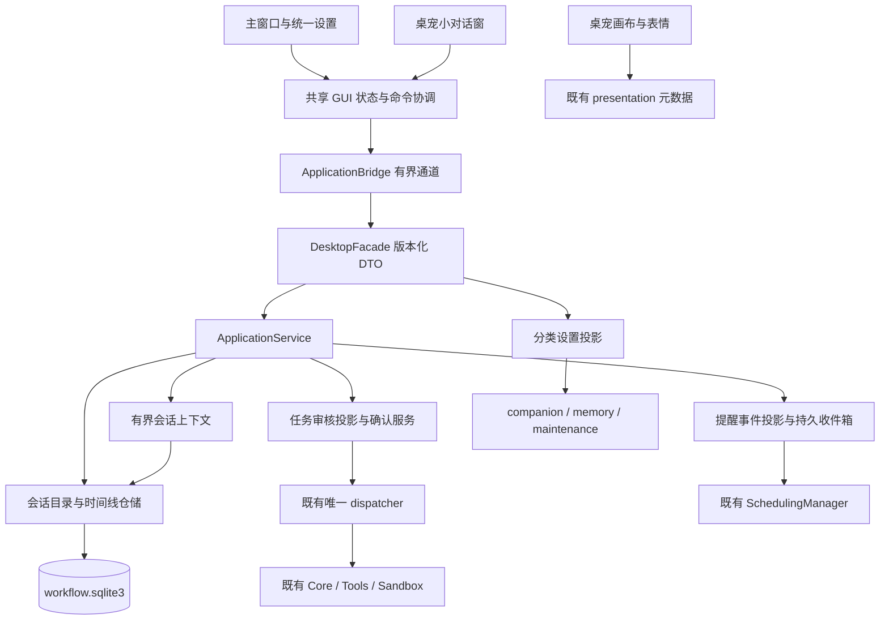

> 历史存档：保留当时的设计、失败与验收边界；不代表当前实现或新的执行授权。当前入口见 [文档导航](../../README.md)。

# 陪伴桌宠重构：前后端技术方案

设计日期：2026-10-25。本文为技术基线；实际接口见[源码说明](../../developer-guide/gui-refactor.md)，范围见[开发记录](development-status.md)，T1 自动化结果与实机未验证边界见[测试记录](test-report.md)。产品行为以[产品设计](product-design.md)为准。

第二轮补充的默认云模型、设置内密钥传递、头像/桌宠素材与工具插件目录契约见[模型、素材与工具扩展](settings-assets-and-tools.md)。下文已同步取消分散设置入口，备份范围随自定义素材扩展。

D0 按用户要求先完成文档；后续开发授权和退役旧 GUI 的补充要求见开发记录。入口见[设计总览](README.md)，页面状态见[页面与状态细则](page-and-state-spec.md)。

## 1. 核心决策

1. 延续 PySide6 Widgets，新增产品组件和状态协调层，不新建另一套桌面执行运行时。
2. 在既有 `workflow.sqlite3` 新增持久会话与聊天记录，不新开第五个业务库。
3. 聊天存档和有界模型上下文分离；现有 `ConversationRuntime` 转为可失效、可重建的上下文缓存。
4. 主窗口、小窗和任务中心共用 GUI 状态仓库、任务审核投影和命令回执。
5. 授权由后端提供当前可操作状态；GUI 不根据“存在 plan”猜测可确认，也不根据按钮点击猜测成功。
6. 提醒到期由已有 SchedulingManager 公共事件接口接入应用层展示，不增加定时模型调用或直接工具执行。
7. 新安装默认云模型；真实本地推理与 `offline` 演示分离，设置中的连接配置决定执行位置，聊天不逐条选择。
8. 配置全部归设置；工具目录是只读能力视图，素材导入与密钥保存走各自受控后台通道。

不向七字段桌宠表现 DTO 塞入聊天正文。画布仍只显示有限状态；小窗是新 UI 消费者，通过既有 bridge 取对话数据。GUI 不直接读 SQL，不调 Core，不在 Qt 主线程同步等待 IO。

## 2. 持久会话与时间线

### 建议数据模型

工作库当前 schema 为 2，本方案建议迁至 3；开发前再次核对实际版本，若已占用则顺延，不能覆写现有迁移。

| 表 / 记录 | 关键字段与约束 | 说明 |
| --- | --- | --- |
| conversation | id、kind、title、revision、context_epoch、next_sequence、created_at、updated_at、archived_at、deleted_at | 默认类型唯一；领域层与数据库约束共同保护默认会话 |
| conversation_item | id、conversation_id、sequence、kind、task_id、revision、body、use_policy、created_at、redacted_at | user_message / assistant_message / task_card / reminder；按稳定 ID 更新而非重复追加 |
| conversation_item_source | item_id、source_kind、source_id、source_revision、use_policy | 显示内容与上下文都能参加来源失效和隐私清理 |
| conversation_receipt | command_id、payload_hash、operation、conversation_id、result_identity | 创建/重命名/归档/清空等命令幂等，不保存执行 grant |
| reminder_inbox / cursor | event identity、source identity/generation、anchor、task/conversation link、acknowledged_at、delivery state | 重启后可查已到期和未读；不等于外部系统通知 exactly-once |
| asset / appearance_profile | opaque asset ID、slot、content hash、尺寸/格式、revision、active reference | 头像和静态桌宠的托管元数据；文件正文在 assets 目录，使用原子发布与 CAS |

表名可在实现中细化，但必须保持约束。`turn_ref` 继续作为 task 与语义轮次的权威绑定；新增时间线 sequence 是 UI 排序位置，两者不能混用。会话 revision 管目录修改，item revision 管消息/卡片更新，context_epoch 管会话上下文失效，全局 privacy_epoch 管隐私屏障。

任务卡只保存 task 引用及必要索引，状态和审核参数从当前 Task/Plan/attempt 投影，避免重复保存整份敏感计划。消息正文是原始显示内容，禁止从历史 task.result 随意拼造一份“完整旧聊天”。

持久 task/card 关联不要求每条普通聊天都绘制可见任务卡。DTO 应区分消息进度、可选查询详情、需审阅/追踪的任务卡；展示判断来自可信任务事实与步骤类型，普通回复不会因内部存在 Task 而占据技术流程面板。同一任务切换为需审批状态时就地展开其关联卡片，不创建第二份任务。

### 事务边界

- 初始化默认会话使用同一工作库事务和唯一约束；任何入口发现目录缺省时调用幂等 ensure，不重复建“日常聊天”。删除/归档请求由服务端拒绝，隐藏按钮不作为保护。
- `submit` 同事务完成 Task/Submission、turn_ref、用户消息、任务卡引用、命令 receipt。事务失败不留下只有半边的“已发送”。已有 dispatcher `register` 钩子需要一并审查，序号由数据库分配，不能先改内存计数后假定已提交。
- UI “正在发送”占位只存在于内存，使用 command_id 与最终 message_id 对账；双窗口重复点击同一意图复用命令键，不能生成两份任务。
- 工具终态仍以 Task/attempt 为权威。助手表达落库失败不能触发工具重做；通过持久投影待办重试保存同一结果，若结果本身没能保存则显示已有任务事实与表达缺失说明，不额外调用模型伪造原回复。
- 同一任务从 Waiting 经确认到终态，更新同一 task_card。等待阶段的解释文本与终态回复用不同 phase 身份幂等发布，不能继续使用当前“同 task_id 只 publish 一次”规则吞掉终态更新。
- 查看、切换、关闭窗口不改变业务状态；归档也不取消正在运行的任务。归档中的新结果显示角标和返回链接。

### 存档与上下文

模型上下文仍保留当前默认上限（8 轮 / 16 KiB 等），不同用途投影继续计入完整元数据预算。跨重启从当前会话仍有效记录重建最近合法窗口，重新校验来源 revision、用途和 epoch。

只有在该请求语义序号之前的有效轮次可进入上下文；未完成计划标记为 draft，工具事实只能来自可靠账本。不同会话不拼接原始消息。长期记忆由现有 MemoryRuntime 检索，共享不等于放宽用途。

存档不因缓存的 1800 秒过期而删除，不受四会话热缓存容量限制。目录/记录查询每页默认 50、上限 100，回执仍受 bridge 字节限制；长正文专用分段/详情接口返回，不以无限列表解决长期使用。容量不足明确拒绝新增持久写入并保留未发草稿，不静默删旧记录。

本轮不以自动摘要作为持久化前提，避免引入额外模型请求和摘要事实污染。可在上下文提示中解释“历史记录可查看，但本次只使用部分近期内容”。

## 3. 隐私、清空与删除

默认会话不可删除身份，但可清空内容，保留 ID、kind 并增加 context_epoch。专项会话删除先标记不可再提交，再执行可恢复清理。清空/删除都先展示实际影响范围。

区分两类操作：

- **清空本会话记录**：先阻断该会话新提交与旧上下文发布，失效来源依赖及未执行计划，取消尚未执行的相关工作，清理聊天正文、标题派生内容、依赖闭包内的上下文副本与任务敏感投影。运行中的同步效果按现有安全边界等待，显示 Pending，不宣称立即停止或完全擦除。
- **遗忘长期记忆**：继续走既有 deletion job 和 Memory 来源闭包；新增会话表、派生标题、提醒正文、GUI 缓存和未投递通知一起参与清理。若用户没有选择遗忘独立长期记忆，不直接删除无依赖关系的已确认记忆；依赖闭包导致额外影响时须在回执中明确列出。

增加会话清理的工作单类型/作用域，不将任意字符串冒充 memory_id 复用接口。固定默认标题不含私人内容；专项标题视作敏感派生数据。所有正文入口都检查清理状态与当前 epoch，不能通过列表标题、小窗或旧备份预览绕回已遮蔽内容。

用途撤销与记录删除不同：撤销云用途立即使相关云上下文失效，不应顺带删除持久会话目录。GUI 可先清屏再重新读取当前允许的本地展示数据，不能把隐私屏障后的临时空 UI 当成会话已被删除。

“仅本地”与“云可用”的事实从原来源继承。设置入口合并不合并权限含义，偏好保存不等于出云许可，更不等于工具授权。

## 4. 拟新增/演进的应用接口

下表为待实现操作名。保留 CLI 的 submit/wait/confirm 兼容入口，新接口不得直接操作工具或成为第二个调度者。

| 操作 | 请求要点 | 返回与行为 |
| --- | --- | --- |
| conversation_ensure_default | command_id | 固定默认会话摘要；幂等 |
| conversation_list | cursor、limit、archived | 稳定排序摘要、default_id、下一页游标 |
| conversation_create | title、command_id | 持久会话摘要 |
| conversation_update | id、expected_revision、title/archived、command_id | CAS；默认会话禁止归档 |
| conversation_timeline | id、before/after cursor、limit、known revision | 有界消息及任务投影、tombstone、会话/隐私版本 |
| conversation_clear / delete | id、expected_revision、command_id | 清理工作单与已清/保留范围；delete 拒绝默认会话 |
| submit（演进） | request、command_id、use_policy、conversation_id、expected_context_epoch | task_id、message_id、card_id、conversation_id、受理状态 |
| task_review | task_id、已知版本（可选） | 可信结构化审核 DTO，包含整份原计划所需展示内容 |
| confirm（演进） | task_id、plan_hash、expected_revision、ordinary_tools、high_risk_tools、command_id | confirmation receipt + 当前 task 投影；实际校验在应用层 |
| command_status | command_id | 是否受理、关联对象与当前状态；用于丢回执核查，不恢复 grant |
| task_updates | task_ids（有界）、已知 revisions | 只返回改变的任务，用于跨窗口共享刷新 |
| settings_sections / settings_update | section、expected section revision、changes、command_id | 非秘密分区状态与保存回执；密钥不走此通用路径，模型配置转独立维护通道 |
| reminder_feed / reminder_ack | cursor、limit / event identity、command_id | 到期/未读投影、确认已读；不重新执行工具 |
| tools_catalog / tool_detail / plugins_catalog | 筛选、分页、catalog revision / stable ID | 从真实注册表查询，可信元数据补充中文显示，不执行工具 |
| model_settings_* / appearance_* / asset_* | 见补充方案中的专用契约 | 密钥敏感通道与图片导入不塞进普通 DTO/命令缓存 |

所有 DTO 带 `schema_version`、会话/实体 revision、`privacy_epoch` 和启动 session identity。读操作进入 READ 通道，清理/取消/状态核查等控制项明确分类，不堵在长普通命令后；mutation 按既有 bounded command channel。

GUI 旧 `conversation_open/close/snapshot` 调用随面板整体迁移；同步更新测试和开发者文档。若保留兼容方法，`close` 仍应清楚区分释放临时上下文与删除存档，不能静默改成 destructive delete。

## 5. 审核 DTO 与授权状态

### 可信投影

`TaskReview` 至少包含：task_id、task_revision、status、plan_hash、conversation_id、title、steps、workspace、source_use_summary、required_permissions、granted_in_current_process、missing_permissions、available_actions、blocked_reason、attempt_summary、confirmation_state。

每个 step 包含原 call_id、注册工具名、中文动作名称、权限等级、所有参数的结构化字段、影响对象、契约版本。用户摘要由可信工具 formatter 生成，不由 LLM 再概括审批范围；参数仍绑定原 plan hash。无法识别的新参数采用有界键值树显示，不能省略后就称“完整审核”。

`available_actions` 是后端当前事实的投影，提交时必须重新核验，不把它当成持久能力票据。`granted_in_current_process` 只用于展示，重启清空。

### 确认协议

1. GUI 从准确版本的 TaskReview 建立审核卡，普通单工具动作按钮明确授权范围；高风险独立确认，默认空。
2. 服务端在已有锁顺序内核验 task revision、plan hash、权限等级、当前来源、attempt、取消/清理状态。需要全部授权的新版 GUI 不发送空集；服务端也返回明确缺失项，不把无变化的 Waiting 当作确认成功。
3. command_id 与 payload digest 绑定，同键异参拒绝。确认事务写回执与排队记录，回执表示 accepted/queued，并非工具已执行。
4. 已受理但任务仍短暂 Waiting 时，依据当前进程待确认/队列状态显示“等待执行”，不重新显示可点授权卡。
5. 原命令回执丢失时先按 command_status 核查。已经受理就跟踪同一任务，未受理才允许用同 command_id 重试；不悄悄换键再提交。
6. 重启后旧 receipt 只能证明历史受理，不能恢复进程内授权；恢复路径显示 NeedsReview 并要求新的明确确认。有 attempt 的旧计划按现有规则禁止整份重放。
7. hash/来源变化时清空旧确认选择并解释原因；同版本的重复轮询不得清空用户正在做的选择。

新增 UI 交互状态 `submitting/accepted/failed` 不冒充 TaskStatus；通过 DTO 合成用户可理解状态。取消和确认竞争由现有控制/事务排序确定，取消按钮点击不等于效果已经撤销。

## 6. GUI 状态所有权与组件拆分

当前 `MainWindow` 同时承担导航、命令、全局失效、聊天拼接与任务展示，应缩成 shell。

| 建议模块 | 责任 |
| --- | --- |
| gui/shell、navigation | 五个入口、聊天专属会话栏、非聊天页扩展布局、返回位置、窗口尺寸 |
| gui/state/conversations | 已加载会话、分页、每会话滚动位置；临时草稿按会话保存 |
| gui/state/tasks、commands | 按任务 ID/revision 合并状态、命令受理、超时核查 |
| gui/components/message_list、composer | 消息虚拟化/分页、Enter/IME、发送状态 |
| gui/components/task_card、approval_review | 主窗/小窗/安排页共用审批展示与交互 |
| gui/settings | 分类设置与保存提示，复用现有后端能力 |
| gui/pet_chat、pet_menu | 小窗、窗口动作菜单、屏幕锚点；不含配置入口 |
| gui/tools_catalog | 工具/能力提供方的只读目录、搜索、详情和真实可用状态 |
| gui/theme、widgets | 颜色间距、可访问状态、禁止滚轮改值控件 |
| application/conversation_service、task_review、reminders | Qt-free 聚合与领域协调 |
| conversation/ports、repository adapter、context runtime | 持久目录协议与上下文投影 |

目录可以渐进落地，不能同时保留两套互相写不同状态的旧新聊天流。新 timeline 成为聊天唯一展示源后移除 `_append_chat + snapshot.setPlainText` 双写方式。

状态合并规则：

- 页面 generation 只淘汰页面查询，不淘汰已受理业务命令及其会话归属。
- 会话栏的可见性和布局列由当前路由共同决定；隐藏后其他页面占满主区，返回聊天恢复。导航不改变默认模型或任何设置。
- 实体 revision 决定新旧，privacy_epoch/session identity 决定数据是否允许接收；不同标识不混为一个计数器。
- 迟到结果按 task/message identity 合并到原会话；当前页面不匹配只是不显示，不丢弃结果。
- 主窗与小窗共享领域数据，但各自保留选中会话与阅读位置；小窗重新打开回到日常聊天不强制主窗跳转。
- 草稿采用共享的会话编辑缓冲；同一会话两窗同时编辑时同步草稿修订，发送一次并清理匹配修订，避免后到回执擦除新输入。草稿本轮只在进程内，不放 QSettings。
- 活跃会话和待处理任务按有界批量查询刷新；隐藏窗口停 UI 专用轮询。全量重载只用于初始化/明确失效，不在每次 mutation 后清空全部选中对象。

## 7. 桌宠尺寸、焦点与生命周期

`pet_scale` 增加到 GuiPreferences，范围验证、旧值缺省 1.0，仅在设置页修改。角色尺寸使用逻辑坐标；图像缓存按 asset revision、表现状态、缩放档和 DPR 有界管理，限制总字节，避免每次滑动或导入永久增加缓存。

PetWindow 的画布、标签几何、居中绘制、fallback 椭圆、稳定透明命中遮罩一起参数化；不能只缩图片不改窗口或命中区域。PetController 当前固定 DPR=2 的缓存也必须一并检查。跨屏/缩放后重新计算 availableGeometry 内的角色和小窗位置。

小窗使用独立可聚焦 QWidget，不继承角色的不激活窗口标志；仅用户明确点击时激活输入，不因后台消息抢焦点。右键菜单不触发左键导航；拖动以系统阈值判断。

Host 统一拥有小窗与菜单，关闭/维护切换时先禁止新交互，再按现有 bridge Closed、图片线程退出、Qt 对象销毁顺序完成。隐藏、禁用、退出区分处理：隐藏不删会话，禁用释放图片和小窗，退出仍等待后台真实结束。

## 8. 提醒到期的完整链路

当前 scheduling events 已持久；新增应用层 ReminderInbox 消费其公共接口，不在 GUI 访问 scheduling 私有连接。

- 使用独立消费游标，不借用 proactive 的 cursor；不要求先建立 Goal/Proposal 才能收到显式提醒。
- 消费键包含来源库身份/世代、事件流、event_id；每批有上限。同一工作库事务写 inbox 和推进 cursor，允许跨库重复读取但靠唯一键去重。
- 展示前重新读取 source snapshot，核对取消、删除、提醒时刻/版本和事件锚点；来源变化、恢复后身份不匹配时停该流并显示需复核，不能直接重置游标补发全部历史。
- 新创建提醒的 task/conversation 映射由工具结果中的可信资源 ID 在工作库登记；若在登记前崩溃，后续可以显示“未关联会话的提醒”在安排页，不臆造关联或重做创建。
- 启用本功能时建立有限基线；旧到期记录不突然全弹窗。已跟踪的新提醒退出期间到期，重启后归入“错过的提醒”，不制造“准时通知”的假象。
- 系统通知默认沿用旧设置；应用内 inbox 与系统通知分开，系统静默不抹掉未读记录。点击通知重新查询并导航到来源会话/提醒详情。
- 本轮不增加后台常驻服务；退出应用期间不保证实时系统提醒。睡眠恢复后按当前来源事实处理已过期事件，具体投递 TTL 在实现契约中明确且可测。
- 通知只用通用摘要；完整内容仅在用户打开受控窗口后显示。通知去重记录不是执行或授权凭据。

编辑/取消提醒仍走受控工具计划或既有授权服务，ReminderInbox 的“已读”只改展示状态，不绕过工具权限修改计时器。

## 9. 统一设置但保留后端边界

设置中心通过聚合 facade 读取分类数据；现有 QSettings 只存桌面偏好，companion SQLite 存人格/互动，memory 持续拥有画像和记忆，配置/凭据由 maintenance 管理。不能为了一个“全部保存”把这些库直接并起来。

外观素材的 profile/asset 元数据进入工作库，图像进入托管 assets 目录；QSettings 不存大图或任意源路径。通用设置聚合只返回凭据存在性和来源，秘密输入仅送独立维护后台。用户本轮明确要求所有配置集中设置，聊天头像、记忆页、工具目录、桌宠/托盘不提供配置快捷入口。

保存以一个分区为单位，带 expected_revision、脏标记、提交中和错误。跨区改动逐区返回结果，不能某项失败却显示“全部成功”。外部/另一窗口修改后发现 CAS 冲突，显示当前值并保留用户草稿供重新选择，不自动覆盖。

需要重启的模型/配置编辑仍通过 Launcher 安全退出生产 Host → 独立维护 → 重开；统一的是入口与文案，不绕开实例锁和恢复标记屏障。表单可保持在同一设置外观中，秘密只驻内存转交一次；保存、已生效及测试连接是不同状态，具体回执见补充方案。

偏好显示须给出有效值和来源（全局/今天/当前会话），明确优先级为当前会话覆盖优先、有效当天覆盖其次、持久偏好再次、人格预设兜底。若原有领域优先级不一致，先统一领域契约和调用方，不能只在 UI 计算另一份结果。

## 10. 迁移、备份与兼容

1. 在实例锁与恢复标记检查之后执行工作库 schema 迁移，先按现有机制创建一致快照，DDL 和版本更新同事务。失败保留旧库并给出维护指引。
2. 旧任务、计划 hash、attempt、command、turn_ref 不重写，旧无会话任务保留在安排历史。当前未持久化的完整聊天无法在升级后凭空恢复；升级说明明确这一点。
3. 首次迁移只新建日常聊天目录。若以后需要导入旧任务记录，应显式区分“历史任务”，不能伪装原始聊天；本轮不自动导入。
4. 修改 `maintenance/archives.py` 的版本白名单、结构验证、manifest 兼容与恢复验证；本轮目录仍是四个业务库，但备份增加托管静态素材和新 manifest 版本，完整说明见补充方案。旧四库备份恢复后缺素材使用默认形象，API 密钥永远不随备份导出。
5. 旧 schema 1/2 备份仍可检查和恢复到新目录，再由新版本应用迁移；新 schema 备份供旧程序读取时必须清楚拒绝，不承诺自动降级。
6. QSettings 新键缺省回退，保留旧桌宠/通知/托盘设置；不保存聊天、授权或凭据。迁移不改变人格开关与云用途许可。
7. CLI 无 Qt 环境仍可导入、运行任务和维护。默认会话服务的初始化不能迫使 CLI 加载桌宠或 GUI。

## 11. 必须一起修改的调用方

| 改动 | 调用方 / 文档同步 |
| --- | --- |
| 会话持久化与 epoch | application/service、dispatcher register、interaction prepare/publish、conversation runtime、workflow/humanization、GUI panels/state、CLI 如有调用 |
| 任务审核与确认回执 | desktop、service、dispatcher、agent pending 权限查询、window/channel/chat、任务/小窗组件 |
| 隐私来源闭包 | application/privacy、workflow journal/deletion job、memory integration、所有正文 DTO、GUI 清屏 |
| 提醒投影 | scheduling ports、application reminder service、desktop、notifications、host、安排页 |
| 新 schema / 素材 | migrations/store/factory、assets 服务、archives 版本/资源清单识别与校验、恢复流程、测试夹具 |
| 云/本地 / 密钥 | config、factory 全部 cloud 判断、llm gateway/url policy、maintenance setup/credentials、launcher 敏感载荷 |
| 工具目录 | ToolManager 公共注册表、可信显示目录、desktop 查询、插件 capability、设置配置入口 |
| 视觉与设置 | window、conversation/companion panel、preferences、pet_*、maintenance 入口、全部表单滚轮策略 |
| 使用说明 | docs/user-guide/desktop、tasks-and-permissions、memory-and-privacy、configuration、maintenance |
| 开发契约 | docs/developer-guide/gui、request-lifecycle、storage-and-maintenance；新增本轮实际接口与交付记录 |

开发前再次枚举接口调用方，并审查改动后的真实 diff。以上是必要范围，不是保证文件名永久固定的重命名清单。
