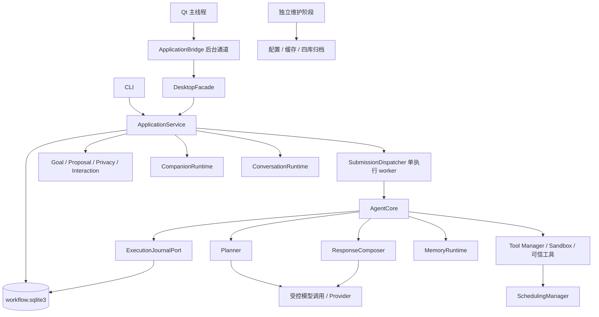

> 历史存档：保留当时的设计、失败与验收边界；不代表当前实现或新的执行授权。当前入口见 [文档导航](../../../README.md)。

# 架构与设计边界

系统分为用户入口、Application 协调层、Core 编排层、领域协议和具体适配器。依赖由装配工厂注入，Core 不直接访问 SQL、Qt 或厂商 SDK。

图中的 Domain 是职责分组，具体协调类见[模块说明](../../../developer-guide/modules.md)。维护阶段与生产 Application 分离，由入口和锁保证操作顺序。

## 权威状态分工

| 问题 | 权威来源 | 不能替代它的内容 |
| --- | --- | --- |
| 任务完成了吗 | 持久 Task、计划、步骤账本 | LLM 回复、桌宠表情、通知 |
| 可以执行吗 | 注册的 ToolSpec、准确 Plan、可信授权、依赖与用途检查 | 模型声称权限、人格设置、接受提议 |
| 目标完成了吗 | Goal/Milestone 状态和用户证据 | 关联 Task Completed |
| 内容能否出云 | 请求用途、来源用途、类别许可、隐私 epoch | 存在 API key、缓存命中、历史同意过其他内容 |
| 记忆可否使用 | 当前来源/revision/审核/删除阻断 | 相似度、旧索引、界面缓存 |
| 退出完成了吗 | Core/调度/桥接/图片线程及窗口实际释放 | 超时、关窗事件、请求取消回执 |

## 需要保留的设计边界

1. **一个生产执行者。** GUI 只提交、查询或控制，既有 dispatcher 执行 Core；调度、本地规则、查询和图片准备可以有各自后台线程，但不另建工具执行 Core。
2. **执行前整份预检。** Plan 固定参数与可信工具契约，缺任何必要授权就 Waiting，零工具执行。Level 1 与 Level 2 独立。
3. **账本先于副作用。** 每步先提交 Started，再调用工具，最后提交可靠结果。结果提交失败不自动重试工具。
4. **外部效果不具备全局事务。** SQLite 事务不能回滚文件/外部服务，失败、取消、崩溃均可能已有部分效果。
5. **隐私先阻断后清理。** 遗忘持久化阻断和代际变更后，才清理记忆、工作副本与缓存；失败保持 Pending。
6. **模型用途分离。** planning、expression、memory_evaluation 走受控调用。人格/模拟情绪不成为 Planner 的执行依据，表达候选不能自行变成持久设置。
7. **本地规则不等于后台授权。** Proposal 生成只使用本地显式来源；接受提议不扩大云许可或工具权限。
8. **维护不并行占用生产资源。** data_dir 实例锁、缓存共享/独占租约、恢复标记分别保护对应资源。

## 两个工厂的差异

`create_application()` 获取 OS 实例锁、检查恢复标记、装配持久四库和生产 facade，续办删除并恢复状态后启动 worker。CLI/GUI 的生产入口都使用它。

`create_agent()` 是低层同步兼容入口，默认使用内存 TaskManager 和进程内人格状态，不提供生产持久队列、实例锁或重启恢复保证。不要因其签名简短而用它实现第二个桌面后端。

当前 Sandbox 是可信工具的路径/参数策略，不能隔离任意 Python 插件。`execution/` 隔离实验暂停，不能据其存在宣称生产工具已在 OS 沙箱执行。

接口参考：[V0.4 持久后端](../../releases/v0.4/interfaces.md)、[V0.5 GUI](../../releases/v0.5/interfaces.md)、[V0.9 维护](../../releases/v0.9/interfaces.md)。
