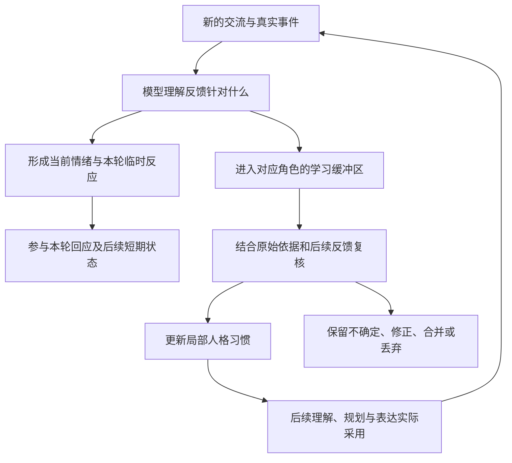
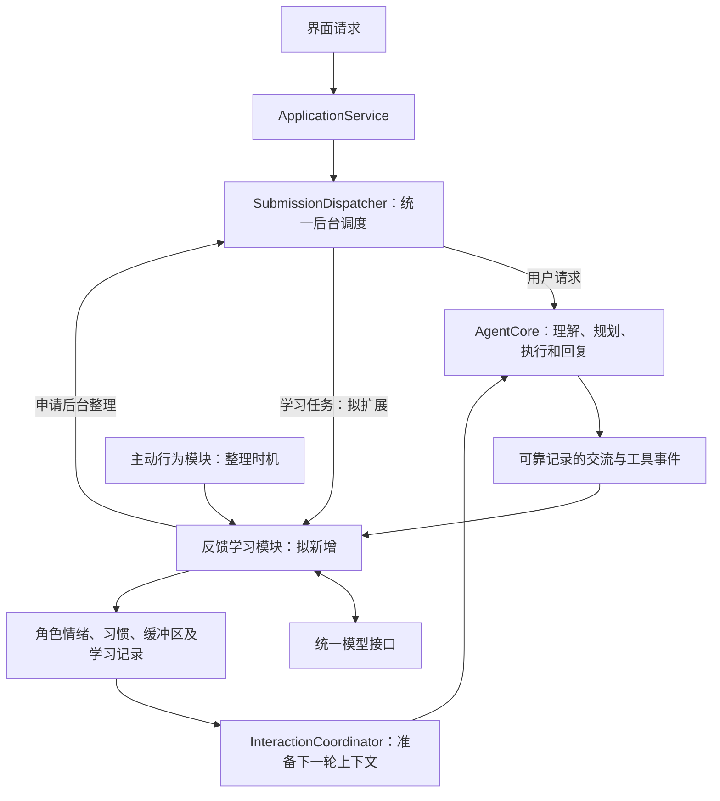
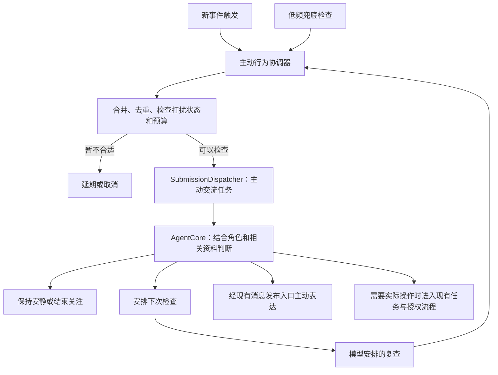

# 人格与记忆重构讨论：把使用方式理顺

日期：2026-10-28。本文记录源码现状与已采纳的设计方向。移除聊天请求的免模型快捷处理、角色卡参与思考、多步重新规划和记忆缓冲区均为待实施方案；本次按用户要求只保留文档，不据此认为代码已经完成重构。

2026-10-29 分阶段实施资料见[完整开发与验收目录](../companion-redesign/README.md)，以最新确认结论为依据，分别安排六阶段开发与验收；本文件继续保留设计含义及当前源码说明。

2026-10-29 补充：采纳五层业务建模，并撤掉旧的独立互动状态模型；职责迁移和删除条件见第三节。本次仍只更新文档，尚未实施代码迁移。

同日后续补充：用户确认云端数据许可有长期安全价值，初期先避免建设过于复杂的权限产品。沙箱、Live2D 和云端许可的正式版后方向见[长期功能扩展规划](../post-release-roadmap.md)。下文关于简化许可的建议针对初期日常使用，不代表永久取消数据外发控制。

2026-10-29 最新确认：**每个角色使用一份完整独立的数据档案，切换全部数据库与运行状态；关闭旧后台后重新打开新后台，未激活角色的后台不运行。** 本方案替代此前“日程、任务、工具记录和一般事实跨角色共享，部分数据按角色隔离”的设计。本文相关条目已同步调整，代码尚未实施。后续逐项结论见[补充结论文档](2026-10-29-redesign-follow-up-decisions.md)。

## 先说我的判断

你的主要判断成立。当前系统把很多本应在聊天中自然完成的事，拆成了需要用户理解的开关、候选、审核和表达参数。后台的部件划分并不都多余，但这些部件已经反过来主导了产品使用方式。

按照现在明确的方向，应用应该是：打开一个角色档案，开始聊天；角色自然记住有价值的信息，逐渐形成自己的相处方式。该档案拥有完整的人格、记忆、聊天、任务与日程；其他档案不在后台运行。普通记忆和人格学习不需要用户逐条批准，也不需要用户先打开五六个许可才能正常工作。

我有几处不同意见，会在下文说明：自动学习仍需要记录依据；角色要保持连续性，不能每聊一句就重写自己；时间、角色隔离和真实执行结果仍应由程序落实。这些要求可以在后台完成，不需要变成用户的审核工作。

## 一、角色采用完整独立档案，整体切换后台与数据库

每个角色使用自己的完整数据目录，包含人格、当前情绪、一般事实与知识、情景记忆、学习缓冲及记录、所有聊天会话、任务、日程、定时器、执行记录，以及数据库中保存的其他状态。当前档案内可跨会话使用的记忆仍然共用，不再建设跨角色共享事实或共享日程的数据层。

例如，向 A 说“我喜欢喝茶”，只会在 A 的档案中形成相应记录；切换到 B 后，B 不自动知道该事实。A 创建的日程和任务也不会出现在 B 的档案中。事实与共同经历仍按不同含义建模，但都属于当前档案。

只运行当前激活档案。切换时停止受理旧档案的新工作，等待活动操作安全结束或停止，保存必要状态，关闭其后台服务、调度器及数据库连接，再打开目标档案的后台和数据库。不能在旧后台仍活跃时直接更换数据库路径，也不需要每次切换复制或覆盖数据库文件。

上下文、缓存、队列和模型调用结果的接收边界随后台生命周期一起切换。旧后台未安全关闭时不能宣称切换完成；晚到结果不得写入新档案。停用档案保留已有记录，但不执行任务、不学习、不主动联系，也不实时触发其日程提醒。重新打开时按有效性与执行账本核对待办及逾期事项，不补发全部历史通知，不盲目重做结果未知的操作。

工具实现和模型适配代码可以复用，每次后台使用当前档案的数据。对操作系统或外部文件已经造成的实际影响不会随数据库切换撤销；操作系统通知权限等系统能力也不属于可切换的角色数据库。

Phase 01 实施补充确认：模型连接及 API 凭据、外部文件工作区、模型缓存应用级共用；各角色业务数据库和受管头像、桌宠资源独立，不因切换档案复制密钥或改写共用模型配置。

### 当前实现是否符合

还不符合。当前更接近“一份全局人格、一份全局长期记忆，加上多个独立聊天窗口”。没有贯穿整个主流程的角色归属。记忆虽然有 owner/session 字段，但通常采用固定的本地所有者和默认会话；这不等于已经实现多角色。

当前长期记忆不按聊天窗口隔离，这一点接近同档案跨会话使用记忆的要求。新的主要工作是建立完整档案的选择与后台关闭、重开流程，不再把现有数据库拆成跨角色共享层与私有层。

因此，角色选择入口需要连接真实的后台生命周期与数据目录，不能只替换界面中的角色名称。

## 二、一个角色只有一个现在，不需要人格版本选择器

我赞成“同一个角色保持唯一人格和连续记忆”。用户面对的应该始终是这个角色当前的状态，不需要选择“人格第一版、第二版”，更不需要给同一个人切换几套平行记忆。

当前实现确实有人工人格配置的版本、历史与回退。它主要用于配置更改和防止旧界面覆盖新数据，不代表当前已有多角色或平行人格系统。但若把这些版本直接摆成使用选项，确实偏离你的目标。

建议用户只看见：角色卡、当前记忆、备份和恢复。后台仍可保留修改序号、必要的变更记录，以便避免同时写入互相覆盖；这些序号是记账信息，不是可切换的人格。

备份以完整角色档案为范围，覆盖其人格、记忆、聊天、任务、日程等数据库状态，不影响其他档案。恢复前明确展示覆盖范围；恢复后的待办、逾期提醒和执行结果需要核对，不能把恢复旧库理解为撤销外部实际操作。不需要日常人格版本选择器。

角色切换按第一节关闭旧后台、打开新后台，不让旧角色任务在新后台中继续执行。旧档案的日程记录保留，但后台停止期间不触发提醒；回到该档案时核对恢复状态。

2026-10-29 删除边界确认：删除角色即删除其完整档案下全部数据，当前档案先安全停止后台再删除，其他档案不受影响。清空某个聊天只清除该会话内容与工作上下文，不动长期记忆、人格或已有安排；不能沿用旧实现对关联任务和提醒的级联清理。完整结论见[补充结论第七节](2026-10-29-redesign-follow-up-decisions.md#七清空聊天遗忘删除角色与取消安排的边界)。

角色生命周期的实施收口：每个档案使用稳定标识，改名不改变归属；各有自己的固定“日常聊天”入口，新角色不自动继承旧档案数据。Phase 01 实施时用户明确旧版现有数据无需迁移，直接清理并新建默认独立档案，不保留迁移快照；不清共用连接、缓存、工作区或已有新版档案。恢复显式备份后仍核对执行与逾期状态。第九项按该最新决定调整，详见[补充结论第九节](2026-10-29-redesign-follow-up-decisions.md#九角色生命周期与旧数据迁移的实施收口)。

## 三、人格改成开放角色卡，并让模型真正参与成长

当前人格主要是三种预设、六个表达轴，以及少量受限身份字段。这更像一个“回复风格调节器”，还不是你想要的开放角色。

建议角色卡可以用自然语言写：名字、背景、性格、价值取向、说话习惯、兴趣、与用户的初始关系，以及你希望它如何相处。比如“沉稳、喜欢追根究底，熟悉后偶尔开玩笑”，不需要换算成六个小数。

正式、温和、幽默等六轴不再出现在普通设置中；我也不建议只是把滑杆藏起来，仍让六轴成为人格的唯一表示。角色卡本身应成为主要设定，模型负责理解它。

角色卡还应参与理解问题、选择建议和组织思路，而不仅是等计划做好以后给回复润色。比如研究员角色可能先比较方案，旅行者角色可能先关心使用场景。两者依然服从真实工具结果和用户的操作授权。

### 已采纳：让角色参与思考和规划

角色卡、该角色逐渐形成的习惯和相关记忆，在规划之前就准备好，参与模型对当前问题的理解、关注点选择、方案取舍和工具步骤安排。组织最终回复时，继续使用同一角色的上下文，避免前面按一种身份思考、后面又套另一种身份说话。

例如“帮我安排周末学习”：研究型角色可以先找薄弱环节，再安排学习与复盘；重视生活节奏的角色可以先考虑精力、休息和计划能否坚持。差异应出现在处理方式中，不只是同一个安排用两种语气说出来。用户明确的目标、当前要求和工具事实仍优先。

当前规划与回复表达已经分开，交互协调器也有准备上下文的入口，因此可以复用现有底座。主要改动是让角色资料真正进入规划，并让后续重新思考沿用同一角色；通常不必仅为此再多加一次模型调用。

单独接入这条资料流是中等难度，让角色长期自然、连贯则需要更多实际场景验证。原先“不同人格下规划必须相同”的部分验证思路也要调整为“允许角色采用不同处理方式，但不改变任务事实和执行权限”。本设计已采纳，本次尚未接入规划器。

### 自学习具体做什么

由模型阅读新的交流和有意义的事件，判断哪些值得记住、用户的表达属于临时要求还是长期习惯，以及当前角色应怎样调整相处方式。代码负责把模型给出的结果保存下来、安排何时生效和归到正确角色。

例如，用户多次说“不用每次结束都问我要不要继续”。模型可以逐渐形成“在适当时直接结束，不机械追问”的角色习惯，并自动生效，不再把它塞进“偏好候选”等待用户点批准。

这里的“学习”首先是更新角色的持续记录、总结和行为习惯，不等于每次聊天都重新训练大模型参数。换模型提供商后，这些记录仍属于应用和角色，不应该丢失。

我不赞成每一轮都让模型把整份角色卡重写一遍。这样很容易把用户一时的情绪当成长久要求，也容易让原本有特点的角色越来越趋同。更合适的做法是：用户写下的初始角色设定保持可辨认；模型学到的习惯持续积累，在有足够新信息时作局部调整。普通调整自动完成，用户随时可以直接纠正。

“多次明确这样说”也不必再写成固定次数门槛，让模型结合原话、时间和上下文判断。后台只保留它依据了哪些真实交流，方便纠错，不能拿模型自己编过的一句话反复证明自己。

人格和普通自动学习应在角色创建后直接启用。需要配置模型密钥时就清楚提示连接问题，不以“人格默认关闭”或静默切到固定规则演示来掩盖未配置状态。

### 已采纳：长期人格与短期情绪共用反馈，分别更新

本节汇总最近几轮关于自学习的完整讨论，包括反馈来源、长期人格、短期情绪、学习记录，以及接入现有后端的方式。以下均为待实施设计，本次只更新文档，不删改代码中的旧规则，也不运行测试。

采用同一套反馈入口、两种更新速度：模型理解新的交流与真实事件，及时形成短期反应；可能值得改变长期习惯的线索先进入第五节的学习缓冲区，之后结合更多信息复核。两条路径共享来源，但不能因为一次心情变化就永久重写人格。

先让模型判断反馈的对象。例如“这样很好”可能认可答案内容，也可能认可语气；任务成功不等于用户喜欢角色的玩笑。明确的“以后先听我说”可以形成长期相处要求，“这次别分析”则只影响当前交流。用户没有回应，只表示没有新反馈，不能自动解释为拒绝角色或需要连续追问。

长期学习不局限于回答长短。研究型角色几次发现建议忽略实际条件后，可以逐渐学会先核实关键条件，再推导方案；它的观察角度和处事习惯会发展。用户设定的姓名、背景等身份保持连续，不因一轮反馈任意换人。

更新由模型结合含义、场景和依据判断，不规定“出现三次就修改”或“模型给高分就确认”。清楚的长期要求可以一次生效；间接线索即使反复出现，也可能继续保持不确定。模型自己的重复总结不构成新增证据。

### 已采纳：显式建立有原因、来源的当前情绪

后续删除或替换当前“工具完成就增加固定数值、失败就减少固定数值”这类决定情绪含义的旧规则，改为模型结合事件、角色人格和当前状态进行理解。工具结果仍是实际事件来源之一，但成功不必总是高兴，失败也不必总是低落；比如失败后的合理反应可能是专注查找原因。

不把“用户的状态”“角色的情绪”“互动方式”和“表达表现”混成一件事：

| 层次 | 含义 | 例子 |
|---|---|---|
| 长期人格 | 角色惯常怎样思考与相处。 | 克制、好奇、重视实践。 |
| 角色当前情绪 | 对眼前事情的模拟反应。 | 因共同解决难题而欣慰，同时略有担心。 |
| 对用户状态的理解 | 用户明确表达或模型暂时推测的需要。 | 用户说疲惫，可能需要降低信息量。 |
| 当前互动方式 | 此时如何开展交流。 | 先倾听，暂时少给建议。 |
| 表达调节 | 最终如何说、如何表现。 | 温和、简短、减少玩笑和动作。 |

用户说“我累了”，首先说明用户的需要，不必把角色也自动改成悲伤。角色很愉快，也不意味着任何场景下都该开玩笑。情绪可以影响关注点、处理节奏和表达，用户明确要求和真实工具结果仍优先。

每条当前情绪采用已确认的四项核心记录，并归属到对应角色：

| 核心记录 | 具体保存什么 | 用途 |
|---|---|---|
| 情绪描述与强度 | 自然语言描述及强弱，可以包含混合反应。 | 允许“欣慰但略有担心”，不强制每轮只选一个固定标签。 |
| 原因及来源 | 简短事件解释，以及对应消息、会话或真实任务结果的关联。 | 知道为什么产生，也能在依据被更正或遗忘后重新检查。 |
| 发生时间与预计持续范围 | 何时形成，预计影响本轮还是后续一段时间，何时或在何种条件下复查。 | 支持平滑减弱、新事件覆盖和重启后的有效性判断。 |
| 不确定程度 | 哪些理解较明确，哪些仍是暂时推测，存在什么疑点。 | 保留不确定，不把模型自报的数值当成已经证实的事实。 |

当前已有的愉悦度、活跃度、背景情绪等数值，后续若为兼容表现层而保留，只作为内部映射或过渡数据，不能继续主导“这件事应该产生什么情绪”。旧规则与新模型判断不能对同一事件各更新一次。

程序仍负责时间经过后的平滑变化、去重、有效性、保存及资源控制。这些是状态落实，不是用固定规则替代语义理解。模型暂时不可用时，可以沿用仍有效的状态并按时间减弱或使用中性表现，不回退到按成功/失败机械增减，也不凭空生成新情绪。

### 已采纳：保留五层业务含义，撤掉旧的独立互动状态模型

2026-10-29 确认：新架构采用前表的长期人格、角色当前情绪、对用户状态的理解、当前互动方式、表达调节五层业务含义。旧的独立互动状态模型不再作为目标架构中的额外业务模块，它已有的必要职责分别迁移到对应模块，避免同一要求保存两份、由两套逻辑作出不同判断。

| 旧互动状态内容 | 新归属与处理方式 |
|---|---|
| 会话约定 | 归入当前互动方式或表达调节，保存来源、所属档案与会话、适用期限和结束条件；长期要求按含义进入当前档案的用户偏好或角色相处习惯。删除独立约定存储与重复生效路径。 |
| 短时模式 `cue` | 将其含义拆入对用户状态的理解和当前互动方式；角色自身对事件的反应归入当前情绪。淘汰“支持、专注、庆祝”等有限模式作为核心业务状态的设计。 |
| 偏好候选 | 统一进入自学习模块的待确认缓冲区，由模型复核后采用、修正、保留不确定或清理，不再维护单独的偏好候选池与人工审批链。 |
| 本轮来源记录 | 随对应的理解、情绪、缓冲记录和学习记录保存，关联真实角色、会话、消息或事件；本轮上下文保留必要关联。无需另建一种互动状态。 |
| 去重与失效记录 | 由各模块的事件处理与状态更新机制负责，防止重复采用、过期结果回写及已遗忘内容恢复；属于运行保障，不作为人格建模的一层。 |

例如用户说“今天好累，我先说说，你别急着给建议”：对用户状态的理解记录明确的疲惫及尚不清楚的原因；当前互动方式采用先倾听、暂缓建议；表达调节采用简短、温和、减少追问。角色自身是否产生关切等反应，由模型结合角色与情境判断，不能直接把用户的疲惫复制为角色情绪。之后用户说“现在帮我想办法”，可以改变互动方式，不必同时认定疲惫已经消失，也不因此永久改变人格。

这些约定不能仅依赖最近聊天让模型每轮重新猜测。需要跨轮有效的要求，应由对应模块保存并检查范围与期限，避免长对话截断后丢失。五层也不要求五套独立服务或每轮五次模型调用：模型可以一次给出区分明确的理解结果，后台按职责采用，供理解、规划和表达阶段使用。

实施时先明确各项信息的唯一归属，迁移必要的有效记录和调用方，再删除 `InteractionState` 及相关旧状态维护、模式合并和候选处理路径，最终不保留两套并行判断。来源校验、去重、失效与遗忘传播能力必须由新归属承接。`InteractionCoordinator` 若仍承担准备本轮上下文的协调职责，可以保留并调整；不能仅因名称相近而一并删除。

这项决定替代的是旧互动状态作为独立业务模型的设计。本文第六节与当前对话流程说明中对旧机制的描述仍用于解释源码现状，不表示新架构继续采用它。当前规划已经覆盖这些职责，代码尚未完成迁移；以上为已采纳、待实施的修改规划。

### 已采纳：当前情绪与六轴联动，保留人格连续性

六轴不重新作为前端滑杆，也不作为人格与情绪的唯一表示。角色卡和学到的习惯提供稳定倾向，短期情绪形成临时调节；具体怎样表现，由模型结合情境判断。不能把临时调节直接覆盖为角色的长期参数。

| 表达轴 | 可以怎样联动 |
|---|---|
| 温和程度 | 按角色反应与用户需要调整关切、安抚方式。 |
| 幽默程度 | 严肃场景减少玩笑；愉快也不强制开玩笑。 |
| 解释篇幅 | 调整交流节奏，遵从用户当前的长短要求，不遗漏必要事实。 |
| 表现丰富程度 | 调节措辞、表情和动作强度，并平滑过渡。 |
| 正式程度 | 结合场景和角色习惯，不随着每个短期情绪大幅波动。 |
| 好奇程度 | 影响探索方向和关注点，不自动等于不断追问用户。 |

不建立一张“某种情绪必然等于某组六轴值”的固定对照表。六轴可作为内部兼容的表现指标，是否全部保留留待实现时评估；开放的角色、情绪含义和思考方式不被它们锁死。

### 已采纳：持久保存学习记录，并允许修正

每次实际采用或继续保留的学习结果，都有对应记录，至少说明：属于哪个角色、依据哪些交流和事件、模型提炼出什么理解、目前哪里不确定、作出了什么调整、适用范围，以及以后怎样复查或清理。记录简短依据和决定，不保存冗长的内部思考过程。

记录服务于连续学习、解释、纠错和备份，不变成供用户切换的平行人格版本。模型新增的普通习惯自动生效，不逐条请求人工批准；用户可以直接说“别学这个”“你理解错了”或要求遗忘。

例如：“我只是倾诉，先别给建议”先带来专注倾听的当下反应；缓冲区可以记录“倾诉时可能希望先被倾听”，保留范围和不确定性。以后明确说“以后也这样”，模型再稳定成相处习惯；下一次若说“这次直接帮我想办法”，当前要求立即优先。

保存一句“以后先倾听”还不算形成完整学习闭环。这个结果必须进入后续角色上下文，实际影响理解、规划和表达，再接受新的反馈。若来源被纠正或遗忘，相关推测、情绪和习惯也要重新检查；不能靠读取旧学习记录把已遗忘内容重新恢复。

学习记录、角色习惯、当前情绪和一般事实都保存在当前档案，不跨档案复制；档案内的工具事件可作为学习来源，但不自动等同于角色经历或人格变化。

### 已采纳：反馈模块在后端中的位置

用户请求主线保留 `ApplicationService → SubmissionDispatcher → AgentCore`。反馈学习模块在应用服务层装配，接收可靠记录的交流和工具事件，复用统一模型接口、记忆服务和角色状态服务。它不接管工具执行，也不重新执行原任务来验证自己是否学对了。

| 部分 | 在反馈机制中的职责 |
|---|---|
| `ApplicationService` | 装配模块，管理启动、暂停、恢复和关闭。 |
| `SubmissionDispatcher` | 安排后台工作，优先保证用户请求；学习任务的调度能力需要后续扩展。 |
| `AgentCore` | 处理当前用户任务，产出真实交流与工具结果。 |
| 反馈学习协调器 | 收集与合并反馈、找依据、调用模型，提交短期状态或缓冲记录，并整理长期习惯。 |
| `InteractionCoordinator` | 为后续理解与回复准备同一角色的人格、已学习惯、当前情绪及相关记忆。 |
| `CompanionRuntime` | 通过当前档案的状态接口保存和读取人格习惯、当前情绪，随后台关闭和重开。 |
| 记忆服务 | 管理当前档案的事实、经历、来源及待复核内容，避免反馈模块另造一套事实库。 |
| 主动行为模块 | 提供主动回顾或到期复查的机会，不重复实现反馈理解，也不要求每次整理都主动发消息。 |

短期反应尽量结合正常模型调用形成，不必每条消息额外请求一次模型。当前轮次可先采用临时反应组织回答，在交流或事件可靠记录后提交对应状态；真实工具失败也是有效事件，不要求任务成功才能形成反馈，模型调用中断则不能被当成用户给了负面反馈。

长期回顾分批、低优先级安排，复用主动模块的检查机会；有关话题再次出现时也能被动复核。不能在 AgentCore 正执行时，把学习工作排回同一队列又同步等待它，造成相互等待。Dispatcher 目前主要处理 Agent 任务，图中的学习调度是待扩展能力，不是现成实现。

2026-10-29 收尾顺序确认：本轮自动记忆评估与缓冲记录保存保持同步，在提交任务并发布回复之前完成；不改为发布回复后与下一次聊天并行整理。这里的“候选”就是已有待复核缓冲记录，不是额外的人工审核池，也不要求本轮将所有不确定内容复核完。记忆评估临时失败允许有限重试，分别记录发起与完成，保存去重并尽量与完成标记同事务提交；耗尽重试后记录失败，不阻止发布已有实际结果。当前不设计自动让位机制。详情见[补充结论第六节](2026-10-29-redesign-follow-up-decisions.md#六当前阶段不设计自动让位机制)。长期回顾与主动复核仍按需要分批安排，上图中的整理调度不代表本轮提炼一律改成异步。

所有学习工作绑定产生它的角色和来源。切换角色、删除来源或清空会话后，晚到结果要重新检查是否仍有效，不能写入另一个角色。旧的 `CompanionEffects` 工具结果规则入口应在实现时统一迁移到这条反馈链，保留必要的事件投递与去重，淘汰旧情绪计算；避免两套逻辑同时推动状态。

实施顺序建议为：先确定角色归属和学习记录，再接入四项情绪记录与模型事件理解，替换旧情绪规则，最后接通缓冲复核、长期习惯更新以及后续规划的实际采用。以上均为本次采纳的设计，不是完成开发或验收的声明。

## 四、那些云端设置究竟是什么意思

先用一个例子解释。你把生日存在本地数据库，不表示回答问题时一定只在电脑上处理。如果应用要让远程模型根据生日回答，它就需要把相关生日信息放进请求发送给那个模型。

当前代码为此额外给数据贴了用途标签：

| 名称 | 通俗含义 | 它不代表什么 |
|---|---|---|
| `cloud_allowed` | 这份内容可以随请求交给远程模型处理。 | 不表示公开发布给所有人，也不保证一定会发送。 |
| `local_only` | 这份内容只能留在本地使用，不能发给远程模型。 | 不等于只是“数据库存放在本地”。 |

除此之外，Companion 又有五个类别许可，分别管自定义人格、偏好、短时状态、模拟情绪和表达用聊天历史。它们初始都关闭。于是可能出现：你已经选了云模型，但它拿不到原本应该帮助它认识角色和用户的某些背景资料。

所以，“默认使用云模型”和“默认不上传可选资料”在当前实现里并不矛盾：前者决定谁回答，后者决定给它哪些背景。**这能解释代码在做什么，但不表示这种产品设计适合本应用。**

旧规划在 `memory.md` 和 `integration-and-acceptance.md` 中明确选择了逐条用途限制；旧人格规划也偏向稳定预设和人工确认。当前这些检查有规划来源，但它们不是兼容远程/本地 LLM 的必需条件，更不能据此推断你认可现在这种使用方式。

### 有必要保留五类云端许可吗

对你现在描述的个人桌宠，我认为没有必要作为常规功能保留。它迫使用户学习后台数据分类，还可能让不同请求拿到残缺的角色与历史，造成“怎么又不认识我了”的体验。

建议改为：用户在模型设置里选好连接后，正常聊天所需的人格、相关记忆和有限历史，都可以交给选定的模型。首次配置时用一句话说明“应用会把回答所需的相关内容发送给这个模型”，以后不逐类、逐条询问。

主业务只表达“请理解这条消息”“请提取记忆”“请更新角色习惯”，不再到处询问“是不是云模型、这个类别允不允许”。API 地址、认证、模型支持什么格式等，由独立模型适配层处理。远程和本地模型提供相同的业务接口。

提供方适配层仍然需要知道连接地址和认证方式，这是把请求送到正确地方所必需的信息；不应把这些细节继续传遍人格、记忆和会话流程。未来接入真正的本地模型，也应走同一套思考与学习流程。

如果以后确实需要“这一段不交给当前模型处理”，可以增加明确的临时使用方式；本次不把它扩展成另一套复杂权限产品。

旧数据若已经被标成“仅本地”，迁移时应一次说明旧标记将如何处理，不能在用户不知情时声称仍遵守旧限制却实际外发。本次只讨论方案，没有改动任何旧标记或发送数据。

## 五、记忆候选、偏好候选为什么存在，建议怎样处理

“候选”就是：模型觉得这可能值得长期记住，但当前系统暂时没有正式采用。

例如，模型看到“这次回答短一点”，可能提出“用户喜欢简短回答”。旧方案担心误把一次要求当成长期习惯，就把它放进候选，等用户接受或拒绝。偏好候选是同类机制，主要处理称呼、语言或少量表达习惯。

这个担心本身有道理，但让用户维护候选列表的解决方式太重。它把“理解我是什么意思”的工作又交还给用户。更麻烦的是，当前有两套相邻流程：普通记忆抽取产生记忆候选，回复信号还能产生偏好候选；部分可识别的明确表达要求又能直接生效，使用方式不统一。

以前报告里“云用途才能产生待审核候选”那句话，展开就是：先打开普通聊天自动抽取，再检查这条资料允许交给模型处理，模型提出一条记忆，系统放进待审核区，用户点接受后才用于正常记忆检索。普通聊天默认连第一步都未启用；明确“记住”的直接保存路径则不需要这样逐条审批。这是现有方案选择的流程，不是大模型记忆功能必须这么做。

建议普通情况下取消“接受候选/拒绝候选”的产品流程，由模型自动处理：

| 用户表达 | 建议结果 |
|---|---|
| “我平时更喜欢简短的回答。” | 自动形成适用的长期习惯；不再请求批准。 |
| “这次短一点。” | 只影响这次，不变成长期性格或偏好。 |
| “如果以后我搬去上海……” | 识别为假设，不保存成“用户住上海”。 |
| “之前说错了，我实际住杭州。” | 自动纠正对应事实，同时保留必要的纠错来源。 |
| 含义不清或前后相互矛盾 | 后台保留不确定性，避免强行认定；只有实际影响当前回答时才自然澄清。 |

后台可以保留“暂未确定的理解”，但它不是用户待办，也不能一直弹框催审核。更不能把“已自动保存”说成“已验证为客观真理”。用户自述、角色设定、工具观测和模型推测仍有不同来源。

普通记忆抽取、偏好理解和人格学习默认自动工作。用户保留“别记这个”“忘掉这件事”“你理解错了”的直接控制入口即可。

顺便指出一处实现上的不合理：当前普通自动记忆评估要求数据为 `cloud_allowed`，这处判断没有结合评估模型实际是否本地运行。于是本来选择本地模型也可以完成的学习，仍可能被这个标签挡住。它确实把业务学习与云端限制绑得太紧，应该重构，而不是继续加更多开关。

### 本次采纳：由模型复核的记忆缓冲区

2026-10-28 补充：以下设计已在本次讨论中采纳，尚未实现。保留候选作为后台的理解缓冲区，由模型主动或被动复核，不再要求用户逐条接受或拒绝。

模型从新交流中提炼出的推测、偏好和可能值得记住的内容，先进入可持久保存的缓冲区。它不是只在内存里放一会儿的临时变量，重启后仍能继续整理。用户明确要求记住的、内容清楚的事实，以及明确纠正已有内容的请求，经模型判断后可以直接保存或更正，不必全部绕进缓冲区；“直接保存”不表示按聊天前缀绕过模型。

基本流程为：**新交流 → 模型提炼 → 待确认缓冲区 → 模型结合依据复核 → 正式采用、修改后采用、继续保留不确定状态，或丢弃。**

| 复核方式 | 什么时候发生 | 模型需要看什么 |
|---|---|---|
| 被动复核 | 后续聊天提到相关内容，或者当前问题需要用到这条理解。 | 原始依据、当前消息、相关记忆，以及已有的支持和矛盾信息。 |
| 主动整理 | 一段交流结束、积累了值得整理的新内容，或到达合适的复查时机。 | 一批相关缓冲记录及其来源，集中去重、检查矛盾、整理时间范围和判断保留价值。 |

主动整理不等于每条消息额外请求一次模型。可以合并处理，避免反复审阅没有新信息的同一条记录。第二次模型判断也不等于增加了一份事实证据：模型要重新检查原话和上下文，不能只看第一次生成的候选，再认可自己的猜测。

**确信度有限的事情，也交给模型自行理解、提炼和保留推测。** 不用关键词表或固定的“提到三次就算确认”代替判断；也不把模型自报的一个高分当作事实成立的证明。需要同时保存它目前怎样理解、依据是什么、哪些地方仍不确定，以及适用的时间和条件。

例如，“我最近常喝咖啡”可以被整理成“用户最近经常喝咖啡”，但不足以认定“用户一直喜欢咖啡”。后续若说“只是加班才喝”，模型应缩小或修正原理解，而不是把两句话当成互相冲突、等待用户审核的两条待办。

### 不确定可以长期存在，不必强行二选一

缓冲区里的内容不要求最终全部变成确定事实。模型认为仍有价值的理解，可以短期乃至长期保留不确定状态；以后获得新信息，再调整理解、适用范围和确信程度。即便成为长期使用的记忆，也可以明确保留为推测，不因存得久就自动升级为事实。

不确定内容可以在相关、归属允许的情况下提供给模型辅助思考，但必须带上不确定性质和依据。它不能被当成已确定事实回答，也不能当成用户已经授权某项操作。只有确实影响当前回答、靠现有信息又无法解决时，才在正常聊天中自然澄清，不形成日常审核任务。

### 清理方式

模型在整理时判断保留价值，优先合并重复内容，修正被新信息推翻的理解，并清理误提取、已无意义或失去依据的记录。长期保留项也应重新检查，不能因为进入缓冲区就永久堆积。

清理不能只按“低确信度”或“时间到了”一刀切：重要但暂时无法确定的内容可以继续保留，必要时概括或归档；价值低、长期没有新信息的项可以过期清理。具体保留与复查安排结合内容由模型判断，程序负责持久保存、执行清理和控制存储及调用预算，不再让用户维护这些参数。

丢弃候选只是不采用这条提炼结果，不等于删除原始聊天。用户明确要求遗忘时则按遗忘流程处理，相关缓冲记录和派生理解也要失效，不能以后重放缓冲或整理旧聊天时又把它恢复出来。

2026-10-29 已确认：遗忘由模型理解对象与范围，复用记忆管理能力完成修改、删除或失效，不另建独立遗忘模块。清空聊天不等于遗忘，不因原消息被清除就级联删除已形成的长期记忆；其来源引用可标明原文已清除。来源修订检查需区分这两种操作。

### 归属从提炼时就记录

每条缓冲记录在当前档案内关联来源会话和消息，并保留预期去向：事实与知识、情景记忆，或角色的相处习惯。一般事实也保留在当前档案，不进入跨角色共享层。多条依据可以支持同一条理解，避免每次提到就重复存一份。

2026-10-29 已确认简化：缓冲记录仅保留当前理解、预期去向、来源／理由、不确定性与适用范围、整理状态与时间这些业务内容，与新版记忆采用兼容结构。模型维护自然语言理由，遇到多段交流的支持、反驳或范围变化时直接修正理解和理由；程序保存真实原消息的关联及必要修订信息，采用简单来源引用列表，不建立复杂的证据关系网。结构和对接结论见[补充结论第五节](2026-10-29-redesign-follow-up-decisions.md#五缓冲区采用简洁结构与新版记忆对接)。

复核只读取当前档案的有效资料；不能读取未激活档案的聊天和记忆，也不能将另一档案的经历学成自己的经历。

## 六、短时要求、通知和打扰，应在对话里处理

2026-10-29 补充：本节下述旧规则与“互动状态”写入仅用于说明当前源码。新设计遵循第三节“保留五层业务含义，撤掉旧的独立互动状态模型”：模型理解用户需要、要求的范围和期限；对用户状态的理解归入对应层，临时交流要求归入当前互动方式或表达调节，长期相处习惯归入人格或当前档案的适用偏好。通知暂停与恢复由主动行为、调度和通知服务实际落实，不再另存一套 cue 或会话约定状态。

保持会话适用范围：“这个会话让我倾诉一下”只影响当前会话，不改变另一会话的代码任务；只有模型结合原意判断为当天或长期、跨会话要求时，才保存到相应范围。范围隔离依靠会话关联与数据读取，不依靠每个请求单独启动进程或线程。表达调节按本轮有效信息形成，不重复长期保存同一要求。

你希望在聊天中说出需求，由后台生效，这个方向是合理的。当前代码已经能用有限规则识别部分要求，但表达变了、存在反讽或复杂上下文时，规则覆盖就容易不足。

“短时要求”指有期限的互动约定，不是一个减少模型调用的快捷通道。以“今天别开玩笑”为例，当前代码的后续处理是：规则提取出当天不使用幽默的约束，保存到互动状态；规划模型仍收到原始请求；在生成回复时，再把这个约束与人格习惯合成一段表达指引交给模型。当天后续回复也会读取这条约定，过期后不再作为当天约束使用。现有这条链路还受人格是否启用、资料用途及云端类别许可影响，不能把规则命中等同于所有环境下一定生效。

这段机制解决的是“当前要求如何在后续回复里保持”，没有省掉整次规划调用，也没有把“今天别开玩笑”自动升级为永久人格。后续重构让模型负责理解约定和期限，程序负责保存与到期落实；本次只解释并记录这条方向，未重构现有短时规则。

建议改为由模型理解意思、范围和时间，再交给后台保存并落实。例如：

| 你说的话 | 后台应该做什么 | 简短回话示例 |
|---|---|---|
| “我现在只想说说，别一直给建议。” | 当前交流少给解决方案；不永久重写角色。 | “好，我先听你说。” |
| “以后别每次都追问。” | 自动更新适用的长期相处习惯。 | “知道了，我会自然结束，不再机械地接着问。” |
| “今天先别主动找我。” | 暂停当天的普通主动聊天；保留已明确约好的提醒，除非用户也要求停掉。 | “好，今天我不主动聊；之前约好的提醒照常。” |
| “连提醒也先别弹了，明早八点再恢复。” | 设置当前档案的通知暂停与恢复时间；后台运行时按时落实，重新打开时核对是否已到期。 | “好，这份档案的通知明早八点恢复。” |

通知在交互上可以通过角色聊天管理，但实际的暂停、恢复和去重应存到调度/通知系统。不能只在角色卡里写“今天别打扰”，然后让一个独立提醒线程照常弹窗。

我建议保留一个容易找到的“暂停主动打扰/恢复”快捷入口，便于立即控制；详细习惯和临时模式不再铺满设置页。通知最终还受操作系统通知权限控制，模型不能凭一句回复假装已经修改了系统权限。

日程保存在创建它的档案内，仅该档案激活运行时触发提醒；切换后不由另一个角色代发。回到原档案时核对逾期状态，不集中补弹历史提醒。当前档案的提醒表达可结合角色，但来源和时间必须真实，也不能重复通知。

补充：采用保留一个容易找到的“暂停主动打扰/恢复”快捷入口，也要留通过对话设置暂停的能力

## 七、工具到底是模型选，还是规则选

正常使用真实模型时，当前已经是模型识别工具需求。应用把可用工具的名称、用途和参数说明交给模型，模型返回具体调用计划，程序再检查权限、参数并执行。

固定关键词匹配主要在 `OfflineLLMProvider`，它是离线演示，不是真正的本地大模型。它只理解少量固定命令。真正部署的本地模型应该接到统一模型接口，而不是拿这套演示规则充当本地智能。

当前“记住：……”有按前缀直接保存并跳过模型的分支；部分短时要求也由正则/关键词提取。本次记录后续统一交给模型理解的方向，尚未实施删除或重构。对开放式角色和自然聊天来说，不能把有限规则当作完整语义理解方案。

当前工具规划还有一个更实际的限制：主要是先生成一份有上限的静态计划，再按顺序执行。它没有在普通成功路径中不断根据中间结果重新思考并继续规划。比如先搜索文件，再根据搜索结果选中一份分析，这类任务需要更完整的“观察结果—再决定下一步”的循环。

建议让模型负责“是否调用、调用什么、结果意味着什么、下一步做什么”；程序负责工具是否存在、参数是否正确、路径是否可用，以及危险操作是否已经明确允许。

取消日程或任务也通过模型调用对应管理工具或接口完成，只有涉及需要许可的操作时才请求用户同意，并按服务的实际结果反馈。取消任务不自动撤销已完成的外部操作，不能将清空聊天当作取消安排的入口。

取消执行任务由任务层停止后续步骤，不要求所有工具都有取消或撤销接口。无法中断的已开始调用可先返回结果，已完成操作保留。需要回撤时由用户另行请求，模型通过已有工具尝试恢复或补偿，并遵守对应权限，不保证所有操作可逆；取消日程或计时器仍使用其管理功能。

低风险查询和普通理解自动完成。真正涉及危险或不可逆后果的操作再让用户辅助判断。当前权限分类也应重新检查，不能把所有有副作用的小操作都不加区别地当成危险操作；本报告不把这个原则等同于已经完成了风险重新分级。

### 已采纳：根据工具中间结果继续思考

把当前“一次生成整份计划，然后顺序执行”改为可以反复观察结果的处理流程：**用户请求 → 模型决定下一步 → 执行工具 → 把实际结果交给模型 → 继续规划或完成回答。**

例如“找到最新会议记录，读取后整理待办”：模型先选择搜索；看到真实文件列表后再决定读哪一份；读到正文后可以继续查找相关资料，也可以直接形成回答。后一步不需要在看见结果之前就猜好。

一次可以规划一个步骤，也可以提出一组彼此独立的步骤；遇到依赖中间结果的地方，再返回模型判断。是否继续、用哪个工具和什么时候完成交给模型，程序负责执行、保存实际结果和控制总步骤、时间及调用预算。

现有模型接口、工具管理、任务队列和执行账本可以复用。基本循环是中等难度，整合到可取消、可授权、可恢复的生产任务中属于中等偏高难度，需要一起处理：

- 让模型准确看到已经完成和失败的步骤，区分工具事实与工具返回文本中夹带的指令。
- 给新增步骤保存独立执行记录；重试、重启和重新思考不能自动重做已经完成的副作用。
- 新规划中的危险操作按实际内容确认，不能继承成“前一步允许，所以后面都允许”。
- 等待用户确认时保留那一步的原计划；确认后执行已展示内容，不能未经重新确认又换成新目标或新参数。
- 保持原任务的档案和会话归属；切换前安全结束或停止旧后台，任务与结果不转移到新档案。
- 达到预算、取消或条件变化时明确暂停或结束，不能无限尝试，也不能在实际没完成时声称完成。

这项能力与角色卡参与思考一并列为近期核心重构方向，可以先基于可信内置工具推进，不以正式版后的完整沙箱或 Live2D 为前提。本次仅记录设计，尚未实现多轮工具循环。

2026-10-30 补充确认：Phase 05 增加用户主动暂停及继续同一多步任务的能力。程序在下一次模型判断前保存进度并暂停，已开始调用及已决定的步骤组允许完成；界面区分“正在暂停”和“已暂停”。恢复时结合最新状态、实际结果和追加要求重新判断，不重放已完成操作。它与主动聊天／提醒暂停、任务取消及后台自动让位分开；完整边界见[补充结论第三节](2026-10-29-redesign-follow-up-decisions.md#多步任务的暂停与继续2026-10-30-补充phase-05-实施)，以该节及 P5 开发验收为准。

第八项补充问题作为新版链路的配套实施要求：同步改造模型网关与持久调用记录的单次限制，关联各轮输入和执行结果，区分模型重试与工具重做，并替换旧 cue／独立偏好候选输出协议，接入已确认的缓冲结构。不新增业务模块，详见[补充结论第八节](2026-10-29-redesign-follow-up-decisions.md#八新版链路的配套实施要求)。

2026-10-29 已采纳追加要求：通过独立接收入口及时登记属于当前任务的用户修改，不等原任务结束再作为普通任务处理；下一次模型判断时合并新增要求与实际执行结果。不在每项工具执行前额外检查追加要求并强制重新规划，允许错过本次判断的修改到下次判断再生效；已决定步骤可继续执行，不承诺即时停止或自动撤销。原有权限、取消和数据有效性边界仍保留。详情见[补充结论第三节](2026-10-29-redesign-follow-up-decisions.md#执行过程中追加要求)。

## 八、当前主动行为是什么，怎样更像一个角色

当前主动行为主要是一个默认未启用的本地规则系统：观察绑定的日历/定时事件、目标或里程碑的截止时间，以及相关任务的完成状态，生成一条“建议”。用户接受建议后，才形成后续任务。普通的定时提醒另有调度和提醒收件箱，不是每次都先生成一条建议。

这套机制擅长“时间到了”“这个步骤可以检查了”，但没有完整做到“角色根据共同经历判断，现在是否值得主动聊一句”。目前情绪变化也主要来自工具任务成功/失败，不是模型对整个互动的理解。

建议保留准确的事件与调度底座，补上模型判断。比如到一个合适的检查时机，给模型相关日程、当前角色记忆和近期互动，让它决定：今天是否需要提醒进度、是否适合关心一下，还是保持安静。模型也可以判断下次值得检查的时机，由本地调度安排，不需要每秒都请求模型思考。

这里应区分三种动作：

- 已经约好的日程提醒：按时触发，不必每次让模型重新决定要不要履约。
- 普通主动聊天或建议：由模型结合人格、经历和用户当前的打扰要求判断，合适时直接表达，不先堆进审核列表。
- 主动执行外部操作：按操作风险决定是否需要用户确认，不能因为角色“很主动”就自动删除文件或联系别人。

普通主动能力可以随角色正常可用，默认表达应克制而自然，之后通过聊天习惯适应。它不是靠“把主动开关默认关闭”解决体验问题，也不是一开启就无休止地发消息。

### 已采纳：什么情况下值得再想一想

触发检查和发消息是两件事。出现一次检查机会后，模型仍可以选择保持安静、推迟检查，或者取消后续关注，不要求每次思考都产生一条主动聊天。

初版采用“新事件触发 + 模型安排复查”，再补充低频兜底，不以随机时间作为主要检查依据。

| 检查机会 | 例子 | 处理方式 |
|---|---|---|
| 新事件发生 | 任务完成、目标变化、日程被修改。 | 提供新的事实，由模型判断是否值得回应；短时间相关事件合并处理。 |
| 模型安排的复查 | 聊天得知用户下午准备面试，认为傍晚可能值得关心一下。 | 交流结束时由模型安排合理的检查时段及取消条件，到时结合最新情况重新判断。 |
| 出现更合适的表达机会 | 本来有一件事值得说，但用户正在聊天或执行任务。 | 暂缓，在交流结束等实际可知的时机重新判断；过时则取消，不积攒一串消息补发。 |
| 低频兜底整理 | 暂无新事件，但仍有值得关注的未结事项。 | 有限频率地检查这些事项；没有有价值的新内容就保持安静，不为触发而触发。 |

模型安排复查时，后台记清：关注什么、为什么值得关注、何时或什么条件出现后再检查、什么情况应取消、归属哪个角色，以及依据来自哪里。用户不必填写这张表。

例如，模型可以留下这样的安排：“今天傍晚再看看面试准备这件事；如果用户已经说过结果，就取消；免打扰时暂缓；过了这件事的有效时间，就结束关注。”这不是已经承诺的日程提醒，到时间后仍由模型判断是否适合主动表达。

随机性可以用于合理时段内的小幅变化，例如已判断傍晚六点到七点都合适，再选择其中一个时间。随机性不能让过时、已回应或明确不想被提起的事情重新出现。

检查时先由程序核对明确状态：应用是否可用、是否暂停主动打扰、是否有正在进行的交流、是否重复处理过、预算是否允许等。条件合适，再调用模型理解事情是否仍有意义。程序检查事实条件，不用关键词规则代替语义判断。

第二次模型思考必须结合最新消息和原始依据。用户已经主动说过结果，就撤销旧关注；用户没有回应，也不机械追问或把沉默解释成需要催促。只使用应用实际掌握的信息，不能把“没有在应用里发消息”当成“现在空闲”，也不为判断时机默默增加屏幕、摄像头等采集。

### 已采纳：解耦的主动行为模块

应用服务层负责装配和管理主动行为的生命周期：启动、暂停、恢复和关闭。具体触发与判断逻辑放在独立模块中，可以在现有 `proactive` 包基础上重构，不另起一套 Agent，也不把所有分支继续塞进 `ApplicationService`。

普通主动聊天统一走“协调器 → Dispatcher → AgentCore”，协调器不再直接调用模型生成并发布。主动任务标记真实来源和关注目标，不能伪装用户要求；Core 复用上下文、多轮工具及同步反馈收尾，可安静结束，工具权限与发布前暂停检查继续落实。纯内部记忆整理仍由 Dispatcher 调用反馈模块，约定提醒仍由调度直接履约。

| 部分 | 职责 | 与其他部分的关系 |
|---|---|---|
| 触发方法 | 发现检查机会，说明发生了什么、涉及哪个事项。 | 使用统一的检查请求交给协调器，不各自调用模型或直接发消息。 |
| 主动行为协调器 | 接收、合并和安排检查，管理角色归属、去重、预算及生命周期。 | 由应用服务装配，使用已有事件、调度和存储能力。 |
| 模型判断 | AgentCore 结合当前角色的人格、可访问记忆、近期交流和最新事实，决定是否行动。 | 普通主动聊天经 Dispatcher 进入 Core，复用统一模型接口；可以决定说什么、何时再检查，也可以选择安静。 |
| 结果处理 | 发布主动消息、安排后续检查，或提交实际任务。 | 复用已有发布、调度和执行入口，不直接绕过工具权限和执行账本。 |

同一事项在一个时段出现多种触发时，协调器先合并，再集中交给模型，避免每个触发器各花一次调用、各发一条消息。模型提出很近的下次检查时间时，也要服从统一的调用预算和频率约束，避免自我唤醒形成无限循环。

新增“任务结束后检查”或删除某种兜底触发，主要修改对应触发方法及其注册关系，不重写整个主动流程。每个待检查项保留来源触发方法；停用或移除该方法时，取消其尚未处理的检查，不能停用后仍按旧安排唤醒。已经建立的真实日程和执行事实继续由各自服务管理，不随某个主动触发器被移除而误删。

检查安排和已处理结果需要必要的持久记录，以便应用重启后识别重复与过时事项。恢复时先核对有效性，不补播关闭期间积累的全部主动消息。

只运行当前角色档案的主动协调器和调度服务，未激活档案不检查、不学习、不主动发消息或触发提醒。切换时关闭旧协调器及其后台；再次打开时先核对待检查事项是否仍有效，不把积压关注全部补发，也不交给另一个档案处理。

免打扰、角色切换等条件也可能在模型思考期间变化，因此真正发布前再核对一次；晚到的思考结果不能越过刚刚生效的暂停要求。暂停/恢复既保留快捷入口，也保留通过聊天设置的能力。

初期只需要几种内置触发方法和一个协调器，不预先建设复杂插件框架。三类动作的边界保持不变：约定提醒由调度按时履约；普通主动聊天由模型判断；外部操作交给现有执行链并按风险确认。以上主动行为设计已采纳，尚未修改代码或开始测试。

## 九、记忆类别重新分配：少而有用，不为凑齐五类而造功能

需要先纠正一个小误会：当前主流程明确写入的主要是 **semantic（语义记忆）和 episodic（情景记忆）**。working 对应的有界聊天上下文另有实现，并不是主要写入的长期记忆类型。

真正的问题不是“只用了两种名称”，而是：语义记忆过于依赖明确保存和少量字段；情景记忆主要在记工具调用元信息；角色共同经历、模型理解和跨事件总结没有形成完整闭环。

我建议长期记忆先保留两种清晰内容，同时把其他职责放回合适的位置：

| 内容 | 建议归属 | 如何产生与使用 |
|---|---|---|
| 事实与知识 | 当前档案的长期记忆 | 模型从聊天和实际事件中提炼，自动更新相关事实，供该档案的各会话按相关性召回。 |
| 角色经历 | 角色私有情景记忆 | 模型概括有意义的交流和共同经历，保留参与角色、会话、时间及依据。 |
| 相处约定、角色习惯和成长 | 当前档案的人格模型 | 从交流中自动理解和调整；依据来自该档案的经历或适用事实。 |
| 当前正在讨论和处理的内容 | 当前会话的工作上下文 | 从该会话的近期消息和摘要构造，不硬塞进永久记忆列表。 |
| 目标、任务、日程的实时状态 | 当前档案的任务与安排系统 | 由对应服务负责；记忆可以引用，不再复制出另一份会过期的“目标真相”。 |
| 工具调用明细 | 当前档案的执行记录 | 用于查看结果和排错；不因调用一次时间工具就新增一段角色人生经历。 |

一个具体例子：连续查了三次时间、两次日程，不应产生五条长期情景记忆。若角色和用户一起准备了一次重要面试，模型可以概括成一段经历；具体创建了哪些日程、工具是否成功，仍在当前档案的执行记录中。

一条事实可以来自多段对话，不应每次提到就存一份重复内容。反过来，“以前住北京，现在住杭州”需要保留时间变化，不能为了去重把历史压成一句自相矛盾的话。

因此，记忆保留来源对话信息，而不把来源会话变成同档案长期记忆的检索限制。同一档案的各会话可按相关性检索其中的事实与情景记忆；当前会话的临时要求仍遵守自身范围，不因召回其他经历就接管另一个会话的互动方式。

这也意味着目前空置或只有兼容意义的 `goal`、`relationship`、`working` 长期分类应重新整理，不再让类型定义制造已经实现相应功能的错觉。

## 十、哪些应该交给模型，哪些仍交给程序

| 问题 | 主要由谁处理 | 原因 |
|---|---|---|
| 用户表达了什么、是不是临时要求 | 模型 | 句式、反讽、指代和上下文无法靠有限关键词完整覆盖。 |
| 值得记住什么、两段话是否重复或矛盾 | 模型 | 需要理解含义、时间与主体。 |
| 角色如何成长、怎样回应、何时主动聊 | 模型 | 这是人格与关系理解的核心。 |
| 工具用什么、结果出来后下一步做什么 | 模型 | 需要结合目标和新结果判断。 |
| 现在是否到提醒时间、记录属于谁、是否重复执行 | 程序 | 需要稳定、可重复的结果，不能每次让模型猜。 |
| 保存、删除、备份和任务真实状态 | 程序 | 模型说“已完成”不等于数据真的写入或工具真的成功。 |
| 危险操作的实际执行边界 | 程序落实，必要时用户决定 | 角色卡和模型判断不能凭空获得执行权限。 |

这里保留程序检查，不是继续用规则替代理解。举例说，程序可以检查模型返回的会话确实属于角色 A，但不应该再用十个正则表达式决定用户有没有在表达“今天想安静一点”。

## 十一、后续开发应该先改什么

2026-10-29 按十项补充结论更新顺序；完整开发边界及验收表以[补充结论第十节](2026-10-29-redesign-follow-up-decisions.md#十开发顺序与验收标准)为准。以下均待实施，未开始测试。

| 顺序 | 开发重点 |
|---|---|
| 1 | 完整档案、默认会话、旧库迁移、关闭与重开、备份恢复及数据结构基础。 |
| 2 | 开放角色卡、五层业务含义、双方历史与工作上下文接入规划和表达；整理模型适配边界与旧用途配置，迁移后删除旧独立互动状态。 |
| 3 | 多轮执行及调用网关、协议和账本配套改造，复用管理接口打通聊天操作、追加要求和任务层取消；按已确认的同步顺序收尾。 |
| 4 | 简洁缓冲与新版记忆对接、去重纠错、遗忘、检索摘要、有限重试、四项情绪与学习记录，接通后续实际采用；淘汰旧固定情绪规则。 |
| 5 | 主动行为协调器、模型检查机会、可靠提醒与聊天通知控制。 |
| 6 | 界面入口随功能替换同步更新，最终清理旧设置和候选流程，并完成整体验收。 |

人格与普通学习正常可用时默认启用，但需先具备可用的来源、纠错和遗忘闭环，再将持续学习作为交付能力。各阶段做对应验证，最终从聊天入口核对实际数据结果，不以单个模块可调用作为整条链路完成的证明。

验收重点包括：档案整体隔离及安全切换、未激活后台停止、迁移与恢复不重放副作用；连续指代和长对话、会话范围与跨会话召回；内部操作真正落地、多轮工具根据实际结果判断、权限与去重；追加要求到下次模型判断采用、取消只停止后续；同步学习有限重试、缓冲保留不确定、修订不覆盖新要求；清空聊天保留长期记忆、遗忘不恢复、删除只影响目标档案；情绪及人格学习有来源并实际影响后续；主动通知按范围暂停和恢复；界面无旧状态重复入口。

验收应区分确定性自动化、真实模型效果和实机交互，未执行部分明确标为未验证。本轮不以复杂云许可、完整沙箱、Live2D、快速绕过模型或自动让位作为必需交付项，不能用模型回复“已完成”替代执行账本和数据库证据。

## 查阅依据

这里列出核对当前行为时使用的文件，正文中的新方案不代表这些文件已经改好：

- 当前装配与全局状态：[application/factory.py](../../../src/deskpal/application/factory.py)、[application/service.py](../../../src/deskpal/application/service.py)。
- 记忆归属、候选与检索：[memory/contracts.py](../../../src/deskpal/memory/contracts.py)、[memory/coordinator.py](../../../src/deskpal/memory/coordinator.py)、[memory/retrieval.py](../../../src/deskpal/memory/retrieval.py)。
- 人格、类别许可与短时理解：[companion/models.py](../../../src/deskpal/companion/models.py)、[companion/repository.py](../../../src/deskpal/companion/repository.py)、[companion/signals.py](../../../src/deskpal/companion/signals.py)、[application/interaction.py](../../../src/deskpal/application/interaction.py)。
- 真实模型规划与离线演示：[planner/llm_planner.py](../../../src/deskpal/planner/llm_planner.py)、[llm/providers.py](../../../src/deskpal/llm/providers.py)、[agent/core.py](../../../src/deskpal/agent/core.py)。
- 当前主动行为：[proactive/engine.py](../../../src/deskpal/proactive/engine.py)、[proactive/manager.py](../../../src/deskpal/proactive/manager.py)、[application/reminders.py](../../../src/deskpal/application/reminders.py)。
- 原先的保守方案来源：[memory.md](memory.md)、[personality-emotion.md](personality-emotion.md)、[integration-and-acceptance.md](integration-and-acceptance.md)。这些是历史规划，不能当成本次新方向的实现完成证明。

以上新增内容均为设计记录。曾误将讨论理解为实施指令而修改代码和测试，用户澄清后已撤回本轮实现与测试改动，保留此前已有代码；期间已运行的临时实现检查不作为当前源码或这些待实施方案的验收结果。未调用真实模型接口或操作用户数据库。

## 2026-10-30 补充：统一复查及上下文连续性

用户已确认：模型安排的复查覆盖所有值得主动跟进维护的事项，情绪纳入同一链路，不新增独立情绪复查模块。同时采纳后端审查问题三的持久任务上下文恢复、问题四的冻结复查批次与公平选取，以及由模型维护情绪含义、程序随时间减弱影响的方案。完整决定统一记录在[29 日结论文档第十一节](2026-10-29-redesign-follow-up-decisions.md#十一2026-10-30-补充确认任务上下文统一复查与情绪变化)，前文原始讨论保留；本补充不是验收完成声明。
