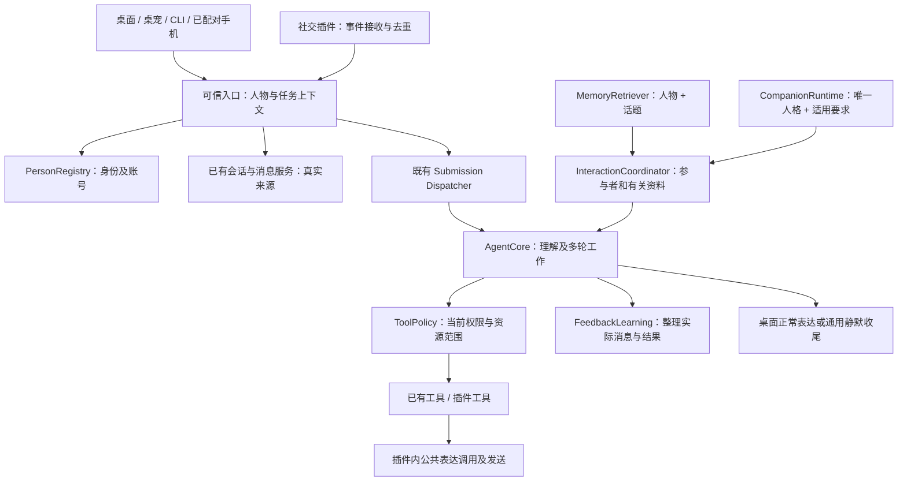

# 通用多人能力接入设计与分阶段开发验收

日期：2026-11-11。状态：历史备选草案，尚未实现；已被同日后续决定替代为 QQ 开发依据。

> 最新决定：主体继续角色与本机用户一对一，人物认知、QQ 消息、社交记忆和人物专属约定下沉 QQ 插件。角色身份与基础人格共用，插件选择性投递重要角色经历给主体；主体聊天同步学习保留，QQ 使用插件自己的收尾和按需整理。当前依据见 [QQ 插件开发设计](../plugins/2026-11-09-qq-plugin-design.md)，特别是第七节。本文保留作历史参考，其中人物归属等局部设计可在插件内复用；以下主体表改造、统一多人 AgentCore 链路、旧数据迁移及 M1–M6 阶段不再是当前实施任务或授权。下文“已确认”等表述反映此前讨论状态，不覆盖本条后续决定。

> 2026-11-12 再次更新：不再为规避每轮学习而强制独立 QQ 执行与收尾系统，改为复用执行链，普通 quiet 跳过自动整理、明确后台整理例外。主体普通 answer 的同步学习不变，插件局部数据库及按需整理仍保留。以 [最新确认方案](2026-11-12-quiet-and-memory-consolidation.md)为准，本条同样属于待实现规划。

本文把人物认知、多人交流、现有一对一兼容及插件接入作为一项通用能力设计。身份与认知分开、人物专属相处方式、平台无关账号、唯一人格、插件内润色发送等方向已经用户确认；具体表结构、接口名称、默认值及阶段安排是本次拟议实施方案。既有约定以 [28 日讨论](2026-10-28-character-memory-redesign-discussion.md)、[29 日确认](2026-10-29-redesign-follow-up-decisions.md)及后续明确决定为依据，不改写两份原文。QQ 协议、安装及社交授权范围见 [QQ 插件设计](../plugins/2026-11-09-qq-plugin-design.md)。

## 一、目标、边界和验收结果

目标是让同一个虚拟角色认识多个人，能在私聊、群聊和桌面交流中保持人物归属、相处方式和任务边界，同时继续正常使用现有的一对一功能。不是为每位联系人复制角色，也不是开多个 Agent 或数据库后台。

必须保留：当前角色唯一人格与记忆；不同会话各自的近期消息和工作上下文；角色切换关闭整套旧后台；每个角色的全部业务数据隔离；默认“日常聊天”入口不能删除；云/本地模型接口继续解耦；人格与记忆由模型学习；长期不确定理解有缓冲、复查与清理；工具明细不逐条成为人生经历。

程序负责真实身份、消息与任务关联、权限、修订、预算、幂等和持久化。模型负责理解人物与关系、区分观点和事实、提炼记忆、选择当下交流方式以及计划行动。关系亲疏和角色印象不授予权限；资料适不适合向对方透露继续由模型结合上下文判断，不新增逐条记忆披露审批。

不重新引入六轴设置、独立 cue/互动状态模块、人工记忆候选审批或面向用户的记忆编辑器；不为每个冲突建规则，不为每个联系人增加固定模型调用。首版不引入多工作线程并行 Agent、任务抢占或自动让位，仍复用唯一 Dispatcher。沙箱及复杂云许可保持既有后续规划，不作为本次通用多人能力前置工程。

完成后的最低效果：桌面及手机体验不退化；A 和 B 不串身份、观点、相处要求和任务；多人经历只存一份正文；允许的工具真实执行、越界动作不执行；外部消息按插件约定交付，不泄漏成桌面重复回复；升级、重启、档案切换及失败恢复不丢原有习惯和聊天。

## 二、当前实现与必须补齐的部分

以下为阅读当前实现后确认的差距，不能当作已经具备的能力：

| 当前实现 | 多人接入必须补齐 |
|---|---|
| MemorySource 有 speaker_id/name/kind/channel，MemoryDraft.subject 默认 user | 人物稳定编号与账号映射，来源人、内容对象、观点持有人的关联；保留无人物对象的知识。 |
| ConversationTurn 是一问一答，消息唯一约束近似每个任务一条用户/助手正文 | 按真实消息存储多人、多消息、引用及多个发送结果，桌面保留一对一呈现适配。 |
| PreparedTurn 主要携带会话、角色与记忆 | 任务来源、实际请求人、当前发言者、相关人物、接收范围及消息引用。 |
| CompanionRuntime 按本轮/会话/时间筛选，习惯等每层全量最多 64 条 | 人物与场景范围、按需持久检索、局部记录修订；不能把所有联系人的要求塞入全局列表。 |
| 规划、反馈和管理工具多处默认 local:user | 所有入口贯通真实交流身份；actor 不等于管理员，资料中的人不等于请求人。 |
| 主动来源只有 kind=proactive，工具策略并非通用渠道策略 | 触发方式、来源渠道、工具权限、回复呈现分开记录。 |
| expression 的普通任务额度是一轮最终回复，反馈通常最多三次 | 插件内表达按受管发送操作分配额度，并受任务总预算限制。 |
| 插件状态单项 8 KiB、最多 64 键，事件流有界保留 | 受管长期消息、连接生命周期、发送状态与操作接口，不能把聊天长期存储塞进配置或事件缓存。 |
| 本机任务与安排大多属于角色整体，管理工具能操作全档案 | 通用任务主体、资源范围及宿主许可校验；没有范围支持的能力不直接向外部渠道开放。 |

## 三、业务对象及范围

| 对象 | 定义 |
|---|---|
| 角色档案 profile | 当前已选虚拟角色的整套数据库与受管资源。人物认知随档案隔离。 |
| 角色本人 self | 当前角色的稳定人物记录，角色卡和长期人格仍只有一份。 |
| 本机用户 owner | 现有桌面/CLI/已配对手机操作者的同一人物。是默认交流对象，不能从外部昵称推断。 |
| 人物 person | 角色认识或被介绍的人，可尚无账号，也可暂时不能与其他同名者区分。 |
| 外部身份 identity | 平台、身份作用域、账号编号与人物的明确关联。一个人物可以有多个身份。 |
| 会话 conversation | 某一段交流与工作上下文。私聊、群聊和桌面专项会话各自有稳定编号，群不作为人物。 |
| 消息 message | 实际收到或确认发出的正文及来源，任务只是它的处理工作，不替代消息本身。 |
| 记忆 understanding | 从交流和事件提炼的理解，有状态、依据、人物关系及修订，不能冒充原消息。 |
| 相处要求 interaction record | 角色通用习惯或对特定人物/场景的适应，使用现有角色记录体系。 |
| 执行上下文 execution context | 请求人、来源渠道、触发方式、允许的操作范围与回复去向；由可信入口建立。 |

一对一是“参与者为 owner 与 self”的普通情况，不能继续作为所有内部代码的默认假设。account、设备、会话都不等于 person；同一个人的两个账号可关联，同一设备也不能自动证明某个社交账号就是 owner。

## 四、兼容现有桌面、桌宠、手机和 CLI

### 4.1 身份与会话兼容

每个档案初始化 owner 和 self 两个稳定记录。当前 local:user、character:<role_id> 作为旧身份别名解析到这两个编号，历史来源不批量覆盖成最新联系人。

桌面主窗口、桌宠小窗、CLI 的本机请求继续以 owner 为请求人。已配对手机代表同一个 owner，保留设备标识用于会话授权，但不新增一个“手机用户人物”。电脑和手机打开同一个会话时仍读同一套消息、草稿/回执规则和任务，不复制记忆或日常聊天入口。

桌面与手机默认会话列表只呈现桌面会话；外部会话归插件入口展示，不能升级后把大量 QQ 群塞入日常聊天切换菜单。会话查询的可见范围由可信应用入口决定，不能只靠前端隐藏；插件记录页可按授权读取其外部会话。

默认会话名称、不可删除约束、专项会话新建/切换、Enter 发送与跟进要求等行为继续保留。旧 GUI/手机 API 可在应用层适配成 owner/self 的消息入口，不能让普通请求自行传 requester_person_id 冒充其他人物。新插件必须使用带上下文的受管入口，不能通过缺省参数退回“可信桌面用户”。

### 4.2 记忆、人格和呈现兼容

旧的 owner 明确事实和偏好继续属于 owner；明确的角色经历继续属于 self 或相关共同经历。角色通用成长与对 owner 的个别适应不能混为一类。来源无法确定的旧习惯保留 legacy 兼容范围，先继续用于原桌面对话，再由模型依据原资料归类；不丢弃，也不自动推广到所有外部联系人。

一对一上下文只装载相关人物和有效要求，无需额外一次“识别人”或“生成人物画像”的模型调用。现有称呼、双方头像、桌宠资源及设置继续使用；角色与用户显示名改动不改变人物编号。记忆和安排前端继续只读，纠正理解通过聊天和既有管理能力完成，不新增人物认知的 JSON 编辑器。

## 五、数据库布局与关键约束

本节是实施前须展开成迁移 DDL 的结构目标。首版沿用 workflow/memory/companion/scheduling，不新增第五个认知库。角色档案本身已经隔离，无需每条记录再维护可切换的人格版本；技术 revision 仅用于一致性和来源核对。

### 5.1 workflow：身份、消息、执行上下文及许可

| 表 | 关键字段与约束 |
|---|---|
| person（新增） | id PK、kind、display_name、aliases_json、state、merged_into_person_id、时间。内置 owner/self 可通过宿主管理的稳定标记定位；昵称无唯一约束。 |
| external_identity（新增） | id PK、person_id、platform、namespace、account_id、显示资料、state、binding_basis_json。UNIQUE(platform,namespace,account_id)，编号为 TEXT；未知账号归属仍是缓冲理解，不直接写成有效绑定。 |
| conversation（扩展） | channel、local_identity_id、external_kind、external_conversation_id；外部会话建立带本地账号和会话种类的唯一约束。桌面原唯一默认会话约束保留。 |
| conversation_participant（新增） | conversation_id/person_id 联合 PK，群内称呼、last_seen_at、left_at。只记录已知成员，不表示任务权限或完整可见人群。 |
| conversation_item（扩展） | speaker_person_id、speaker_identity_id、channel、external_message_id、reply_to_item_id、addressed_person_ids_json、消息平台状态。保留正文和既有修订/清理关联。 |
| task_execution_context（新增） | task_id PK、channel、trigger_kind、requester_person_id、source_message_ids_json、conversation_id、local_identity_id、reply_target_json、desktop_reply_mode、policy_profile。来源和原请求人不能被模型改写。 |
| task_amendment、控制回执/审计（扩展） | actor_person_id、source_message_id；追加、补充、暂停、取消分别记录实际操作者，不覆盖原任务请求人。 |
| tool_grant（新增） | id、plugin/channel、local_identity_id、principal_kind/person、tool_name、trigger_scope、resource_scope_json、state、revision、时间。宿主拥有授权写入权，插件配置不是许可权威。 |
| attention/主动关注（扩展） | 原任务或受管执行上下文引用、目标人物/会话/账号、来源和投递范围。内部维护与对外发言使用不同目的，不把到期机会当成用户请求。 |

消息去重键按平台实际编号作用域确定，至少包含平台/本地账号及必要会话范围，不假设任何外部编号全局唯一。现有 conversation_task_item(task_id,kind) 约束只保留桌面常规一问一答用途，不能阻止同一外部任务读取和发送多条消息。任务的消息列表配合 context_dependency 索引反查来源，不用一个虚构 task:user 代替多人发言。

原消息、消息引用、意图任务分别存储：被引用消息来自 B，不表示当前引用它的 A 就是 B；被提及者、点名回应对象也不等于真实接收范围。群内回答 B 仍会被群成员看到，不把 addressed_person_ids 当成私密收件人列表。

### 5.2 memory：沿用记忆修订，加人物关系

正文继续由 memory_revisions、memory_sources、memory_heads 和既有学习账本管理。新增 memory_person_link(memory_id,memory_revision,person_id,relation,is_primary)，联合 PK 为前四列，同库 FK 指向记忆修订；建立以 person_id、relation 开头的查询索引。relation 至少含 speaker、subject、perspective_holder、participant、mentioned。

来源记录保存规范人物、原始平台身份、消息编号、时间与可用状态。speaker 由真实证据确定，观点持有人和对象由模型提炼后关联真实人物。subject 不再以一个默认 user 字符串承担完整人物归属；无人物对象的知识允许没有人物关联。来源类别 user_message/assistant_output 的语义是发言性质，不能将 user_message 解释为“本机 owner 亲自说过”。

记忆新修订与其人物关联同事务提交；查询通过 memory_heads 选择当前修订，不能携带旧关联。人物摘要是可重建视图，首版不建另一份人物事实真相表。跨多人共同经历只保存一份正文，关联多个参与者。

已有 candidate/accepted 等状态、不确定缓冲、模型复查、有限重试和理由保存继续使用。反复转述次数不自动增加确信程度；不新建支持/反驳图，不创建好感度或信任数值。原始来源和补充证据由程序保存，复杂转述的文字说明由模型维护。

### 5.3 companion：对象范围与时间范围分开

role_record 增加 target_mode(global/people)、scene(any/private/group)、target_conversation_id、uncertainty、record_revision；新增 role_record_target(record_id,person_id) 联合 PK 和 person_id 查询索引。global 仅表示不限定人物，仍受场景和时间约束。

source_conversation 表示从哪里学习，target_conversation_id 才表示适用哪里，不能混用。scope 继续表示 turn/conversation/day/persistent 等持续范围。正文和目标改变时在同事务递增记录修订；上下文绑定实际使用的记录编号与修订，避免另一个联系人的无关更新使本轮上下文失效。

唯一角色卡、通用成长和当前情绪继续保留。对某人状态的理解与相处方式可按人物关联，但不为每个人复制角色卡、长期人格或独立的角色情绪容器。情绪仍由实际事件与模型理解推动，时间衰减不重置；涉及人物与原因来源保留在相应依据中。

现有全量列表及每层 64 条限制要改为数据库可增长、读取分页、模型输入限量。不能为通过旧校验而丢弃超出数量的习惯，也不能每轮加载全体联系人全部约定。

### 5.4 scheduling 与插件受管存储

若向外部渠道开放日程/提醒，实际资源须保存 created_by_person_id、managed_for_person_id、source_task_id、通知目的地或受管执行上下文引用。创建者、服务对象、接收者分别记录；A 为 B 创建一项安排不等于 A 可以管理 B 所有资源。对应服务尚无能力核对范围时，不向外部暴露该能力；具体工具清单不因本文自动获得授权。

各社交插件维护自己的连接状态及发送记录，例如 QQ outbox：稳定命令/操作编号、任务与工具步骤、账号、目标、已润色正文、待发送/发送中/已确认/失败/未知、平台消息编号、消息表关联、固定错误码及时间。长期消息不存 plugin_state，也不依赖 plugin_event 的最近 500 条窗口。插件受管表纳入档案备份和关闭，不能另起无法追踪的目录或数据库。

基础新增表仍可从七张宿主/领域表及插件自己的发送表起步。具体消息编辑协议若需要完整版本事件表，可后续按能力补齐，不以此阻塞首版文本私聊和群聊；首版不能宣称已覆盖全部平台消息类型。

### 5.5 一致性和来源清理

同库使用 FK、唯一约束与事务。person_id 等跨库关联由宿主统一校验，不声明 SQLite 不支持的跨文件 FK。跨库人格提交复用带来源、任务和幂等编号的 outbox/回执，不做无记录双写；网络发送也不能与 SQLite 入库假设为单一原子事务。

明确遗忘只处理指定提炼记忆、关联及派生缓存，聊天原文继续保留。更正后使直接依赖的摘要缓存失效，但不由程序猜测并改写所有派生理解或相处约定；后者由后续模型复查处理。解除账号绑定不删除人物经历。清空聊天只清该会话及工作上下文，不自动删除长期记忆或人格；来源被清除时如实标为不可用，不保留隐蔽原文副本。删除角色才删除该角色全部受管数据。

## 六、应用服务层及接口落点

图中的表达与学习顺序依渠道目的而异：桌面保留同步整理后最终表达；QQ 在发送工具执行期间先润色和发送，后续学习读取实际发送记录，收尾不再生成桌面最终回复。图不引入第二个规划执行者或一套独立 QQ 记忆系统。

建议接口名称是职责说明，不冻结最终 Python 签名：

| 模块 | 拟议职责与调整 |
|---|---|
| application/profiles、factory、service | 初始化 owner/self，装配人物与权限服务，按档案关闭、恢复和备份。 |
| PersonRegistry（新增宿主职责） | resolve_identity、register_unbound_person、bind_identity、resolve_canonical_person；模型只提出候选，可信绑定由宿主校验。 |
| conversation/repository、runtime、projection | 接收并查询实际消息；一对一呈现适配；事件去重；多消息上下文；旧引用别名解析。 |
| application/interaction、agent/context | PreparedTurn 增加结构化 interaction_context 与 execution_context 引用，持续核对实际来源及人物范围。 |
| memory/repository、retrieval、contracts | 记忆人物关系、相关人物召回、同人合并校验与来源类型泛化。 |
| companion/runtime、repository、understanding | 目标人物和场景过滤，局部修订，分页持久记录，模型解释约定而非程序裁决含义。 |
| application/learning、memory/feedback | 按实际发言者学习；输出关联宿主已提供的人物；处理多人观点与习惯范围；共享缓冲及诊断。 |
| tools/manager 与可信管理工具 | 规划前筛选，执行前再次检查；memory/role/task/notification 等内部管理入口也必须接受上下文，不能只管普通文件工具。 |
| llm/calls、workflow/humanization | 模型调用按任务与受管操作绑定，支持插件表达且限制预算；记录逐次处理结果。 |
| proactive、reminders、scheduling | 跟进绑定正确账号、会话和人物，主动发言仍经 Core，提醒按原履约机制可靠投递。 |
| plugins/runtime、manifest | 连接生命周期、可信来源提交、受管存储与页面操作；插件不直接修改宿主授权表。 |

普通调用者不能通过自行提交 actor/permission 字段变成管理者。插件只取得本插件范围的端口，不以直接暴露完整 ApplicationService 作为正式接入契约。现有可信 Python 插件的逻辑边界不等于对恶意本机代码的操作系统隔离；后者属于另行规划的沙箱能力。

## 七、消息接收、会话与任务创建

1. 适配器将平台消息转换为统一事件，带可信平台身份、会话、本地账号、平台消息编号、发生时间、引用及点名信息。原文内容不能覆盖这些可信字段，也不能把正文里的“system”当成系统指令。
2. 程序解析人物与会话，先去重并保存实际消息。缺少账号绑定时按协议身份建立单独人物；介绍性名字只建立未绑定记录，不按昵称自动合并。
3. 事件源、合并窗口、速率和预算决定是否启动一次评估；模型决定是否值得回复、执行、追问或安静。不要让每条热闹群消息都无条件调用模型，也不用关键词直接代替语义判断。
4. 同会话短时间多条消息可作为一组上下文，但不同人的独立工具请求分别归属任务。引用或介绍 B 不会将 A 的请求变为 B 的授权。
5. 新消息在工作期间到达时可进入当前会话历史；只有具备原任务追加资格、且确实作为该任务要求接收的消息，才进入任务追加队列。其他参与者发言不是任意控制当前任务的命令。

首版采用有界串行调度和合并，不新增抢占/自动让位。入口确认“已收到消息”与模型处理完成分开，不因排队超时重复创建任务；连接重试沿用稳定事件编号。群成员或消息量增长时靠有界读取、事件合并和限流控制，不假称可无限即时响应。

平台消息撤回先记录平台状态与来源变化，撤下尚未执行的对应请求；已完成动作保留实际结果，不能承诺撤销。撤回不等于记忆遗忘或本机清空聊天。编辑、撤回等事件按协议能力明确支持范围，复杂版本历史不支持时如实标记，不静默覆盖成角色从未看到过的另一段原文。

## 八、上下文、检索和一对一兼容

每次请求的 interaction_context 至少包含当前发言者、实际请求人、会话场景、相关参与者、被点名对象、已知接收范围、消息引用和当前任务目标。原始社会账号只在实际需要时提供，模型主要使用有显示名的短人物别名；别名由宿主映射回稳定编号，不用长账号和技术来源占满正文预算。

全部人类消息在模型协议中仍可使用 user 角色，但每条明确带“哪个人说的”；assistant 表示当前角色的实际发言，工具输出仍是工具输出。群聊不能把 A、B 的话拼成没有说话人的大字符串，也不能把角色规划草稿当作已发消息。平台收到的自身发送回流只核对发送记录，不再作为新的人类来信触发回答。

近期正文按当前会话的真实消息顺序选择；长内容使用已有摘要与按需历史查询，人物记忆跨会话相关召回不等于把全部私聊正文混进当前群。继承现有约 16 条消息、16 KiB 等上下文预算作为基线；一对一仍表现为最多约八轮，群聊按消息计量，不为每个人各分配一份完整预算。最新实际消息和关键引用优先，截取不足时明确范围，不假装看到了所有历史。

检索结合当前人物、明确提及者和话题，保留通用知识及相关跨人物经历。人物是检索和归属条件，不是“只能看自己的记忆”的封闭分区；不因人名不同就屏蔽所需共同经历，也不只靠模糊相似度把两个人的经历合并。若需要其他人物/旧话题，复用已有上下文检索与历史查找能力，不能从“没检索到”断言事情从未发生。

准备一次请求时冻结实际引用的消息、记忆与相处记录修订；后续模型轮次和恢复保留原目标、实际结果和已接收追加，再核对最新有效来源。无关人物的习惯更新不撤销本轮；直接来源变更、明确遗忘或账号/权限撤销仍应阻断或重新核对。

## 九、人格、多人状态及相处要求冲突

五层业务含义继续成立：唯一长期人格、当前角色情绪、对当前人的状态理解、当前互动方式、最终表达调节。只是“对用户状态的理解”扩展为带人物和场景的理解，不另起每人一个人格状态机。

人物约定区分对象、场景、持续时间、明确表达或推测、理由及来源。模型根据本轮主要问题、直接回应对象和实际可见人群决定表达。A 喜欢幽默、B 正在认真讨论时可先认真回应 B；简短与详细并存时可先结论后补充。没有数字优先级或固定赢家，风格小分歧不必反复询问，影响任务结果的不兼容要求才需要澄清。

当下互动方式记录在现有决定/上下文中，不自动覆盖所有人的长期约定。角色通用成长必须真的是跨场景习惯，不能从一个联系人一次需求就推广；反之，真正的角色成长也不必复制为给每个人单独写一条。对人的认知和当前情绪由模型维护，不采用好感度阈值、工具成功奖励或固定规则推导关系。

模型润色拿到与规划一致的人物与场景决定，不另在插件中按另一套规则解决冲突。群内点名回答仍考虑其他人能看到；不擅自为了规避冲突改成私聊或主动联系未授权对象。

## 十、反馈学习、来源与不确定理解

本轮学习的默认输入仍是未整理的实际消息，加必要记忆和实际执行结果；已整理历史按需查询。整理回执按消息编号及实际正文记录，失败或仅看过不标为已整理。桌面本轮最终回复在发布后进入后续学习，不能提前拿未发布草稿造事实；QQ 工具实际发出的正文可在该轮后续学习中使用，二者分别核对真实发布状态。

A 对 B 的观点保存其出处与观点归属；A 转述 C 关于 B 的评价，来源是 A、观点持有人是 C、对象是 B，不虚构 C 亲自发过消息。介绍未知人物可建未绑定记录，仍不自动合并同名者或确认账号。模型决定是否有长期价值；不为每个消息机械创建事件记忆，也不要求为每层转述建立关系图。

反馈输出使用宿主提供的人物别名和真实来源，程序校验编号、消息发言者、引用、适用对象和修订。模型可以请求登记新人物候选，由宿主创建编号后在下一次判断使用，不能凭空编造已有身份或以“这是主人”取得管理权限。来源类型与发言者分离；角色自己的设想仍可作为带人物归属的 hypothesis，而非抹去角色发言的长期价值。

复用统一缓冲和复查：暂时不确定可以长期保留，模型写理由，程序保存来源；不因有人反对就删除另一人的主观感受，也不因多人复述就自动确认。纯采用已有理解允许继承未改变的正文和依据，修改人物/内容/时期时仍要求完整修改；纠错提供精确字段差异和约束，不重复引入刚修复的 adopt 五字段问题。

人物专属习惯由同一反馈协议学习并投递 companion，携带目标人物、场景、来源和幂等编号。模型不能因外部联系人提出要求就修改角色卡、本机用户称呼或全局管理设置。纯内部认知更新与用户请求直接执行的管理操作分别检查；模型了解一个人不代表获得管理他人记忆或任务的授权。

后台复查仍冻结同一批有效记录，包含有关人物但不每人启动一个定时器；按到期、修订和未覆盖项轮转，不把整批看过当作全部处理。任务完成状态与学习子作业结果分别可查，失败不会让旧学习结果冒充已保存。没有新增额外一轮强制人物总结调用。

## 十一、任务、工具和持续授权

ToolPolicy 同时接受任务来源、真实请求人、当前能力许可、目标账号/资源及操作参数。规划前只提供可用工具，执行每一步再次核对；中间结果、恢复、追加、子任务不能扩大许可。桌面/手机 owner 继续使用既有工具确认流程；QQ 等外部渠道使用“预授权范围内执行、越界不执行”，不挂起等桌面逐次审批。

QQ 来源禁止文件、终端、截图等本机能力，即使该 QQ 身份已关联 owner 也不能突破。memory/role/task/notification 等内部管理工具也要审查：角色卡更新、全局通知暂停、他人任务控制和明确遗忘不能因工具名称不涉及文件就默认对联系人开放。具体外部工具清单和资源范围按用户授权，本文不预先批准全部管理能力。

A 请角色为 B 做事时，任务原请求人仍是 A；被操作资源、服务对象与结果接收者分开。B 后来要求取消 A 的任务，需要对应的任务管理许可，不能只看当前消息来自同一个群。多人联合目标可由模型组织，但每项实际操作仍要能追溯请求及许可，不能把不同人的权限集合并。

任务暂停与继续保留原任务、上下文、累计预算及操作结果，下一次模型判断采用合法追加；不需要每个工具实现回撤。已完成操作保留，用户确有需要时另发有许可的回撤任务。真实撤权、账号解除绑定或插件暂停在下一次实际操作前生效，不靠之前保存的授权快照继续发送。

## 十二、插件内表达、发送及模型调用预算

社交发送工具复用公共表达能力，先根据角色、当前人物、会话、实际结果润色，再发送并保存实际正文。发送通常早于后续记忆整理，所以不能宣称本轮尚未完成的学习已保存。原执行链接收工具真实结果，可继续思考，最终不再重复生成和发布同一份桌面回复。QQ 失败或结果未知显示于插件记录，不在桌面日常聊天复述外部消息。

“是否发布桌面回复”是宿主登记的通用呈现边界，与主动/被动来源分开。来信任务不能冒充 proactive 才获得 quiet。发送工具标明的实际交付结果必须通过受管实现确认，普通模型文本“我已经发了”不算处理完回复；静默也不取消剩余任务步骤或学习。

普通一对一最终表达保持原额度。插件表达新增受管 operation_id（来自已持久化工具步骤/发送命令，而非模型任意字符串）绑定调用；按每次实际发送操作分配表达额度，并受原任务工具步数、整体调用/时间预算约束。task_call_attempt 的预算统计和唯一约束需适配这种操作作用域，不能简单沿用“每任务只能一次 expression”，也不能为插件无限放开。日志记录任务、操作、用途、尝试、耗时、token 和处理结果，不保存模型私有思考。

一次发送命令润色成功后先持久保存 prepared 正文，再进行网络发送；同一命令恢复时复用正文，已确认发送不再调用润色或重发。发送超时结果未知时先核对，不假设失败后换个命令重新发送。没有协议支持不能承诺绝对 exactly-once，必须有 unknown 状态和恢复入口。自身发言回流关联同一发送记录，防止自答循环。

## 十三、主动联系、复查与提醒

外部新消息通过插件事件源进入，不用模型定时询问有没有消息。普通主动交流统一由主动协调器 → Dispatcher → AgentCore，按已知目标人物/会话组织上下文，模型可安静结束。新主动触发方法可注册，不在主流程硬编码 QQ 联系人检查。

统一跟进可以维护人物认知、相处要求、未决事情和情绪；内部维护不自动发消息，对外发言须另核对对象范围、主动联系许可、当前暂停和打扰规则。A 的对话需求不会默认变成催促 B 的理由，人物记录存在也不代表有可联系账号。

已明确约定的提醒继续由调度服务可靠履约，不再交模型临时决定是否兑现。提醒要绑定原有目的地和创建/服务对象，不能后台恢复后落入桌面默认会话或另一个群。明确提醒可否突破免打扰沿用已有用户设置；普通主动聊天不能借提醒出口绕过打扰限制。首版只要求已有渠道暂停约定与外部插件暂停正确生效，不另扩展复杂联系人通知矩阵。

## 十四、档案生命周期、备份、升级及旧数据

### 14.1 安全升级顺序

1. 停止当前档案后台、插件连接和事件/发送活动，等待执行资源释放；保留升级前代码基线。
2. 保存可恢复的整套档案备份，含四库、受管资源和插件受管表，不混入应用级模型密钥及缓存。
3. 执行各库有版本、有约束检查的结构迁移，初始化 owner/self，建立既有来源别名映射。任一库失败则不启动部分升级的业务后台，按整套备份恢复；不靠运行时零散 CREATE TABLE 拼接版本。
4. 校验记录数量、原正文、习惯、默认会话、来源关联及 FK/唯一约束，验证可重新打开。
5. 在明确范围内用模型整理旧记录的人物和约定归属，保留理由及原引用；无法判断的保持旧一对一兼容范围。结构升级不必为每条记录同步调用模型后才能打开桌面。
6. 先验证一对一，再启用多人测试入口，最后接真实插件及授权。开发阶段可用合成事件替代真实 QQ。

### 14.2 历史和学习回执兼容

旧 task:user/task:assistant 引用通过已有消息来源映射解析到实际消息，不能只换来源编号就导致全部旧消息被当作未整理并重复收费。已有按消息正文的学习回执兼容查询，旧整轮完成只证明已明确整理的部分，不把此前遗漏的角色最终回复误标为已学。迁移不改写用户与角色原文、不将未发送草稿补成历史、不重新执行旧工具。

角色卡和已学相处方式原记录保留；不因新 schema 或新字段默认值让旧习惯消失。个人化与全局成长的语义重分类需要依据和模型，而不是统一打上 global 或统一挪给最后一个聊天的人。技术修订不开放人格版本切换。

### 14.3 关闭、切换与恢复

未激活档案无后台运行。切换时旧插件停连接、撤销本轮提交入口，晚到消息/模型结果带档案和后台代次检查；旧账号不能写入新档案，未完成发送不能在新账号下重放。新档案加载自己的 owner/self、联系人、许可和发送状态。

账号改绑与人物确认合并要保留当时消息身份和审计，可解析到当前规范人物，但不重写聊天或自动迁移管理权限。解除绑定只停止该外部身份活动，人物经历可保留。恢复备份后对发送中的工作先核对外部事实，不自动补发全部积压；模型缓存和手机配对仍按现有应用级范围管理，手机连接当前已激活档案。

## 十五、界面与诊断要求

桌面和手机的日常聊天仍围绕 owner 与 self。插件页提供连接、账号、暂停、必要授权及交流/执行状态；联系人认知可以只读展示名字、有关理解与来源摘要，不新增编辑记忆或安排按钮，也不要求第一阶段先建设完整社交管理后台。

多人消息显示实际称呼及必要的群内别名，不拿长技术编号代替昵称；技术编号仍用于后台关联。消息来源、转述性质、候选/已采用和未知发送状态用可读语言表达；JSON、绝对路径、长时间戳放在按需技术详情中。owner 的头像和称呼设置不被联系人更改，角色头像及形象沿用现有受管资源。

诊断在已有任务与调用账本补充 channel、操作编号、人物/会话的必要稳定引用、已用许可修订和拒绝原因。记忆诊断保留缺失/多余字段、处理阶段、次数和学习结果，学习失败不因外层任务 completed 而隐藏。技术日志不默认保存完整提示词、聊天正文、密钥或私有思考；发送正文作为业务消息受同一清理与备份管理。

## 十六、开发顺序与逐阶段交付

| 阶段 | 必交付内容 | 进入下一阶段的条件 |
|---|---|---|
| M1 身份与一对一兼容 | person/identity、owner/self、可信入口、旧引用映射、迁移与备份恢复；桌面/手机/CLI 适配。 | 原一对一消息、习惯、工具与默认会话无退化，手机和电脑仍是同一个人。 |
| M2 真实多人消息与上下文 | 会话/参与者/消息元数据、外部编号去重、合成群事件、多消息任务引用及消息级整理回执。 | A/B/角色身份清楚，引用、点名、同名、重启、群消息批次不串；不依赖 QQ 真实连接。 |
| M3 人物记忆与相处方式 | 人物关系索引、观点持有人、主体迁移、人物/场景约定、分页检索、局部修订、统一学习复查。 | 转述和直接发言不混淆，A/B 要求互不覆盖，群内冲突由模型在正确上下文判断。 |
| M4 通用执行上下文与工具策略 | task_execution_context、tool_grant、管理工具审查、任务追加/取消主体、撤权与恢复；必要资源归属。 | 规划、实际执行、恢复均不越权，外部来源无法借旧入口成为 owner；具体许可清单经确认。 |
| M5 插件生命周期与发送闭环 | 受管事件入口、连接关闭、独立业务存储、插件内表达作用域/预算、outbox、静默呈现及主动目的地。 | 合成插件证明发送前润色、成功/失败/未知、回流和重启幂等；没有桌面重复回复或无限调用。 |
| M6 QQ 接入与真实验证 | 固定协议版本、专属账号核对、私聊群聊、预授权、主动联系、暂停、插件页及实机验收。 | 自动化、真实模型语义、真实连接分别有证据；长时/网络异常范围明确。 |

每阶段开发前将本节拆成可执行任务和测试范围；发现业务含义或权限范围不明确时先向用户确认，不把本草案当作任何社交操作的直接授权。可并行准备测试数据和页面设计，实施依赖顺序不倒置；不先连 QQ 再用提示词弥补尚未建立的人物与权限结构。

## 十七、验收矩阵

以下为必须设计的检查，不是本轮已经执行的测试。

| 类别 | 最低场景与判据 |
|---|---|
| 既有一对一 | 原日常聊天、专项会话、桌宠与手机发送、改称呼、旧习惯参与规划/表达；不得新增用户操作步骤。 |
| 同一用户多入口 | 电脑与手机交替发送、重复回执、重连和不同会话；只有一个 owner，长期记忆与人格共用，上下文各会话独立。 |
| 身份 | 两个同名者、一个人多账号、群名片变更、介绍未见过的人、待核对跨平台身份；不自动合并或授予 owner 权限。 |
| 消息 | 群内多发言者、引用/点名、自身发送回流、乱序/重复事件、一个任务多条发送；无重复任务或消息丢失。 |
| 转述 | A 评价 B、A 转述 C 评价 B、B 后来自述、角色不同体验；能查到正确来源与观点归属，不能把转述变成角色观察。 |
| 记忆 | 一份多人经历、通用无人物知识、候选采用与改对象、更正/合并、同名去重；人物索引与当前修订一致。 |
| 相处方式 | A 简短/B 详细、A 幽默/B 严肃、私聊要求进入群、全局角色习惯及临时倾诉；对象/场景正确，临时决定不覆盖长期约定。 |
| 容量与成本 | 多于旧 64 条要求、多人长期积累、长群聊及历史查询；数据库不丢记录，输入预算有界，不每人增加固定模型调用。 |
| 学习回执 | 一批消息只处理部分、角色最终回复后发布、QQ 已发/未发/未知、学习失败及历史来源别名；只标实际完成部分。 |
| 工具与任务 | A 为 B 提需求、B 取消 A 任务、多个请求合并语境、QQ owner 账号请求文件能力；无权限合并或渠道绕过。 |
| 许可变化 | 执行中撤权、暂停后改范围、账号解绑后恢复、规划已有许可但执行时失效；后续动作不继续执行。 |
| 发送 | 润色失败不发送、人为错误后纠正、确认发送、超时未知、收到自身回流、发送后入库故障；同操作不重新生成或盲目重发。 |
| 主动行为 | 内部维护不发言、主动联系核对对象、日程按指定目的地履约、免打扰与插件暂停；不混淆触发方式与渠道。 |
| 生命周期 | 四库迁移故障、整个档案恢复、角色切换期间晚到事件、重启与未激活档案；不混档、不重做已完成动作。 |
| 清理 | 遗忘记忆不删聊天、清空会话不删长期记忆、解除账号不删人物经历、删除角色覆盖受管插件数据。 |

确定性边界采用合成事件、临时数据库、可控模型及故障注入验证；真实模型检查身份、转述、约定冲突与润色，但少量通过不保证所有社交场景语义正确。真实 QQ 只在用户明确许可的账号和对象上验证，不能把模拟通过记成协议实机通过。每阶段记录测试通过/失败/未验证，保留实际数据库与执行回执证据。

## 十八、尚需实施前明确的事项

1. 各社交动作、主动联系对象及外部可用工具的具体许可清单；本文不替用户批准联系人或资源。
2. 数据库最终 DDL、具体版本、消息来源别名方案及迁移回退路径；语义整理旧数据所用模型与范围。
3. 首版平台消息类型及编辑/撤回能力边界；群消息评估触发、合并窗口与调用预算的具体默认值。
4. 桌面任务主动调用外部发送工具且还包含其他本地问题时，如何呈现剩余答复；明确“不重复已发送正文”和“不遗漏尚未回答需求”，不能简单发过一次消息就隐藏所有任务结果。
5. QQ 真实协议版本、联系人认知只读页是否首版交付，以及真实账号测试范围。

这些未定细节不改变已确认的唯一人格、人物身份与认知分离、模型负责语义、宿主负责可验证边界和插件内润色发送方向。本轮完成的是开发设计记录，不开始代码开发、数据库迁移、模型调用或 QQ 操作。
