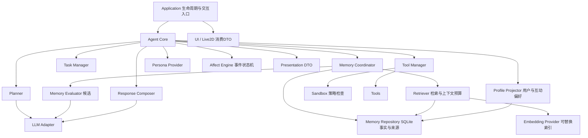

# 记忆、人格与情绪机制设计

2026-10-22 补充：当前 V0.8 已实现有限人格/情绪并完成有明确边界的[最小测试](../../versions/v0.8/test-report.md)。新的[拟人化优化方案](../v0.8/humanization-proposal.md)、[代码组织](../v0.8/humanization-architecture.md)和[实施/验收计划](../v0.8/humanization-delivery-plan.md)以实际源码为基线细化尚未实现的能力；它们仍为设计提案。本目录以下内容保留早期长期设计及其历史状态，不据此推断当前交付能力。

范围更新（2026-10-19）：V0.7 改为静态图片桌宠，Live2D 推迟到正式版后的更新；本文的 UI/Live2D 图示为长期设计，不是当前实现或本版要求。当前表现层见 [V0.7 验收边界](../v0.7/acceptance-boundaries.md)。人格/情绪仍属于 V0.8，不因此提前实现。

状态更新（2026-10-15）：**本文是基于 V0.2 的长期设计提案；部分记忆机制已在 0.3.0 实现，其他机制仍未实现**。实际契约见 [V0.3 接口](../../versions/v0.3/interfaces.md)、[交付](../../versions/v0.3/delivery.md)与[验证](../../versions/v0.3/test-report.md)。下文“基于当前实现”的表格是 2026-10-14 V0.2 快照，不描述当前源码。

| 提案机制 | V0.3 实际对应 | 仍属未来设计 |
| --- | --- | --- |
| 来源化记忆 | MemorySource/Draft/Item、schema v2、legacy 隔离、CAS 审核与更正 | 完整来源 span/派生依赖 DAG、跨事件总结 |
| 检索/时效/遗忘 | global/local owner 资格过滤、词法+真实 CPU 语义、as_of、衰减排序、七天候选 TTL、共享来源闭包删除 | 长文分块、多语言/大规模索引、accepted 自动遗忘策略 |
| UserProfile | preferred_name/reply_language/verbosity 三项明确偏好投影 | 完整关系画像、自动推断个性、RelationshipProfile |
| 请求上下文 | 单次请求有界证据 bundle 与 revision/epoch、Waiting 依赖失效 | 多轮 WorkingContext |
| 隐私/管理 | local_only 出云过滤、CLI 导出/审核/更正/删除、关联 Task 擦除 | 全链路 incognito、importer、历史日志/备份擦除 |
| 人格/关系/情绪/表现 | 权限隔离作为约束保留 | Persona/Affect/Relationship Engine、Presentation DTO、UI/Live2D |

accepted 不等于客观真实；语义分数不等于真实性。下文总体设计图包含未来节点，不能据此推断都已实例化。

状态：**架构提案，未实现、未冻结 API、未完成效果验证**。日期：2026-10-14。适用基线：V0.2。本文只规划后续机制，不改变当前运行行为。

## 设计结论

采用“有证据的记忆 + 可解释的用户画像 + 稳定的人格设定 + 可控的关系偏好 + 事件驱动的短期情绪”。五者分开存储和更新，由 Core 组装为一次交互的只读快照。事实、工具结果、任务状态和授权拥有独立权威来源；人格与情绪只影响允许的表达和表现。

长期陪伴感来自记得正确、能被纠正、行为连贯和尊重用户习惯。不能用保存全部聊天、无限累加好感度、随机改变情绪或一段不断增长的 system prompt 代替这些机制。模型负责语言理解和候选提取；规则与事务负责确认、权限、时效、删除和状态更新。

文档分工：

| 文档 | 内容 |
| --- | --- |
| [记忆机制](memory.md) | 分层、数据契约、写入/确认、更正、检索、遗忘、删除、隐私与迁移 |
| [人格与情绪](personality-emotion.md) | 人格、关系、用户情绪线索、状态动力学、表达约束与交互示例 |
| [集成与验收](integration-and-acceptance.md) | 模块接口、请求时序、事务/失败、版本分工、指标与反例测试 |

## 基于当前实现的判断

以下是本轮读取源码得到的事实，不将路线图中的计划算作实现。

| 现有证据 | 当前能力与缺口 | 设计响应 |
| --- | --- | --- |
| [memory/models.py](../../../src/deskpal/memory/models.py) | 五种 kind；importance/confidence/decay_rate 存在，confidence 默认 1；没有来源、审核状态和版本链 | 保留分类兼容，拆分声明类别、生命周期和证据资格；旧分数不能证明真实性 |
| [memory/manager.py](../../../src/deskpal/memory/manager.py) | SQLite schema v1；同 ID 覆盖；LIKE+新近排序；查询更新 last_access；删除一行 | 增加修订、来源、投影与索引失效；访问不等于巩固 |
| [agent/core.py](../../../src/deskpal/agent/core.py) | Observe 无匹配时使用最近五条；“记住”正则保存 semantic；工具记忆为请求与显式工具结果 JSON 截断；普通聊天不自动保存 | 检索允许返回空；结构化事件保留否定与失败；显式记忆操作有独立路径 |
| [planner/llm_planner.py](../../../src/deskpal/planner/llm_planner.py) | 只传记忆 content，拼到 system，附不可信提示 | 上下文带来源/状态/时间，作为独立数据区；提示隔离之外仍做结构化约束 |
| [application/factory.py](../../../src/deskpal/application/factory.py) | Core 同步串行；Task/Waiting 进程内；SQLite Memory/Scheduling 分库；ExitStack 管理资源 | 依赖注入、单写者、明确事务；不假设跨库原子性或持久任务 |
| [execution_log](../../../src/deskpal/execution_log/__init__.py) | 日志含请求、计划和结果；凭据键脱敏不能清除正文中所有秘密 | 新记忆删除必须声明日志/备份范围；隐私模式需要日志入口一起支持 |

V0.2 已提供可复用的基础：工具确认绑定私有原计划、普通/高风险授权分开、工具结果结构化、DTO 快照、数据库生命周期及离线测试。应在这些边界上演进，无需更换整个 Agent 框架。

## 五种状态的含义

| 状态 | 回答的问题 | 主要更新来源 | 时间尺度 |
| --- | --- | --- | --- |
| Memory | 用户说过什么，系统观察到什么，当时发生了什么 | 有来源的消息、工具结果、用户明确修订 | 一次事件至长期 |
| UserProfile | 当前哪些用户偏好/事实可用于个性化 | 有效、允许使用的记忆投影 | 天至月，明确更正立即生效 |
| Persona | 桌宠以何种稳定方式表达 | 版本化预设与用户设置 | 持久，禁止对话自动漂移 |
| RelationshipProfile | 用户允许怎样称呼、互动和提及共同经历 | 明确互动偏好及其来源 | 持久、可撤销 |
| AffectState | 当前适合怎样的语气/表情强度 | 经校验的新事件、时间衰减、用户重置 | 秒至小时 |

UserProfile 是关于用户的资料，Persona 是角色设定，RelationshipProfile 是互动约定。它们不能共享一份可被模型任意编辑的自由文本。用户当前心情的推测另存为短寿命 UserAffectCue，不加入长期人格标签。

## 架构与信息流

箭头表示调用依赖；Tools 仍由 Tool Manager 在 Sandbox 检查后执行。图中的 Presentation DTO 经 Application 传给 UI，Core 不导入 Qt/Cubism。Persona/Affect 不拥有 Tool Manager、权限或事实仓库写入能力。可用 UserProfile 为规划提供明确约束，例如输出语言、工作区内用户指定的目录偏好；原始人格数值和情绪状态不进入执行决策输入。

响应由“已核验内容”与“表达策略”组合：任务成功/失败、工具参数、确认风险等内容由结构化结果决定。普通聊天允许风格生成；执行结果的关键字段由可信模板或结果卡片呈现，避免依赖一次 LLM 改写后的语义检查来保证真实性。

## 必须保持的约束

1. **保存资格不等于真实性。** accepted 表示通过持久化/使用规则；用户自述、工具观测、外部材料和模型假设仍带不同标签。
2. **每个可使用的长期断言都有来源和时间语义。** task_id 单独不能当证据，摘要必须可追溯至受保留策略管理的来源。
3. **旧事实不会被相似度复活。** 更正、删除、时效、可见范围先于排序；派生画像和摘要同样受约束。
4. **记忆不能给自己授权。** 记住“以后随便删文件”不产生 ToolContext 授权；关系熟悉度和情绪也不能授权。
5. **模型自己的回答不是独立证据。** 重复提取、重试和检索不增加事实可信度、不重复增加情绪或关系计数。
6. **控制权明确。** 用户可查看来源、更正、停止记忆、限制外发、重置人格/关系/情绪；静默或长期离线不触发惩罚。
7. **失败分层。** 工具已经完成后，可选记忆提取/情绪/动画失败不应诱导重做工具；显式记忆写入失败必须明确报告。
8. **跨版本渐进交付。** V0.3 先完成记忆与画像；人格情绪的运行实现继续按 V0.8 计划，接口设计不等于提前交付。

## 从既有研究吸取什么

以下仅支持设计思路；本项目具体协议、公式、阈值和发布门槛均为工程建议，不是复现论文结果或心理学诊断模型。

| 一手资料 | 借鉴 | 本项目的取舍 |
| --- | --- | --- |
| [Generative Agents，2023](https://arxiv.org/abs/2304.03442) | 记忆、检索、反思协作支持连续行为 | 摘要和反思保留证据链；不照搬“所有经历都永久保存”，不让反思自动升级为用户事实 |
| [MemGPT，2023](https://arxiv.org/abs/2310.08560) | 区分长期存储与有限上下文，按需搬运信息 | 上下文是有预算的临时视图；模型可提出检索/记忆候选，状态修改由受控服务执行 |
| [LongMemEval，ICLR 2025](https://arxiv.org/abs/2410.10813) | 同时评测提取、跨会话、时间、更新和无法回答 | 验收不能只有向量相似度或“还记得我的名字”；增加更正、无答案、过期和误召回 |
| [EMA，2009](https://stacymarsella.org/publications/abstracts/MarsellaCSR09-abstract.html) | 围绕事件意义及其变化建模情绪动态 | 用可解释事件规则驱动状态；先采用小模型与确定性衰减，不让 LLM 每轮自由修改情绪数值 |
| [BGE 官方模型说明](https://huggingface.co/BAAI/bge-small-zh-v1.5) | Query/passages 处理有区别，相似度阈值需用实际数据校准 | 沿用中文 CPU embedding 候选；相似度只做相关性，不判断事实真假或情绪可信度 |

本设计也参考原始交接文档的五类记忆与 formal/humor/initiative/patience、energy/satisfaction/affinity/mood。保留其产品意图，但将混合了权限、关系和短期状态的变量重新划界，详见人格与情绪文档。

## 推荐默认策略与取舍

V0.3 默认仅显式记忆与最小工具事件；用户启用自动抽取后只产出候选，普通对话不弹逐条确认。明确“记住/更正”在意图和内容无歧义时直接作为该项保存指令，给出可撤销回执。候选在用户主动查看记忆时集中审核，CLI 阶段也提供入口。该策略会少自动记住一些信息，但更容易纠错和说明依据；以后可增加用户主动开启的低敏偏好自动接纳模式，须独立评测，不作为 V0.3 默认。

初期继续 SQLite 与本地 embedding，无需图数据库、独立向量服务、人格微调或专用情绪模型。优先做可信数据与可解释规则，再以实际检索/体验基准决定是否增加 reranker、知识图谱或学习式情绪评估。

关联规划：[总路线](../roadmap.md)、[V0.3 开发计划](../v0.3/development-plan.md)、[V0.3 验收边界](../v0.3/acceptance-boundaries.md)。
