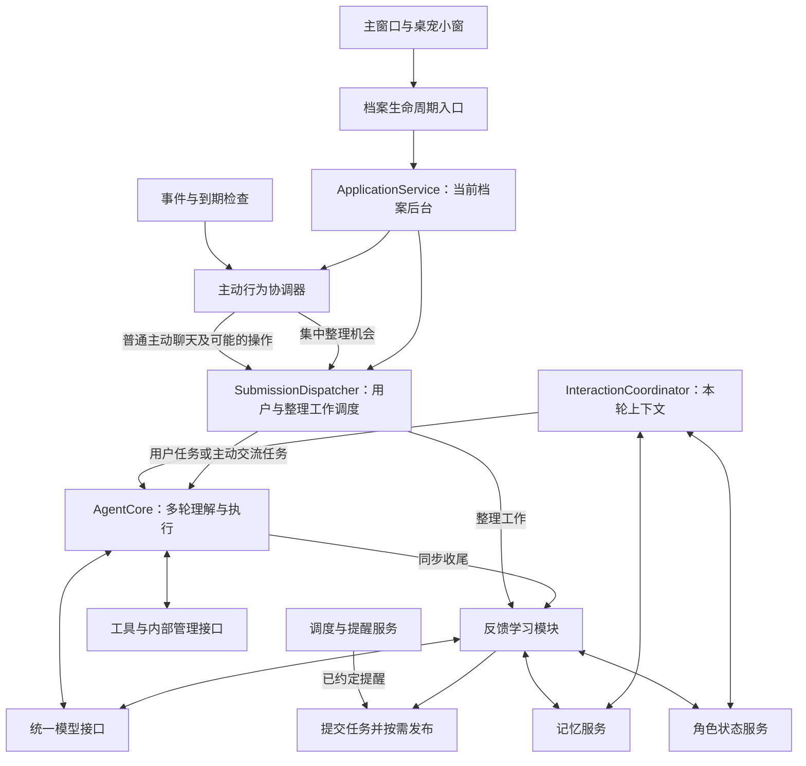

# 公共架构、数据归属与接口契约

日期：2026-10-29。状态：公共目标契约，P1–P5 实际交付范围以各阶段实施记录为准，P6 待实施。适用于本目录全部阶段；名称为语义约定，不冻结具体 Python API 或 SQL。

## 应用服务层

本轮反馈整理由 Core 直接调用接口并等待结束，不把它排回当前单工作线程再同步等待。主动集中整理可作为独立工作排入调度器，初版串行执行、无抢占。明确遗忘直接作为当前任务的管理操作，不等主动整理。

普通主动聊天统一经主动协调器、Dispatcher、AgentCore，不再由协调器直接调用模型生成并发布聊天。协调器提交关注事项、理由与真实来源；AgentCore 复用统一上下文、模型、多轮工具和同步反馈收尾，并可决定保持安静、延期或结束关注。任务明确标记为主动来源，不能伪装成用户新指令或借此取得许可。安静结束只提交必要工作记录，不制造空聊天或虚构用户消息。纯内部整理仍走反馈模块，约定提醒仍由调度履约；真正发主动消息前仍核对暂停、代次和去重。

ApplicationService 管理实例、装配关系和生命周期；具体持久化由领域服务负责。模型适配、工具执行、记忆和界面保持接口边界，不新增第二个执行 Agent。界面通过现有 Bridge/Facade 进入应用层，不能自己连接数据库。

## 现有代码的主要落点

| 当前部分 | 目标调整 |
|---|---|
| `application/factory.py`、`service.py`、`instance.py` | 按档案创建和关闭整套资源，可靠切换与恢复。 |
| `application/dispatcher.py`、`agent/core.py` | 多轮任务、追加要求接收、同步整理、集中整理调度；P5 补充用户主动暂停及继续同一任务。 |
| `application/interaction.py`、`agent/context.py`、`conversation/*` | 统一上下文、双方历史、范围和摘要；保留来源校验。 |
| `llm/calls.py`、`workflow/humanization.py`、`planner/*`、`response/*` | 多次调用、阶段化输入输出、替换旧信号协议。 |
| `memory/*`、`companion/*`、`application/effects.py` | 简洁缓冲、模型反馈、四项情绪、习惯、删除和修订；去除旧规则含义计算。 |
| `proactive/*`、`application/reminders.py`、`scheduling/*` | 检查时机与通知控制，提醒履约不依赖模型再次决定。 |
| `maintenance/*`、`assets/*`、`gui/*` | 档案维护、资源配套、接口迁移和用户可读交互。 |

## 数据归属与最小技术元数据

正式存储布局及升级约定见[数据库结构设计](database-design.md)：当前 workflow 6、companion 4、memory 3、scheduling 1。P5 新增暂停控制、通知策略及关注记录，见[实施记录](phase-05-proactive/implementation.md)；2026-11-03 追加逐次模型调用诊断。以后扩展须由各库存储入口执行有版本的事务迁移，业务服务只读取／写入已初始化的结构。

一个档案包含 `workflow.sqlite3`、`memory.sqlite3`、`scheduling.sqlite3`、`companion.sqlite3` 及其应用管理资源；新结构尽量复用现有数据库，不为每层建立一个新库。模型缓存等可复用安装资源不属于角色经历；凭据沿用现有安全引用方式，不写入普通数据回执或备份正文。配置与凭据范围由 P1 明确清单，不能改变“所有角色业务数据库独立”的要求。

后台每次打开有独立生命周期标识。任务、请求、追加要求、模型结果与界面回执绑定档案及该次后台，晚到结果不能投递新后台。角色显示名不是主键。

| 记录 | 最少需表达的技术关联 |
|---|---|
| 本轮上下文 | 档案、后台代次、会话及序号，角色状态修订、相关消息／记忆引用，本轮适用要求。 |
| 任务来源 | 区分用户请求、主动交流和内部整理，记录目标及真实依据；主动机会不是用户指令或工具授权。 |
| 模型调用 | 所属工作、用途、思考轮次、尝试序号、输入来源修订、调用结果状态。只记录必要摘要和引用，不保存完整私有思考。 |
| 工具步骤 | 稳定步骤标识、参数快照、权限确认关联、执行状态及真实结果，所属轮次。 |
| 追加要求 | 所属任务、顺序、内容、已被哪次模型判断纳入；去重接收标识。 |
| 任务暂停控制（P5） | 原任务与档案归属、去重请求、正在暂停／已暂停状态及修订、已完成结果与进度、待采用要求、授权等待及累计预算。暂停与恢复有持久记录，不保存模型私有思考。 |
| 整理工作 | 所属档案、来源范围与修订、发起／完成、尝试次数、结果引用。不是新的记忆业务类别。 |
| 记忆和缓冲 | 现有稳定标识、修订及时间；五项业务内容配简单真实来源列表，不建立支持／反驳关系图。 |

单库内原子事务落实相邻状态更新；跨库通过可重复的步骤和必要回执恢复，不假定四库有一个跨连接事务。锁不跨模型调用持有。确定性修订检查由程序完成，含义冲突交给模型；明确遗忘、失效或错档案的结果不能直接提交。

## 五层业务含义

| 层 | 保存与使用原则 |
|---|---|
| 长期人格 | 用户角色卡及渐进学习的局部习惯；稳定身份不随每次反馈重写，参与规划与表达。 |
| 角色当前情绪 | 描述强度、原因来源、发生时间及持续范围、不确定性；模型理解事件，程序保存及平滑表现。 |
| 对用户状态的理解 | 自述或暂时推测分清，保留范围、依据与期限，不复制成角色情绪。 |
| 当前互动方式 | 当前怎样交流，按会话或明确扩展的范围读取；不因长期记忆跨会话就自动传播。 |
| 表达调节 | 本轮如何说和表现；按前几层生成，不长期重复保存同一份派生约定。六轴仅可作内部兼容。 |

不要求五层各调用一次模型，也不要求五个独立服务。P2 建立读取和保存边界，P4 实现学习更新。

## 模型和操作的公共返回语义

模型决策表达继续操作、需用户补充或完成回答。操作结果至少分清成功、失败、结果未知和无变化；执行完成不证明返回文本里的外部断言真实。模型不能自己修改工具的权限等级。

自然语言内部管理与界面管理调用同一服务。明确记忆修改本轮落实；自动推测进入缓冲，不声称已经验证。普通聊天可直接形成回复草稿，所有聊天回复统一经过表达润色；此前允许省略润色的描述以 2026-10-30 用户纠正为准。2026-11-01 真实调用修补将最终润色放到同步反馈提交之后：规划草稿 → 同步提炼与实际提交 → 带真实学习回执的最终表达 → 提交任务并发布。反馈仍在发布前串行完成，不转为后台并发，不把草稿承诺当作保存成功。同日用户进一步确认：提示词模式正式输出自然语言正文，原生 JSON 模式才严格解析回复外壳；两者均只做一次最终表达，仍通过任务网关、隐私检查和禁止工具边界。中间尝试的提示词 JSON 格式纠正及两次表达预算已撤除，不用“接受不合规文本作为 JSON 回退”混淆两种正式协议。内部规划与反馈结构化协议保留。

新增需许可的实际操作展示准确参数；等待时保存相应步骤，确认只适用已展示内容，不能扩张到之后所有步骤。低风险和需许可的分级在 P3 形成明确表，而非按角色性格选择权限。

2026-11-02 聊天承接补充引入前文线索检索及共享摘要；2026-11-03 将其独立理解调用合入首次规划：先按原句读取记忆，再把角色、近期原文、有效摘要交给首次规划，同时形成交流要求和可选的带来源补查线索。有补查时先取资料，再判断行动；首份提议不执行。可选理解无效时保留原设置并给出提示，沿有效原资料再判断；来源撤销或修订冲突仍阻止晚到提交。主机保留完整修订和删除索引，只向模型提供紧凑视图。普通成功聊天为首次规划、同步学习、最终表达三次调用，工具多轮、补查及失败修正另计。澄清仍经最终表达、不提前学习；每个已结束的澄清决定允许下一次答复额度，普通无澄清任务仍一次，总上限九次。详见[聊天承接报告](../../reports/2026-11-02-conversational-continuity.md)和[开销优化报告](../../reports/2026-11-03-request-cost-optimization.md)。

P5 新增用户主动暂停任务：独立入口登记意图，程序在下一次模型判断前保存进度、实际暂停并释放执行线程；已开始调用及已决定步骤组允许完成。恢复同一任务，结合最新状态及追加要求再判断，不重放已完成步骤、不重置预算、不自动授权。暂停跨重启保留，追加要求不自动恢复；取消后不可恢复。与通知暂停、授权等待及学习自动让位分开，具体边界见 P5 开发验收。

## 清理的优先约定

清空聊天只清正文、摘要和会话临时状态，长期记忆保留，原文引用标记不可用。明确遗忘只删除指定记忆及其旧版本、索引和对应学习正文；来源关系不作为级联删除依据，聊天原文、同轮其他记忆、人格及执行记录保留。可能受影响的理解交给后续模型复查，不按来源任务批量擦除。记忆页只读，修改通过聊天中的管理接口落实。删除档案前关闭后台，删除其全部角色数据。取消任务停止后续步骤，不要求工具中断和自动回滚。备份恢复可带回备份时间点的数据，必须说明实际范围，不能宣称它等于撤销外部操作或彻底擦除外部副本。

## 2026-10-30 补充契约

遵照[完整补充确认](../companion-model/2026-10-29-redesign-follow-up-decisions.md#十一2026-10-30-补充确认任务上下文统一复查与情绪变化)：任务所有后续判断与恢复按持久引用恢复有效记忆，复用原执行账本、追加要求与会话上下文；复查触发与执行使用同一冻结批次，完成与尝试分开记录并轮转覆盖到期事项。模型安排的内部维护和可能的主动交流共用关注存储与 Dispatcher，前者调用反馈学习、后者进入 AgentCore，不另建情绪模块。情绪仅按真实更新时间计算影响衰减，语义与是否续期由模型判断。新增要求分别在 P3、P4、P5 的补充验收中验证，不计入旧通过数。

## 内置插件接口

插件清单声明稳定 ID、接口版本和可选的事件源、存储、页面能力。可信工具使用 `register_plugin_tool` 登记归属，沿用工具管理器的参数校验、授权和审计。基础工具、工作区文件、屏幕截图、日程与计时器、助手管理是当前的五个提供方。工具目录按提供方筛选，历史任务继续按原工具名执行。

`PluginRuntime` 绑定当前档案的工作流库。`PluginData` 以插件 ID 隔离状态，允许声明存储的插件保存有界 JSON，使用修订号处理并发更新。事件按插件和事件源分流，生产者用稳定 ID 投递，消费者用序号拉取。每个事件源保留最近 500 条，去重覆盖保留窗口。游标落后到窗口之外时，消费者需重新同步。日程与计时器复用已有提醒泵，把到期事件与收件箱、消费游标一起提交。插件事件只记录到期引用，页面通过提醒接口读取当前名称。

插件可注册宿主渲染的页面。首版支持布尔选项和有界的记录列表，前端只能写该页声明的选项。日程页的筛选偏好随档案持久保存。工作流库版本 8 新增 `plugin_state` 和 `plugin_event`，沿用打开档案时的事务迁移和现有备份。当前宿主在档案启动时装配可信插件。第三方安装、运行隔离和动态启停属于后续能力。
