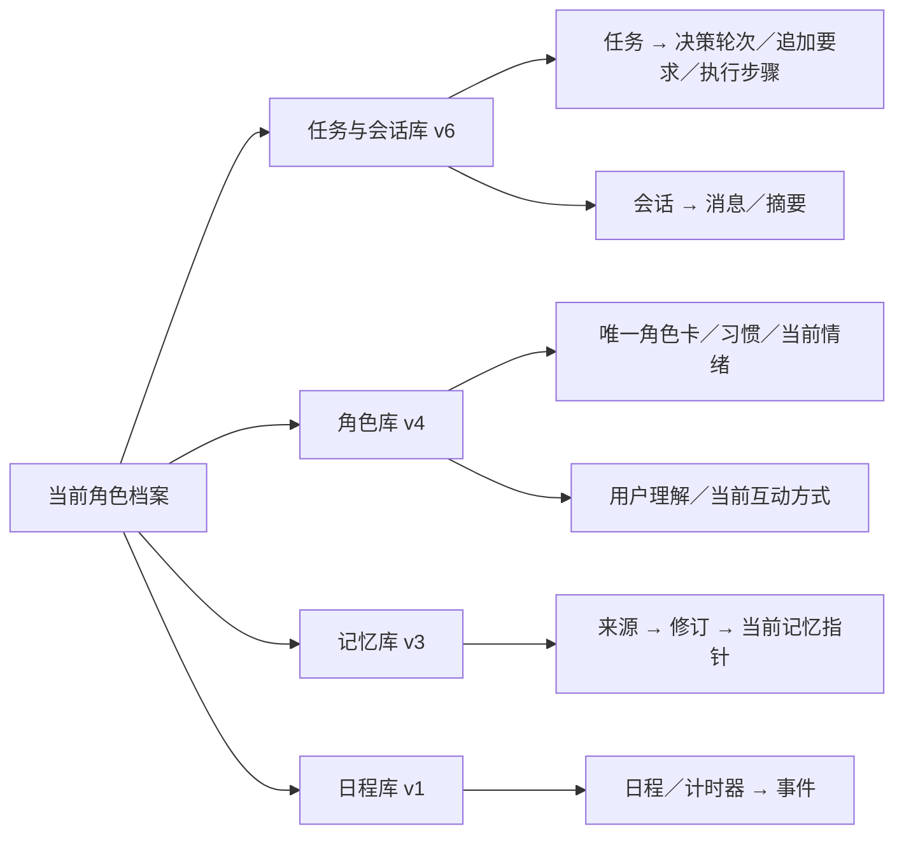

# 当前功能的数据库结构设计

2026-10-29 设计，2026-10-30 完成首次结构整理，并随 Phase 04 增补记忆库升级。首次整理覆盖 P1–P3；P4 实际结构和验证另见[实施记录](phase-04-memory-learning/implementation.md)。2026-11-03 当前版本为 workflow 6、companion 4、memory 3、scheduling 1，不恢复人工候选审核流程。

## 四库归属

继续每个角色一套四库：`workflow.sqlite3` 保存任务、执行账本、会话和来源；`companion.sqlite3` 保存唯一角色及其状态；`memory.sqlite3` 保存长期记忆；`scheduling.sqlite3` 保存日程和计时器。各库由自己的存储模块负责事务和升级，应用工厂管理生命周期；跨库关联保存稳定 ID，由应用校验，不伪造 SQLite 跨库外键或跨库原子事务。

记忆库已有来源、不可变修订、当前指针、删除标记和检索缓存；首次整理保留 schema 2，P4 再以正式迁移升级为 schema 3，接通缓冲、自学习与去重恢复的真实读写。日程库保留 schema 1，继续负责日程、计时器、事件和存储身份。

## 工作流 schema 4

图中箭头表示归属；跨库来源引用由业务层校验，不表示数据库外键。

把 P2/P3 的临时扩展统一纳入 `WorkflowStore` 的版本迁移：服务、协调器、会话 repository 不再自行建表。已有核心任务／会话／资源表保持，新增表集中定义、增加真实父记录外键、值域检查及查询索引。

| 表 | 归属及关键关联 |
|---|---|
| `decision_round` | 每任务逐轮不可变快照，任务＋轮次唯一，正文保留原始 JSON 和摘要。 |
| `task_amendment` | 任务追加要求、接收 command_id、顺序和消费轮次；内容与执行完成分开。 |
| `task_origin` | 用户／主动来源与真实依据，关联任务，不代表操作许可。 |
| `context_history` | 被替代的输入快照及引用，用于追溯，不是人格版本切换。 |
| `context_archive_source` | 历史副本的删除用来源索引；源对象可跨库，task_id 有本库外键。 |
| `conversation_context_summary` | 会话摘要、epoch、修订与来源；清空会话删除摘要，长期记忆保留。 |

迁移接纳旧 schema 3 中已存在的上述扩展，逐表复制并验证，不因 `CREATE IF NOT EXISTS` 而把缺列或损坏表假装成新版。旧版没有扩展表时可创建空表。声明为 schema 4 后缺少必要表／列／索引即拒绝打开，不自动补出空状态。计划的既有 JSON 字节、哈希、步骤编号、回执和来源关系保持不变；不重新执行任务。

约束覆盖父任务／会话存在、轮次与修订为正、追加顺序与字节上限、来源／用途枚举及 JSON 合法性。索引支持按源对象清理历史副本、按任务读取未消费的追加要求。`immutableplan` 保留最初计划，`decision_round` 保存后续决策，不覆盖第一份计划来模拟多轮执行。

## 人格 schema 4

取消 `role_state` 的整份聚合 JSON，使用以下表。业务接口仍返回原来完整快照，调用方无需直接接触 SQL。

| 表 | 保存内容 |
|---|---|
| `role_meta` | 唯一角色状态的全局修订与重置代次。 |
| `character_card` | 唯一开放角色卡，稳定 ID、修订、正文、来源性质和旧用途限制。 |
| `role_record` | 习惯、用户状态理解、当前互动方式各自一行；内容、理由、明确／推测性质、范围、时间和用途独立成列。 |
| `current_emotion` | 当前四项情绪内容、来源、有效期及用途，最多一条。 |
| `role_receipt` | 管理命令及模型理解的幂等回执，保持已有 fingerprint。 |

角色卡、记录正文和理由使用自然语言 TEXT；范围、时间、性质、用途等需要筛选／检查的值使用结构化列。每条记录的来源保留一个 JSON 对象，以兼容消息和事件的不同真实关联；用生成列／索引检索 task_id、conversation_id，不再解析整份人格。少量尚未固定的额外元信息允许 JSON，不能把核心业务字段重新塞成第二份聚合状态。

记录以稳定 ID 为主键，另存层次与排序；同一 ID 不允许在不同层重复。保存时在同一事务中按 ID 更新各条记录、删除不再存在的记录，并维持整体修订和幂等回执。删除记录、清空当前情绪和重置角色继续走既有业务接口。`source_task`／`source_conversation` 是从来源对象派生的查询列，不再维护一份容易失配的来源副本。

不把五层含义强制变成五个库：长期人格由角色卡及习惯构成；当前情绪独立；用户理解和互动方式是有范围的记录；表达调节继续由本轮上下文形成，不重复持久保存。来源关联不建立支持／反驳关系网，且不成为用户需维护的数字字段。

## 迁移、备份与验证

已登记新版档案的数据按原含义保留。每库升级在一个事务内完成，版本号最后提交；失败回滚并拒绝使用半升级结构。P1 对首次旧根目录清理的决定不扩展到本次已登记档案。既有 workflow 升级前快照机制保留；应用级完整备份仍可用，恢复不撤销外部操作。

角色 schema 3 拆分后保留稳定 ID、所有记录、期限、用途及回执；旧 schema 1／2 仍只把实际身份转换为标注的可编辑导入内容，保留原限制，不编造背景。当前版本损坏不能被当成新建角色。原始 JSON 快照与来源 JSON 只负责内容，不作为可执行 SQL 或权限。

归档识别同步支持 workflow 4／companion 4，旧版本仍能离线检查和显式导入；检查归档不能调用构造函数迁移。验收使用合成库，验证迁移前后内容、约束、索引、重复打开、故障回滚、缺表拒启、回执不重复、清空与遗忘、完整备份恢复，以及 P1–P3 功能回归。真实用户档案不在开发测试中启动或改写。

实际升级发生在下一次正式打开该角色档案时。四库不是一个共同的升级事务；某库失败时应用启动失败，该库回滚，已成功升级的另一库可以保持新版，修复后再次启动会识别版本继续，不重复迁移或执行操作。workflow 原有升级前快照保留在同目录 `workflow.sqlite3.schema-<旧版本>-<随机标识>.backup`；角色迁移失败依靠事务保留原库，不额外承诺自动四库快照。需要回退整个档案时使用应用完整备份恢复至新目录，不能把单库快照覆盖到正在运行的档案中。

## 实施与验收记录

本节的 193 项是首次数据库整理的历史验证；P4 新增结构和最终验证以其实施记录为准。

源码和测试代码由父 Agent 编写，固定测试由 6 Luna 高执行。新增 `workflow/schema_v4.py`、`companion/schema.py` 集中结构定义；更新各库初始化／迁移及只读归档识别，移除 Journal、HumanizationStore 和 ConversationRepository 构造时的临时建表。角色稳定 ID、修订、记录顺序、来源、额外元信息、限制及幂等回执均经迁移对照；旧 schema 2 的命令回执也保留到 `role_receipt`。

最终 **193 passed、1 skipped、0 failed**；10 个改动源文件 `mypy --strict --explicit-package-bases` 通过。新增数据库专项 **17 项**，覆盖旧版有／无扩展表、原始计划字节保留、外键与值域、故障整批回滚、当前版缺表／索引拒启、角色重复 ID 拒绝、分层更新和事务中断、命令重放，以及旧归档只读检查、恢复后正式打开才升级。回归涵盖 P1 档案生命周期、P2 上下文／角色、P3 多轮执行、持久会话、完整备份和受管图片维护。

最终证据为仓库根下 `data/validation/database-5584c732-4695-4a5d-85e9-76071818e1d1/artifacts/` 的 `pytest.command.txt`、stdout／stderr、退出码和 `pytest.xml`；strict 证据为 `data/validation/database-911da5ff-db98-4238-ba7b-8cdc0fc1cb37/artifacts/mypy_strict.*`。

首批 pytest 因重复运行复用临时目录而出现 Windows 文件占用、输出覆盖，该批不计为最终验收。父 Agent 复核后还修正了三项旧版恢复断言：工具成功后需有最终回答决策才可恢复为完成；允许恢复已有确定结果的任务，但不能重做完成的步骤。新增检查确保缺少最终决策不会凭工具成功伪造完成。最终在新目录单次执行全部指定用例通过。

唯一跳过项是平台不允许创建合成符号链接的测试；不能据此声称该环境验证了符号链接分支。另有构造恶意重复 ZIP 项的预期 warning。未执行全仓测试、真实模型、原生 GUI 或真实用户档案升级；本轮没有改写真实数据库，也没有 Git 提交。

## Phase 04：记忆 schema 3

缓冲与正式记忆共用 `memory_revisions`，不新建第二个事实库。当前理解、去向、理由、不确定性与适用范围、状态和复查时间随修订保存；原始来源仍在 `memory_sources`，真实引用列表单独建立查询路径。

| 表 | 作用与关系 |
|---|---|
| `learning_job` | 发起与完成分开记账，绑定来源任务、会话代次、隐私代次、角色修订和实际引用，记录尝试次数及安全故障分类。 |
| `learning_link` | 某条理解的简单来源列表；关联消息、其他记忆或真实工具事件，保存修订及原文是否可读，不建立支持／反驳图。 |
| `learning_record` | 关联工作和理解的简短变更记录，包括保留与不确定性；不保存完整私有思考。 |
| `learning_role_outbox` | 同库提交的角色调整投递回执；角色库幂等接收，pending／applied／invalidated 与缓冲的确定程度相互独立。 |

迁移不批量采用旧 candidate／disputed，不把旧领取标记当成完成。撤去旧系统附加的七天默认 TTL，保留真实指定期限；旧工具元信息和 working／goal／relationship 长期内容归档，不再进入正常召回。保留原修订、来源、实际断言性质及历史查看。升级失败整体回滚；当前 schema 3 缺少必要学习结构即拒绝打开。

同批理解、来源、学习记录和工作完成在一个记忆库事务提交；跨角色库用投递表与角色回执恢复。清空聊天擦除原话副本但保留长期理解，明确遗忘继续使用已有共源清理边界，并清理学习和待投递副本。备份校验新增识别 memory 3，检查不触发迁移。

### 2026-11-06：按轮记录聊天已整理状态

普通聊天的记忆整理按任务 ID 判断整轮是否已处理。旧档案里状态为 `completed` 的 `turn:<task_id>` 学习工作直接视为已整理。新工作在记忆事务提交时，将本轮及本次纳入整理的未整理历史轮次登记到既有 `memory_learning_receipts`，使用独立命名空间生成的标识。空结果也会登记。模型调用、校验或保存失败的轮次仍可在后续整理中纳入。已经被后续工作覆盖的待恢复评估会跳过，避免重启后重复整理。回执只存不透明标识和时间，清理学习正文时保留已整理状态。四库版本保持原样，旧档案无需迁移。

默认反馈材料包括本轮交流、当前实际工具结果、近期窗口里未整理的历史、已有会话摘要、相关记忆和角色资料。已有记忆可附带其保存的引用片段。普通聊天的理解、规划和表达仍使用原有的近期历史窗口。独立后台复查继续读取已冻结的来源。

需要核对旧原话时，反馈模型可单独返回 `history_query`。宿主在本会话当前代次的较早已发布轮次中做词面检索，核查来源、用途和已整理标记后，补给最多三轮，正文合计最多 8 KiB。补查在同一次评估中最多执行一次，额外模型调用计入已有的三次额度。补查材料标为已整理，可辅助核对和更正理解。新记忆需要来自本轮、未整理交流、真实工具结果或已有理解的证据，已整理原话本身不能单独生成新记忆。

会话摘要可以沿用旧摘要，增量纳入已入库的本轮用户原文，以及本次实际提供的已发布历史。摘要继续保存来源修订，助手草稿等到实际发布后才具备历史来源资格。此次调整的范围是记忆整理输入和完成标记。遗忘操作对原文的清理边界仍需另行修正。

定向验证使用独立合成档案。记忆反馈集成测试 36 项通过。通过现有 DeepSeek 连接完成两轮聊天，两轮整理均提交，第一轮标记在重启后仍可读。第二轮规划仍收到第一轮原话，整理请求的历史材料已排除第一轮。本轮助手草稿引用了旧句，因此整理请求仍能通过当前草稿看见这句引用。

补查单独验证。真实模型发出关键词查询，宿主返回带已整理标记的旧原话。模型首次根据补查生成摘要时把 `dialogue_context` 写成字符串，未通过数组校验。用现有纠正流程再调用一次后，生成了通过校验的摘要，区分旧色、旧编号和当前颜色。补查验证覆盖到有效提议，正式聊天中的摘要落库未纳入该单独探针。两轮聊天和补查合计收到 15 次成功的 HTTP 响应。

## Phase 05：工作流 schema 5

在 schema 4 基础上追加 `task_control`、`task_control_receipt`、`notification_policy`、`notification_policy_receipt`、`attention`、`proactive_method`、`proactive_meta`。任务保留同一主键与步骤账本，新增非终态 `Paused`；暂停意图和实际检查点分开保存，累计处理耗时不在恢复时清零。通知按主动聊天和提醒两条记录独立控制，不修改日程事实；关注保存真实来源、时间窗口、方法及实际任务关联，不作为新的长期记忆类别。

`WorkflowStore` 负责 4→5 的事务升级、必要列／索引／外键及策略记录校验。旧计划和步骤不重写，升级前沿原流程保存合成或正式运行时对应数据库的备份；开发验证不打开用户真实库。当前版缺表、缺字段或缺必要索引拒绝打开。归档查看只读识别 schema 5，恢复后由库入口升级旧格式；其他三库版本保持不变。具体接口、恢复和验证结果见[P5 实施记录](phase-05-proactive/implementation.md)。

## 2026-10-30 补充：复用现有存储承接上下文和通用复查

本次补充不新建业务数据库或重复记忆表，也不改变四库 schema 版本。上下文正文按 workflow 的 context_snapshot/context_dependency 与 memory 的当前标识、修订恢复，实际执行和追加要求仍归现有账本。模型安排的内部维护复用 attention，maintenance 作为现有可扩展 proactive_method 注册项；批次引用、轮转尝试和复核覆盖使用既有 proactive_meta，已完成批次的临时元数据可清理。复查目标正文只保存在原关注记录，冻结批次不额外复制正文。

情绪的更新时间、半衰期与真实事项来源引用位于 current_emotion 已有 source 元数据中；influence_weight 和 elapsed_seconds 是读取投影，不新建权重状态表，也不在读取时写库。反馈产生的 followups 复用 learning_role_outbox 的投递信封，与角色调整分辨处理，依靠稳定工作标识恢复到同一关注记录；没有角色调整时不凭空改角色修订。以上仅说明本轮存储承接，实际结果见持续实施日志。

## 2026-11-03：工作流 schema 6 调用诊断

新增 `model_call_diagnostic`，以 `call_id` 一对一关联既有 `task_call_attempt`，保存开始／完成时间及计量 JSON。任务、用途、尝试序号和调用状态继续从原表读取，不复制整份任务或改变原有调用预算。诊断包括耗时、逻辑输入和回复正文字节、服务端报告的输入／输出／缓存／推理 token、响应标识、固定错误码及校验字段路径；缺失用量保持未知，不推算金额，不保存请求正文、认证头、异常原文或私有思考。

`WorkflowStore` 在原升级事务中完成 5→6，沿用升级前单库快照。旧调用不伪造诊断明细；新调用逐次记录，后一次成功不覆盖前一次失败。只读归档检查识别新版本，完整备份包含诊断表，恢复旧归档仍到正式打开时才迁移。其它三库版本不变。实际验证与使用限制见[本次报告](../../reports/2026-11-03-request-cost-optimization.md)。

## 2026-11-06 增量：摘要投递与通知设置

工作流版本 7 新增 `conversation_summary_source`（历史来源独立关联）、`conversation_summary_delivery`（摘要幂等投递回执）、`notification_settings`（当前档案统一免打扰时间及提醒突破开关）、`notification_deferred`（等待免打扰结束的提醒及实际释放时间）。旧摘要的引用数组迁入来源表，摘要正文继续保持有界，不累积向模型传递全部旧引用。

记忆版本 4 新增 `learning_summary_outbox`，与学习提交共用事务，记录待投递、已应用或失效状态以及失败分类。学习完成/消息已整理与摘要投递成功分别记录，保存故障重试存储，不能重复模型学习。备份校验同步接受工作流 7 和记忆 4。

来源关联不再作为删除级联：遗忘只作用于指定记忆，清空会话不删除已创建日程、执行结果或人格。详细实现及未执行的验收项见[本次报告](../../reports/2026-11-06-memory-boundaries-and-notifications.md)。本轮仅编写迁移，尚未在真实库执行。
