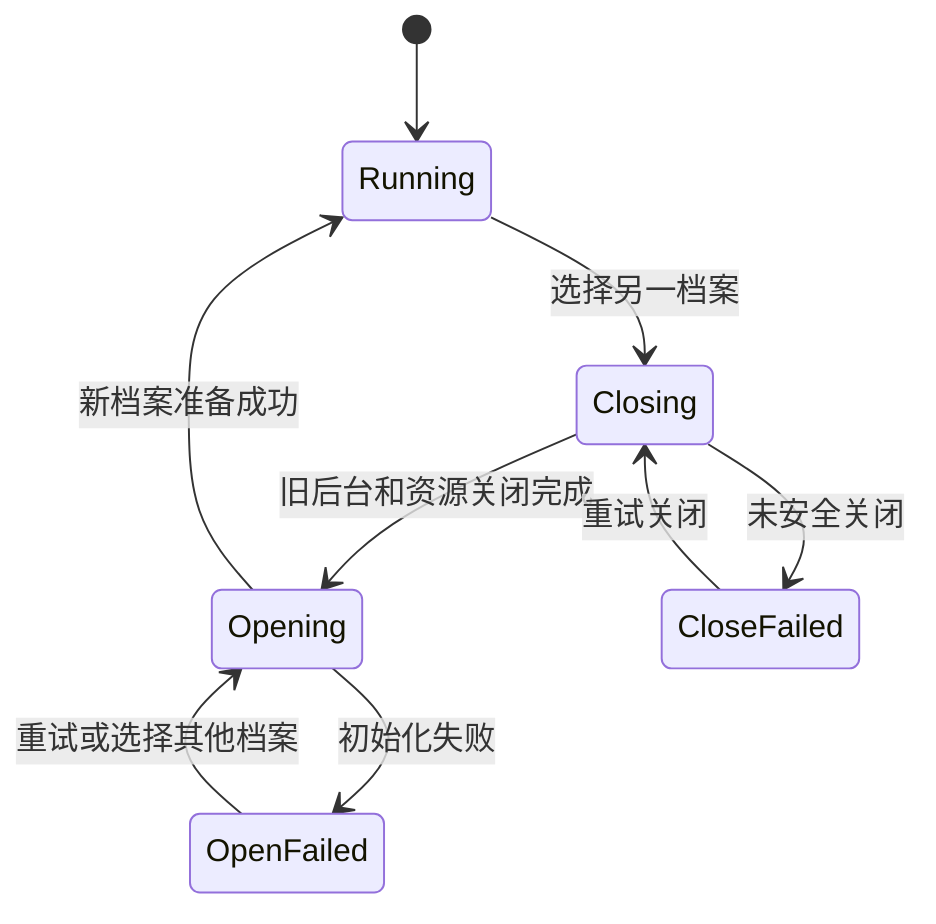

# P1 开发：完整档案与数据基础

日期：2026-10-29。状态：代码开发与获准的定向隔离自动化已完成，原生实机未验收。实际范围见[开发记录](development-status.md)和[验证记录](verification.md)，前置约定见[公共契约](../architecture-and-contracts.md)，验收要求见[本阶段清单](acceptance.md)。

实施补充确认（2026-10-29）：模型连接、API 凭据、外部文件工作区和模型缓存继续应用级共用；角色业务数据库、受管头像与桌宠资源独立。切换档案只切换角色数据后台，不改写共用连接或复制密钥。实际完成范围与验证另见阶段实现记录。

最新覆盖决定：用户明确旧版现有数据无需迁移，直接删除。首次初始化清除旧根目录中的角色业务数据库及配套、受管图片与角色执行日志，以全新独立默认档案开始；不生成迁移快照，不继承旧聊天、记忆、人格或安排。清理仅限明确角色数据清单，保留共用模型缓存、工作区、配置凭据、已存在的新档案及稳定实例锁。以下迁移保留要求按本条调整；显式备份恢复能力仍要实现。

## 目标与范围

把当前单数据目录运行方式提升为可选择完整角色档案的方式。一个档案一套数据库和必要资源，任一时刻只激活一套后台；不在数据库中增加跨角色共享事实、日程或工具流水层。

交付创建、改名、打开、切换、删除、默认会话、旧数据清理和完整备份恢复。档案入口可先最小化，完整设置体验在 P6 收口。本阶段不实现自动学习或重新生成旧人格。

## 代码与数据入口

重点修改 `application/factory.py`、`service.py`、`instance.py`、`desktop.py`，桌面 Host/Launcher/Bridge、会话 repository，以及 `maintenance/archives.py`、`maintenance/service.py`、资产服务相关调用方。新建的档案目录选择职责放在应用启动／宿主边界，不让运行中的 Core 替换数据库连接。

实施前列出所有路径：四个数据库及 WAL 配套、受管头像和桌宠资源、必要运行回执、档案元信息、连接配置引用、模型缓存与外部工作区。明确哪些随档案保存，哪些只是安装资源或系统凭据服务；不得把角色数据库遗漏在旧全局目录。

档案使用稳定标识和独立数据根，显示名可修改。最小注册信息只需标识、显示名、目录及选择状态；不能用未经检查的显示名拼接任意文件路径。原地目录切换不复制整库；初次迁移和显式备份恢复另行处理。

## 开发步骤

1. 盘点当前工厂、维护和 GUI 的所有 data_dir 使用点，定义档案选择入口和后台代次，扩展现有实例互斥与关闭回执。
2. 首次启用新版档案时按固定清单清理旧角色数据，并登记全新默认档案。使用明确初始化阶段和原子注册，失败可重入；完成标记存在后不得重复清理或重建默认档案。既不迁移原记录，也不生成迁移快照，不让模型补编旧经历。开发工具不直接清理用户真实数据。
3. 新建档案初始化独立数据和固定日常聊天。不得复制来源档案的事实、学习、任务或安排。角色卡在 P2 接入，但身份标识从本阶段稳定。
4. 切换按下述状态顺序完成，并使 GUI 在切换期间停止向旧后台发送普通请求。
5. 改名只更新显示数据；删除当前档案先关闭，移除该档案数据库和受管资源，不清理其他档案或外部工作区文件。删除后界面回到档案选择入口。
6. 维护备份和恢复按完整档案工作，扩展现有格式识别和资源清单；独立维护仍不与当前生产后台同时操作同一档案。
7. 调整所有调用方及说明，保留现有实例锁、恢复中标记、凭据不出回执和资源关闭规则。

## 切换状态与失败处理

Closing 不强杀正在写数据库的线程；任务层停止后续步骤，不可中断调用等待返回。关闭未完成时，不启动新后台也不报告切换成功。打开失败时界面可展示原因并重新选择，不能仍显示旧角色但实际读新库。

关闭前使旧回执和界面缓存失效，资源清单包括队列、模型调用接收、上下文、调度器、提醒泵、主动模块及数据库连接。所有关闭完成后再释放档案锁。旧模型回调即使晚到也只可废弃，不可写入新档案。

## 迁移与恢复要求

| 项目 | 实施要求 |
|---|---|
| 默认会话 | 每档案各有固定日常聊天，不能单独删除；清空和角色整体删除是不同入口。 |
| 历史人格与用途标记 | 本次按授权随旧角色数据清除，不转换、不外发；用户显式导入备份中的限制仍须按既有边界处理。 |
| 备份范围 | 四库和角色受管资源完整列入清单；配置、系统凭据和外部工作区沿现有边界明确列明，不把密钥复制到明文包。 |
| 恢复隔离 | 恢复在关闭状态进行，失败保留恢复标记；不能运行半恢复档案。 |
| 恢复后 | 校验执行账本和调度代次，已完成副作用不重放，逾期提醒记录状态而非补弹全部通知。 |

恢复旧备份时，备份之后发生的外部操作可能不在旧账本中；不能仅凭备份里的 Pending 就自动执行。历史可变操作应先核对或标为待确认状态，不保证旧快照能推断外部世界的最新状态。

## 完成条件与交付

P1 验收项全部有结果，数据目录及资源清单有文档，切换关闭错误可恢复。保留尚未实施角色卡和学习的真实边界，不将其标为完成。提交接口与初始化说明、档案操作说明及验收记录；开发测试使用合成数据，不自行运行用户真实目录的清理。
