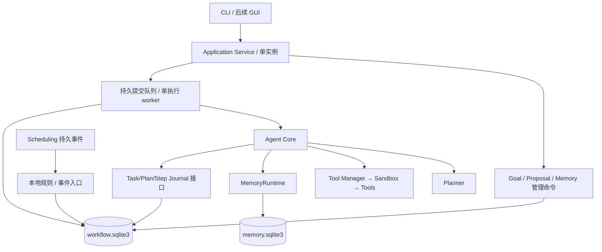

# V0.4 开发计划

> 实施前规划快照。2026-10-15 已开始实施，当前实际接口与证据见 [V0.4 交付目录](../../versions/v0.4/delivery.md)，以下“尚未实现”等表述记录规划时点。

日期：2026-10-15。状态：**架构建议与分阶段计划，尚未实现、尚未冻结代码 API**。基于 0.3.0 工作区实现和[分阶段路线](../roadmap.md)。配套[环境评估](environment-assessment.md)与[验收边界](acceptance-boundaries.md)。本轮只新增规划文档，现有版本号、业务代码与配置保持原状。

## 目标与最小闭环

V0.4 交付“能记住目标、提出本地建议、持久排队、在重启后说明执行到哪里”的后端。不扩成无人值守执行器，也不把全部长期陪伴设计塞进这一版。

建议闭环：用户显式创建 Goal/Milestone → 关联日程/目标截止事件 → 生成可查看的 Proposal → 用户接受 → 原子创建 Task/Submission → 单 worker 规划 → 展示准确计划并按风险确认 → 步骤执行与检查点 → 可查询结果；重启时重新审查授权和未完成步骤。Task 完成只提供目标进展证据，Goal 完成仍由用户明确确认。

必须覆盖持久 Goal/Milestone、Task/Plan、步骤账本、有界提交队列、默认关闭的本地规则提议、CLI 管理、启动恢复与跨库存储副本清理。后台云建议、目标自动拆解/DAG、自我修改任务、完整多轮上下文、GUI/系统通知、人格情绪与 OS 隔离均不纳入必需范围。

## 从当前实现出发

| 实际入口 | 可复用 | 必须补齐 |
| --- | --- | --- |
| `tasks/models.py`、`manager.py`、`ports.py` | 七种 Task 状态、合法转换、快照隔离、scrub | 持久 ID/revision、恢复状态、事务领取与步骤记录；不能仅换存储就称能恢复 |
| `agent/core.py` | 静态 Plan、具体参数确认、单请求、取消边界、记忆资格检查 | `_pending`/依赖为进程内；将计划与 grant 分离，执行前后持久检查点 |
| `planner/models.py`、`tools/models.py` | Plan/ToolCall/ToolSpec | 持久计划 hash/revision、稳定 step ID、可信工具契约版本；schema 本身无法表达全部行为变化 |
| `scheduling/service.py` | 事件与 fired 同库事务、到期去重、单独线程 | 持久 consumer、公开来源快照/事件版本与库身份；不从线程直接执行 Core |
| `memory/contracts.py`、Core 管理入口 | 来源/revision/用途/删除回执/Waiting 失效 | 重启后仍可查的依赖索引，以及可恢复的跨库擦除工作单 |
| `application/factory.py`、`cli.py` | 装配与关闭、前台 CLI | 数据目录实例锁、Application 服务、队列/恢复/目标/提议入口；忙时不丢提交 |

`MemoryKind.GOAL` 是记忆分类，不是目标状态权威。memory epoch 只用于失效检测，不是可以逐条消费的业务事件日志。

## 架构与存储决策

新增 `goals/`、`proactive/`、`workflow/`，扩展 `tasks/` 与 `application/`；各领域定义 Protocol/DTO，具体 SQLite 在 adapter/composition 层。Core 不 import Goal SQL、调度私有连接、线程控制或 UI。

**一个工作库承载工作流事务。** Goal/Milestone、Proposal、Task、Plan、step_attempt、submission、inbox/cursor、audit_outbox、deletion_job 同属 workflow 库；Memory 与 Scheduling 保持原库。Proposal 接受和 Task/Submission 创建可在同库原子提交。跨库先读取事件，再在 workflow 内可靠接收和分批处理；不宣称三库和 JSONL 的全局事务。

**单目录单实例。** Application 在任何库初始化/迁移、scheduler 启动之前拿 OS 持有锁；锁路径规范化，第二实例拒绝。SQLite 锁和 PID 文件不能替代运行实例所有权；不按“租约过期”接管仍在运行的进程。实例锁最后释放。

**兼容入口。** 保留同步静态计划和同实例确认语义；生产 CLI/后续 GUI 统一经过 Application 服务。Application 的 `run/handle_request` 同步 facade 负责 submit+wait；dispatcher 调用内部 Core 的“执行已存在 task_id”入口，该入口不再提交队列，也不创建第二个 Task，防止递归等待死锁。confirm 关联原 Task/Plan。低层自定义 Core 注入仍可用于测试，但其不持久能力须明确区分。现有 `create_agent` 返回 Core，工厂兼容适配/返回值/资源所有权须在第一阶段冻结并覆盖旧调用，不暗改公开契约。

## 目标、提议与执行的三类权威

| 对象 | 建议生命周期 | 约束 |
| --- | --- | --- |
| Goal | Active ↔ Paused；Active/Paused → Completed/Cancelled | 显式创建和完成；终态不直接重开，可复制新目标 |
| Milestone | Pending → Completed/Cancelled | 无循环依赖/DAG；完成标准、证据、Task 关联独立保存 |
| Proposal | Pending → Accepted/Ignored/Expired/Invalidated | 查看不消费；没有伪造“Completed”状态，工作结果查关联 Task |
| Submission | Queued → Claimed → Finished；另有 Blocked/Cancelled | 有界、稳定顺序、原子领取；状态不是执行授权 |
| Task | 保留既有七状态语义，拟增 NeedsReview/Uncertain | 最终状态图与旧调用兼容必须先冻结；不能把恢复未知叫 Running 或 Completed |
| Step attempt | Started → Succeeded/Failed；未决 Started → Uncertain | 开始记录在调用前提交；结果记录在返回后提交；未知不重试 |

Goal 保存 `revision`（每次 CAS 写入）与 `execution_version`（仅执行条件/状态改变递增）。进度备注不应无故废掉所有兄弟任务；期限、完成标准、用途、暂停/取消/完成等变化应使旧 Proposal/未执行工作失效。是否属于执行条件由主机定义，不由模型决定。

Milestone 也有执行条件版本；SourceBinding 有独立 ID/revision、状态和用途。Proposal/Task 记录准确作用域及这些依赖。单独完成/取消 Milestone、移除或改版绑定只阻断对应作用域未执行工作，不误伤同一 Goal 的其他里程碑；Goal 级失效再覆盖全部关联工作。

Proposal Accepted 的证据是唯一 Task/Submission 已原子创建；Task Completed 的证据是执行账本和结果；Goal/Milestone Completed 的证据是用户明确完成命令及其确认材料。三者不能互相冒充，模型说“完成了”不更新权威状态。

## 计划快照、授权与崩溃恢复

持久 Plan 至少含 ID/revision、完整 canonical JSON 与 hash、原请求引用、稳定 step/call ID、准确参数、工具显式 contract version/schema fingerprint/权限等级、workspace/策略版本、Goal execution_version、Memory `(id, revision)` 依赖。严禁截断参数后算作同一计划。

持久层保存“曾确认”的审计记录，**不保存可执行授权集合**。普通和高风险 grant 只在内存，绑定本次运行 session、Task、Plan hash/version；重启全部清空。恢复展示原快照，再确认；工具缺失/升级、workspace/策略/记忆/Goal 改变时旧计划失效，重新规划和确认，不能偷换参数。

| 重启时可核验证据 | 推荐恢复动作 |
| --- | --- |
| 尚未开始的 Queued，或 Planning 中断 | Blocked/NeedsReview；显示原请求，由用户恢复后再规划；默认不启动云调用或工具 |
| Waiting、计划完整且从未执行 | NeedsReview；重新展示精确计划，清空全部 grant，再确认 |
| 有 Started、无可靠结果，或步骤记录不一致 | Uncertain；展示已知步骤与未知区间，禁止自动继续或一键重试 |
| 前几步成功、后续尚未开始 | NeedsReview；显示已完成效果，本版不自动续跑半个多步计划 |
| 全部步骤可靠成功，仅 Reflect/候选学习/终态收尾中断 | 先复核取消/失效标记；无阻断时基于结果收尾 Completed 并给 warning；有取消时保留效果及取消语义，不能覆盖取消意图；零重放/自动补云 |
| 已可靠终态、无未决 attempt | 保持历史终态，查询不再执行 |

恢复优先核对 attempt，不能只看 Task 的最后一个状态字段。V0.4 对运行中取消拟改为持久 `cancel_requested` 并在步骤边界生效，不能在调用仍进行时声称已停止；已有 V0.3 cancel 返回契约的兼容调整需显式测试。若取消后崩溃仍有未决 Started，也必须报告 Uncertain。

取消由受控 Application 控制命令直接事务写入，不能排在被阻塞的执行 worker 尾部。“取消/版本/清理阻断检查 + 新 Started 提交”由同一工作库事务决定先后；以 Started 提交界定当前步骤已开始，之后提交的取消不能保证该步骤不发生效果，但禁止再领取后续步骤。控制命令不并发调用 Core 执行入口。

Uncertain 通过显式复核命令附证据，记录“确认发生/确认未发生/仍未知”等判断；它不直接重新运行原步骤。部分步骤已完成时，resume 仅用于复核，本版继续剩余操作需新建只含明确剩余意图的工作项，不能重跑原完整 Plan。确需重试时建立新的工作项并重新确认，保留旧未知记录。已返回失败同样不能据此推断零副作用；本版无自动工具重试。

## 事件入口、本地规则与队列

首批规则只使用显式 Goal/Milestone 与显式绑定的 Calendar/Timer：目标截止窗口、关联日程/计时器到期、关联 Task 结束后提示用户复核里程碑。没有绑定的私人日程不自动进入目标建议；不扫描全部记忆推测目标。

事件投递键包含 `consumer + source_store_id/generation + stream + event_id`；业务建议唯一键包含 `goal_id + execution_version + milestone/binding 作用域及版本 + rule_id + root_source_key + kind`。同一来源事件服务两个里程碑时各有独立建议；规则升级不靠改变唯一键重发旧建议。Task/Goal 自有事件使用 workflow outbox，同事务写入；Scheduling 跨库重复读由 inbox 去重。

现有 Scheduling 按 source 查询，因此 timer/calendar **分别维护接收 cursor**。接收事务把完整事件引用写入去重 inbox，再推进该流接收 cursor；它只表示“已可靠接收”，不表示规则处理完成。另一工作库事务将 Proposal/合法跳过原因与 inbox 处理进度一起提交。每轮提议额度耗尽时余项保留 Pending；单事件扇出过多时保存作用域 continuation，跨轮继续，绝不将“预算不足”当作业务跳过。任一阶段失败只重试持久阶段，不能漏事件或重复建议。

日程内部 revision 目前只表示提醒版本，不是所有字段版本；V0.4 需公开事件 occurrence revision、来源库标识和按 ID 查询的完整当前来源快照/指纹，用于接受及出队复核。不得导入 Scheduling 私有 SQL 连接，或只凭历史 event label 执行。

首次启用默认从当前尾部开始；补历史必须明确时间/条数上限。保留消费者可检测的库身份、游标锚点；发现库替换、ID 回退、锚点不符即停止消费并复核，不自动清 cursor 重放。独立库任意回滚恢复不提供一致性保证，手动恢复流程需重建消费世代与明确补读策略。

`accept` 在一个工作库事务中校验 Pending/revision/TTL/Goal 版本、本地来源资格和队列容量，再创建唯一 Task/Submission、关联并标 Accepted。幂等重试返回原 Task；同一 command ID 配不同参数拒绝。跨库来源接受前预检，**出队和每步前再检查**，不假装跨库预检和提交是原子的。

接受只允许进入规划/审阅流程，不携带 grant，也不隐式允许把日程/Goal 原文发云。新 Goal 和来源绑定 `SourceBinding` 建议默认 `local_only`；Scheduling 现有事件没有出云策略，不能默认为 cloud_allowed。Proposal/TaskIntent 继承所有来源中最严格的用途。没有云处理许可时保持本地待审或使用离线/直接规划；若用户确需云规划，应先明确修改原对象/绑定的用途并产生新版本，再形成新意图，不能仅给 TaskIntent 改标签洗掉来源限制。配置了云聊天 key 不是来源用途授权。

本地规则控制器默认关闭；无后台云生成器。静默窗口限制主动展示而非后台执行权限：可本地生成待查看项，CLI 只在命令边界显示有界摘要，不打断输入。静默期结束重新查 TTL/来源/Goal，过期不集中重放。建议初始参数：队列容量 100、单次事件批 100、每轮新提议最多 10、轮询 1 秒、提议从事件到期时间起最长保留 24 小时；均为待冻结配置，不是当前已支持键。

## Memory 副本、审计与关闭

持久请求、Plan reply/参数、结果和 Proposal reason 可能复制记忆正文，必须有依赖/派生引用索引。少存正文，`local_only` 派生内容保持用途限制，启动与外发前复核资格；不从 JSONL 重建执行指令。切片 0 还须冻结请求/Plan/结果的 UTF-8 字节上限和保留期限：计划超过上限应在执行前拒绝，结果正文过大可明确省略并保留 outcome/摘要引用，不能截断 JSON 冒充完整快照或丢掉步骤执行结论。

忘记先在 workflow 提交不含正文的 deletion_job 和使用阻断标志，使关联待审计划失效并撤销内存 grants，再幂等执行 Memory forget，清理工作库相关正文/输出/计划/提议，最后完成工作单。启动先处理未完清理，再允许显示/云调用/派发。清理失败继续阻断并返回 pending，不能伪称完成；回执说明工作副本、独立用户对象、历史日志/备份/云端的不同保留范围。独立创建的 Goal/日程不按文字相似度自动删除；有明确派生来源的副本才进入清理清单。Uncertain 也须擦除正文/参数/结果，只保留 opaque attempt ID、取消意图和不含正文的判断状态。

业务状态与带事件 ID 的 audit_outbox 同工作库事务；JSONL 是可重试投递的观察副本，不是工作状态事实源，也不保证物理行 exactly-once。outbox 默认仅存结构化引用；包含正文的未投递 outbox、inbox、command 幂等回执缓存也纳入 deletion_job，防止遗忘后重投新写出正文。已投递历史日志仍按回执说明保留。重放 outbox 只能投递日志，绝不再执行工具；JSONL pending/失败独立可查询，不抹掉已发生效果。

关闭顺序：停止新提交/主动生成/领取 → 发出协作取消、等待活动 Core 到安全边界 → 停止并 join worker/scheduler → 关闭 Core/连接/模型 → 最后释放实例锁。活动工具可能继续需要 Scheduling，不能先关它的连接。超时只能报告仍在关闭/调用未结束；不得释放存储或锁后留下执行线程。本版不强杀 Python 线程或承诺同步工具即时停止。

## 分段实施与 Agent 分工

| 切片 | 工作与主要所有权 | 完成门槛 |
| --- | --- | --- |
| 0：冻结契约 | 主 Agent + 架构审查 | 状态图、恢复表、接口/兼容、用途、锁/连接所有权、删除清单通过审查 |
| 1：工作流基础 | 持久化 Agent | workflow schema/备份迁移、CAS、唯一键、原子接受/领取、outbox/deletion_job；真实 SQLite 故障测试 |
| 2：持久执行 | Core/恢复 Agent | 计划快照、步骤检查点、队列适配、grant 重置、NeedsReview/Uncertain、跨库记忆清理；子进程崩溃测试 |
| 3：目标管理 | Goal Agent | 显式 Goal/Milestone、版本、完成证据、暂停取消与持久 Task 关联；CLI 可独立使用 |
| 4：本地提议 | Proposal/事件 Agent | Scheduling 公共快照/身份、分流 cursor、规则、幂等接受、静默/TTL/背压；断点重扫无重复 |
| 5：整合与发布 | 主 Agent + Testing Agent | 双 Python 回归/strict、Windows 真实竞争/崩溃、资源/安装/文档，逐项填写实际证据 |

最多四个并发席位；共享 DTO/Core/factory 由主 Agent 合并，修改同一文件串行。子 Agent 交回文件清单、设计、接口、测试、潜在问题。可在契约冻结后并行开发互不重叠模块，不能跳过持久执行门槛就接入主动入口。V0.4 只有全部必需切片通过才宣称完整交付；未完成恢复时可称内部阶段，不能用功能演示代替崩溃验收。

接口草案包括 `GoalManager.create/revise/set_status/complete_milestone`、`ProposalManager.list/accept/ignore`、`SubmissionDispatcher.submit/dispatch_one/stop_accepting`、`ExecutionJournal.start_step/finish_step/recover`、`ApplicationService.resume/review_uncertain`。写操作带 command ID 和 expected revision；具体参数、错误、返回 receipt 在切片 0 冻结。本轮不创建这些类，也不估计未经实测的日历交付日期。
