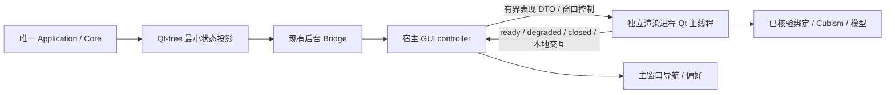

> 历史方案快照（2026-10-19）：用户已决定 V0.7 改用静态图片，Live2D 推迟到正式版后的更新。下文不是当前开发范围、依赖或验收门槛；未完成的 Live2D 项不得标作通过。当前范围见 [V0.7 验收边界](acceptance-boundaries.md)、[开发计划](development-plan.md)和[环境评估](environment-assessment.md)。

# V0.7 开发计划：Live2D 与桌宠表现层

日期：2026-10-19（Asia/Shanghai）。状态：实施前计划；当前产品 **0.5.0rc1**，未开始 V0.7 产品代码开发。本轮交付本计划、[验收边界](live2d-acceptance-proposal-2026-10-19.md)和[环境评估](live2d-research-2026-10-19.md)，不是 Live2D 已接入的声明。以源码和最新检查点修正历史规划，不覆盖历史失败证据。

用户补充：暂无商业使用计划；当前不开展应用发行（“应用初版”暂按发行/出版理解，仍是工作假设）。先以非商业本机研发为目标，实际使用许可必须核清；商业发行准备仅在未来发行前执行。初版美术资源可由Agent使用内置生图工具制作，边界见[环境评估第9节](live2d-research-2026-10-19.md#9-初版美术资源的生图路线用户补充)。

## 1. 现有入口与可复用资产

| 位置 | 已有能力 | 本轮后续接入点 |
| --- | --- | --- |
| `src/deskpal/gui/main.py` | 可选 Qt 导入、QApplication、唯一后台 factory；`setQuitOnLastWindowClosed(False)` | 保留入口和 factory；桌宠依赖惰性加载，不另起 Agent |
| `src/deskpal/gui/host.py` | DesktopHost 拥有 bridge/window/tray/notifications，Closed 后退出 Qt | 增加表现 controller 所有权及退出汇合；不得仅凭 bridge Closed 就遗失渲染进程 |
| `src/deskpal/gui/bridge.py` | 命令/查询/控制分通道、有界交付、epoch、后台初始化与关闭 | 增加窄状态查询种类，复用背压和代际机制；不把渲染回调接入命令通道 |
| `src/deskpal/application/desktop.py` | Qt-free DTO、任务摘要/通知元数据、会话/epoch | 添加准确的最小表现快照；不直接复用含正文的 task review，不依赖通知开关 |
| `src/deskpal/gui/preferences.py`、`tray.py`、`window.py` | QSettings 偏好、托盘恢复退出、主窗口几何/DPR修正、纯文本安全呈现 | 新增独立宠物开关/位置/减少动画偏好和显示菜单；不复用主窗口 geometry 键 |
| `tests/gui/`、既有 GUI 检查脚本 | 合成数据、offscreen、慢后端、关闭/隐私/授权与原生显示脚本 | 复用夹具思路；新建 v07 证据目录，原生渲染不能用 offscreen 结果代替 |

现有静态占位在主窗口对话提示中，没有可直接升级的独立桌宠窗口，也没有已定义的 Live2D 状态总线。不能只换一张图就完成 V0.7。

## 2. 实施方向与职责

首选验证路线是 **现有 Qt 宿主 + 窄状态投影/controller + 独立 Qt 渲染进程 + 已维护绑定/Cubism SDK**。首个探针候选为 `live2d-py 1.0.0`，尚未冻结依赖或证明可用；具体风险见环境评估。只有探针失败且可维护性理由明确时，才评估官方 Native SDK 小型 helper 或其它现成绑定，不默认自研 Live2D 渲染底层。

渲染进程不加载生产 config/factory，不持 API key 或数据库。父进程启动时构造最小环境白名单，IPC 不传整个 Application、Plan 或用户正文。独立进程提供故障围护，不提供 V0.6 权限隔离保证；首版资源限定为已核验可信本地包。禁止模型脚本、远程 URL、角色卡工具命令。

拟分包（名称在阶段1冻结，不代表当前已有接口）：`presentation/models.py, ports.py, state.py` 为 Qt-free 纯 DTO/映射；`gui/pet_controller.py` 为宿主所有权；`gui/pet_process.py` 为 IPC/进程适配；`gui/pet_window.py` 与 Live2D adapter 只在渲染进程导入。纯领域 DTO 不导入 Qt，后端不导入具体渲染器。

同进程 QOpenGLWidget 只作为兼容性探针对照：它会把 SDK 的原生崩溃/长调用带入宿主，不能直接满足故障不影响原应用的条件。不通过证据证明等价前，不将其作为生产捷径。

## 3. 需要冻结的契约

| 契约 | 首版要求 |
| --- | --- |
| PresentationSnapshot | schema/session/generation/sequence/privacy_epoch/revision、host 生命周期、固定 presentation 枚举、有效期；可选不透明任务 token，不带正文/SQL/授权/任意参数 |
| 状态来源 | 从 Application 公共只读快照取得活动工作摘要；不读 UI 当前选中实体，不把 bridge Ready、notification_feed 或队列长度等同于执行阶段 |
| 状态查询 | 单个在途、低频异步、有界回执、最新值合并，开关独立于系统通知；关闭宠物后停止专用查询，恢复先刷新快照；不长期持读锁/阻塞取消 |
| 映射策略 | lifecycle 优先，活动任务优先于短暂终态，revision/sequence 去重；unknown 不装 idle，Waiting/Uncertain 不装 success；启动与重连不补播历史 |
| RenderPort | start/show/hide/set_state/local_motion/stop 与 ready/degraded/closed；本地动作使用白名单，不接受通用函数调用 |
| IPC | 本机父子专用 QProcess 管道候选；长度前缀 JSON、版本握手、generation、严格字段/数值/长度预算；stdout 只协议，stderr 有界诊断；不使用 pickle/监听公网端口 |
| IPC 初始预算 | 单帧≤16KiB，累计待发≤64KiB；状态槽只保留最新1份、控制队列≤16条；诊断 ring≤256KiB；超限降级并关闭本渲染会话。数值由阶段0探针后冻结 |
| ModelManifest | 明确 model3 入口、资源闭包/hash/尺寸/动作映射/许可；禁止 URL、脚本、绝对路径和 root 外引用，控制 JSON、纹理尺寸与总量；不自动下载缺文件 |
| 偏好 | enabled 默认false；独立逻辑几何/屏幕标识/scale/置顶/穿透/减少动画；坏值回退；不保存 task/正文/授权；旧偏好缺键保持不启宠 |
| 退出 | controller 维护 Disabled/Starting/Ready/Hidden/Degraded/Stopping 状态，宿主 Closed 与 renderer-reaped 两条件汇合后退出 Qt；Core 关闭超时继续保锁/保诊断 |

Qt/OpenGL 固定在渲染进程的 Qt GUI 线程；仅纯 IO/预检在独立工作线程。SDK 只能同步加载时先验证分阶段准备/`create_renderer=False` 的真实可用性、所有权和 GIL；类型 stub 不是实现证明。宿主不等待模型加载，超时取消与回收独立可用。纹理、FBO、SDK model、动作回调须显式清理并记录线程/context；正常退出不靠晚期 GC。

## 4. 分阶段推进与出口

各阶段有实际结果再推进；不承诺未经探针验证的日历工期。模型/许可受阻时阶段1、2的无模型工作继续，不能把阶段3、4改写成占位验收。

| 阶段 | 实施工作 | 出口与证据 | 依赖 |
| --- | --- | --- | --- |
| 0A 来源与兼容性冻结 | 同一 release/commit 核查构建/加载/渲染/析构/GIL/测试源码；审 wheel 内文件/PE依赖/许可；官方 SDK 与模型用途核验 | 固定版本/hash/清单/许可结论；列出二进制来源与未覆盖项；新增下载/安装前按工具要求中文批准 | 本计划完成；公开源码文本可先读 |
| 0B 最小原生探针 | 独立合成环境中真实模型首帧/动作、alpha、Qt版本/GL profile/FBO/DPR、重复释放、故障/退出/父死；双 Python | 真实资源与线程/context日志、完整首败、资源初测；冻结路线/模型/参数/预算与首版范围。不可行则输出替代路线审查，不强接生产 | 0A，合法 SDK/模型和获准依赖 |
| 1 窄契约与纯状态层 | 最小应用快照、DTO/reducer、代际/epoch/过期/去重/背压、fake RenderPort | 6 Luna 定向单元/strict/合成集成；唯一 Core、零额外工具执行；父审数据/权限方向 | 不依赖模型；接口先于并行实现 |
| 2 控制与窗口生命周期 | controller、子进程适配、主窗口/托盘开关、偏好/位置/屏幕恢复、异常/关闭汇合；明确静态降级 | Q/进程测试覆盖加载中退出、迟到回调、无托盘、穿透恢复、坏偏好；fake 仅验证协议/生命周期 | 阶段1；Qt现有依赖可用 |
| 3 真模型渲染整合 | 已选绑定 adapter、真实加载/动作/命中、帧率/隐藏暂停、context重建/清理、有限故障诊断 | 原生真模型冒烟、动作证据、100轮开关/加载释放/隐藏恢复；父审线程/GIL/析构及故障围护 | 0B和阶段2通过 |
| 4 显示、交互与压力验收 | 混合DPI/多屏/边界/屏幕变化、焦点/穿透、慢Core、睡眠/锁屏/RDP、崩溃/挂起和父死 | 验收矩阵逐项证据，资源曲线/退出码/回收结果；缺设备标未测；异常交父审归因 | 阶段3；实际交互环境 |
| 5 最终构建和本机验收审查 | 双Python受影响回归/strict、纯CLI/GUI无Live2D、本机wheel源码安装、同构建30分钟长测、研发使用许可/操作/测试报告 | 构建/依赖/模型指纹一致；已实现/已测/未测/阻断分别记录；父 Agent 最终验收限定非商业本机范围；对外发行条件另列 | 前述技术硬门槛与实际研发使用许可满足；无发行计划时不要求先办商业出版手续 |

先执行的实现工作为：冻结最小表现 DTO 和应用状态来源、独立开关/降级、子进程生命周期和测试夹具；这些不因缺少模型停止。真正装 SDK/绑定前先给出来源/许可/用途和受控命令，不静默运行上游自动下载构建脚本。

美术工作线与技术探针分开推进：角色方向→生图概念/透明静态图→拆件/遮挡补绘/一致性检查→评估Cubism建模与动作制作工具→导出实际模型→L02验收。Agent可承担生图、定向编辑和工程整理，但当前不承诺仅靠生图完成分层PSD、网格绑定或`.moc3`导出；需要Editor或建模协作时提供具体缺项。技术探针使用合法可测试模型，不等自有美术完成；生图静态资源可先服务于明确标注的降级界面。

## 5. 关键生命周期和窗口规则

开启时创建新 generation；最多一个渲染 owner，Ready 后才显示真实画面。加载中隐藏/关闭属于独立控制意图，迟到 ready 必须服从当前 generation；失败标 Degraded 并停止自动重启，重试由用户明确触发。隐藏暂停逐帧绘制且保留已加载资源；关宠释放模型/context/进程，两种操作不能混同。

宿主退出时先阻止新表现输入和后台新工作，异步并行发起应用 shutdown 与渲染 stop；父进程仅对自己创建且身份可核验的渲染子进程执行超时回收，不能 kill backend 或按进程名批量终止。退出期限和 escalation 细节经阶段0冻结。父进程异常消失由管道EOF/存活探针触发子进程收敛；Qt事件循环挂住时还需经审查的父死回收机制，不默认复用 V0.6 Job/launcher。

子进程关闭失败时主窗口显示真实状态并保留控制；DesktopHost 不先销毁 QProcess/QObject。Application 关闭超时仍遵循既有 Closing、资源和锁保留契约。渲染子进程故障回退不得新建 factory、恢复任务或补执行任何副作用。

桌宠不因状态变化自动 raise/activateWindow；显式导航才恢复主窗口。点击与拖动按 Qt 拖动阈值区分；不做高频全桌面鼠标采集/逐像素读屏。透明命中需实际 native 输入验证；若形状命中不可维护，先提供显式全窗穿透模式和可恢复控制，不能宣称透明区域天然不挡鼠标。

几何保存使用逻辑坐标及目标屏幕可用区域，DPR只用于物理渲染 viewport/纹理命中换算；每次 screenChanged、DPR/availableGeometry 变化和屏幕移除时重新校验，不能假设多屏是一块无缝连续矩形。所有自己的窗口恢复都必须有可见控制位置；不自动更改 Windows 缩放/任务栏/电源设置。

## 6. 分工与测试纪律

沿用用户约定：**6 Luna，高思考，执行常规单元/mock/strict/回归、实机重复验证和证据采集；父 Agent 负责架构、图形/线程生命周期、复杂故障归因、关键修改审查和最终验收。** 必要时仅将复杂实现交 6.1 Sol。共享文件明确 owner，接口修改先由父 Agent 冻结；不能同时修改同一文件。不唤醒任何此前 V0.6 任务。

本轮已由新建 6 Luna 任务只读核查明确解释器元数据与测试资产；没有运行产品测试/GUI。后续测试分 U/Q/N/H/R，命令绑定绝对解释器、离线 provider、独立合成数据/偏好，拒绝沿用私人配置。首次失败输出、退出码和必要现场保留，不改预期/跳失败/覆盖证据；首次停滞或线程归属异常立即升级父 Agent，不凭下一轮通过结案。

全仓测试包含大量 V0.6 诊断测试：本轮不默认执行整个 scripts 或旧实验。阶段5先静态审核测试收集与夹具，确定全回归是否只含合成/mock；任何会访问真实封存对象或触发 native 实验的入口均不得运行，报告所选安全回归范围与未运行原因，不删除/改skip来伪造全量通过。

## 7. 决策点、阻断与恢复

| 未定项 | 谁/何时决定 | 不依赖它的工作 |
| --- | --- | --- |
| 绑定二进制与固定源码是否一致、释放/GIL是否满足要求 | 父 Agent阶段0技术评审；证据不足不安装/定版 | DTO、纯状态测试、控制/降级设计 |
| 角色美术与实际模型/动作来源 | Agent可负责内置生图和资源整理；角色方向在实际生图前确定；建模/导出能力另评，采购/外部委托由用户决定 | 合法测试模型技术探针、无模型控制层；不将生图PNG当运行模型 |
| 未来模型与动作分发许可 | 当前无发行工作；未来发行前再核查，未到需要采购时不反复询问 | 合法非商业本机开发与真实模型验收 |
| 可扩展应用分类/出版许可与实际发行主体 | 发行前由用户决定真实发行方式，必要时向Live2D核实；不代用户签约/发邮件 | 内部开发与明确许可的本机验证；不承诺免费可分发 |
| 混合DPI/实物断屏/休眠/RDP的可用设备与操作 | 到对应验收时再协调用户，不擅自改系统配置 | 逻辑几何、模拟screen信号、单机原生项，明确替代不了硬件项 |

用户要求暂停时立即停开发/测试并通知所有本轮子 Agent；保存源状态/未提交差异、准确构建指纹、证据路径、首败、未完成与恢复命令。恢复只接 V0.7 自有合成资源，不打开 V0.6 封存对象。Git stage/commit/push/reset/PR 均由用户自行处理；不批量清理未跟踪文件。

实现后才新增 `docs/versions/v0.7/{interfaces,operations,test-report,delivery}.md` 并更新实际架构/依赖说明；本轮不提前生成“交付报告”，不修改产品版本号。
