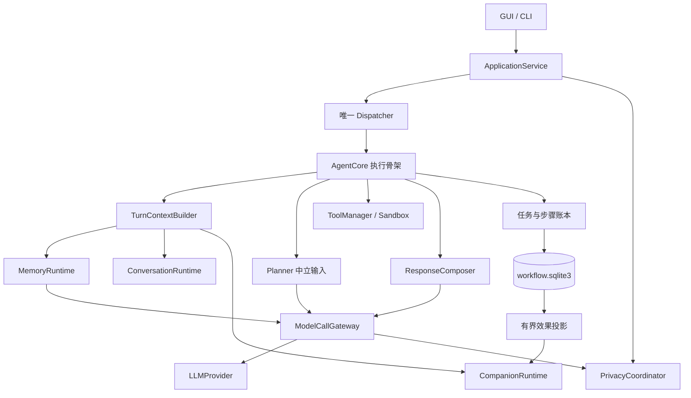

# 拟人化优化：代码组织、协议与状态一致性

后续状态：2026-10-22 H0–H5 已完成源码整合，未运行验证；实际文件组织和与本提案的差异见[开发记录](../../versions/v0.8/humanization-development-status.md)。下面的拟议路径和接口保留原设计，不据其逐字推断当前 API。

日期：2026-10-22。**拟议架构，以下新增文件、类型、端点和表均未实现。** 以当前 V0.8 源码为基线；总体行为见[方案](humanization-proposal.md)，实施顺序见[交付计划](humanization-delivery-plan.md)。本轮只写文档，桌宠只预留契约。

## 1. 现有代码的具体切入点

| 现有文件 | 当前职责/问题 | 重构边界 |
| --- | --- | --- |
| [agent/core.py](../../../src/deskpal/agent/core.py) | `_run` 混合观察、规划、授权、执行、Reflect、无工具表达、记忆和终态；`_companion_*` 负责可选表达与代际 | 提取上下文准备和回复生成；任务转换、权限预检、attempt 和失败判断继续留在执行链 |
| [agent/ports.py](../../../src/deskpal/agent/ports.py) | `CompanionPort` 返回通用 dict 和风格字符串 | 内部转类型化快照/只读策略端口；外部旧管理 JSON 由兼容适配层维持 |
| [companion/runtime.py](../../../src/deskpal/companion/runtime.py) | 同时拥有 SQLite、配置校验、时钟、衰减、预算、偏好和效果收据 | 保留 Runtime facade；先等价拆出纯 reducer、模型和仓库，再增加信号能力 |
| [companion/policy.py](../../../src/deskpal/companion/policy.py) | 云分支只使用预设，本地分支做请求词匹配 | 改为“先按用途过滤输入，再解析表达规则”，不在解析后删敏感字段 |
| [planner/llm_planner.py](../../../src/deskpal/planner/llm_planner.py) | `plan(request, memories, tools)`，单次调用、直接答案和工具计划共存 | 新增类型化中立上下文入口；仍不接人格/情绪/风格化助手文字 |
| [memory/coordinator.py](../../../src/deskpal/memory/coordinator.py) / [contracts.py](../../../src/deskpal/memory/contracts.py) | 记忆来源、用途、审核、三字段 profile、epoch；`learn` 可单独调用模型 | 复用；补上下文依赖和模型调用上下文，不新建人格专属事实库 |
| [application/service.py](../../../src/deskpal/application/service.py) / [dispatcher.py](../../../src/deskpal/application/dispatcher.py) | 唯一执行队列；管理操作在执行中 Busy，不能真正并发受理遗忘 | 提取隐私协调器和短控制入口；普通配置管理仍沿用串行门禁 |
| [workflow/store.py](../../../src/deskpal/workflow/store.py) / [journal.py](../../../src/deskpal/workflow/journal.py) | schema 1；不可变计划、依赖、attempt、删除 job、outbox | 添加会话引用/上下文依赖/隐私门禁/调用账本/效果 outbox；保持原计划 hash 验证 |
| [application/factory.py](../../../src/deskpal/application/factory.py) | 装配 Provider、Core、Memory、companion 和生产生命周期 | 装配新的只读端口、用途化模型客户端和协调器，不把 SQL/Qt 移入 Core |
| [application/desktop.py](../../../src/deskpal/application/desktop.py) / [gui/bridge.py](../../../src/deskpal/gui/bridge.py) | 有界 JSON、session/memory epoch、后台命令/读取/控制通道 | 增量添加会话和隐私控制契约；保留旧端点及七字段 presentation |

不拆出独立“情绪 Agent”，不增加第二个会调用工具的模型环，不用通用事件总线替代当前明确的生命周期。

## 2. 目标文件结构及所有权

以下路径相对 `src/deskpal`；“新增”均指未来实施时创建。优先按实际阶段建立文件，不一次生成空框架。

| 文件 | 动作 | 单一职责 |
| --- | --- | --- |
| `conversation/models.py` | 新增 | TurnRef、ContextItem、ExecutionContext、DialogueContext、ContextTicket |
| `conversation/ports.py` | 新增 | 上下文读取、引用校验、会话生命周期的 Protocol |
| `conversation/runtime.py` | 新增 | 有界内存窗口、轮次顺序、上下文冻结；不连接数据库/模型 |
| `conversation/projection.py` | 新增 | 分别构建规划和表达视图，整项裁剪、用途与来源传播 |
| `companion/models.py` | 新增 | PersonaSpec、InteractionConstraint、UserCue、ExpressionDirective、Candidate 等不可变类型 |
| `companion/ports.py` | 新增 | companion 仓库、信号消费、表达快照端口；不依赖 Core |
| `companion/repository.py` | 新增 | 原 runtime SQL、schema 迁移、CAS、效果收据/预算同事务 |
| `companion/reducer.py` | 新增 | 原衰减、窗口限额、事件资格和模式决策；纯函数、注入时间 |
| `companion/signals.py` | 新增 | 明确句式 ConstraintParser、模型候选校验和来源规则 |
| `companion/policy.py` | 修改 | 输入有效偏好/cue/persona 的确定性合并；输出有限表达策略 |
| `companion/runtime.py` | 缩减 | 管理 facade、事务协调、纯投影；维持旧 snapshot/command 适配 |
| `response/models.py` / `response/ports.py` | 新增 | ResponseInput、ResponseDraft、ReplyEnvelope、ResponseComposer Protocol |
| `response/composer.py` | 新增 | 一次无工具模型生成、严格 envelope 解析、候选区隔离 |
| `response/templates.py` | 新增 | 确认、失败、取消、未知、存储回执、工具关键事实的确定性文字 |
| `llm/calls.py` | 新增 | ModelCallGateway、按用途绑定的 Provider 视图；预算、出口核验、元数据计数 |
| `agent/context.py` | 新增 | 组合 Memory、conversation 和 companion 只读端口；构建一次请求的两种上下文 |
| `agent/core.py` | 缩减 | 保留原执行骨架；调用上下文与回复服务，复核结果并提交 |
| `workflow/conversation.py` | 新增 | 会话身份、轮次引用和上下文快照持久适配，不拥有生成能力 |
| `workflow/migrations.py` | 新增 | 显式、事务化、可验证的工作库迁移；由 Store 在锁后调用 |
| `application/interaction.py` | 新增 | 临时约束/偏好候选命令、来源关联、跨模块回执；不执行工具 |
| `application/privacy.py` | 新增 | 隐私代际、使用阻断、清理阶段、出口/发布屏障 |
| `application/effects.py` | 新增 | 有界消费已提交的 companion outbox，重启过期抑制与幂等确认 |
| `application/factory.py` / `service.py` | 修改 | 装配、转发与资源关闭，Service 逐渐减少内嵌清理细节 |
| `application/desktop.py` / `cli.py` | 修改 | 可见控制面及兼容 DTO；CLI 始终 Qt-free |
| `gui/conversation_state.py` | 新增 | 会话/轮次/隐私代际的新鲜度验证，与窗口控件分离 |
| `gui/conversation_panel.py` | 新增 | 有界会话视图、清空/新会话、候选与结果卡片；复用既有任务审查导航 |
| `gui/window.py` / `companion_panel.py` | 修改 | 会话入口、候选确认、字段云用途、本轮生效解释；不实现桌宠表现 |
| `presentation/companion_contracts.py` | 仅预留路径 | 后续实现无正文 CompanionPresentationHint，见第 10 节 |

`conversation` 不依赖 `response`、Core 或 Qt；`response` 可依赖 companion/conversation 的 DTO，但不能依赖 ToolManager 或任务写接口。`companion` 不导入 MemoryRepository、Application、Provider 或 GUI，外部来源只通过不可变引用进入。具体仓库和 Provider 始终由 Application 装配。



图中 Memory → Gateway 指候选评估的受控调用，存储/检索本身不发云请求。不存在 Composer → Planner 或 Composer → Tools 的调用边。

## 3. 内部数据契约

下面是拟议字段约束，不是可直接导入的现有类。内部采用 frozen dataclass/Enum/tuple；Desktop 边界才转换为严格、有限 JSON。

| 类型 | 核心字段 | 约束 |
| --- | --- | --- |
| `TurnRef` | conversation_id、turn_id、sequence、task_id、source_revision | ID 由主机生成；重复 command_id 不产生新 turn；source_revision 专用于内容/用途，不随 UI 读取变化 |
| `ContextItem` | source_kind、bounded_content、source_refs、use_policy、expires_at | source_kind 区分 user_statement、assistant_unverified、execution_fact、memory_claim；不能由模型升级 |
| `ExecutionContext` | current_request、reference_items、memory_bundle、dependency_refs、digest | 只含历史用户引用和可信任务事实；无 Persona/UserCue/Affect/助手自由回复 |
| `DialogueContext` | current_request、recent_messages、eligible_memories、execution_evidence、expression_directive | 助手文字明确不可信；所有派生项保留来源用途；与 Planner 输入分离 |
| `ContextTicket` | host_session_id、conversation_id/epoch、turn_sequence、privacy_epoch、expression_epoch、use_policy_revision、source_refs | 防止旧上下文出云、提交和显示；任何必要来源失效均拒绝 |
| `InteractionConstraint` | key、value、scope、source_ref、expires_at、use_policy、revision | once/session/today/persistent；到期由主机时钟算；模型不能自行提交 |
| `UserCue` | mode、evidence_kind、source_ref/span、expires_at、generation | 会话内；不得成为任务授权或长期用户诊断 |
| `ExpressionDirective` | tone、length、humor_allowed、followup、intensity、reason_codes | 有限枚举/布尔；不得含任意提示文本、工具名、权限、路径或待执行内容 |
| `ResponseDraft` | reply_text、validated_candidates、ticket、degraded_reason | 模型返回的任何候选都不表示已经存储；无状态写权限 |
| `ReplyEnvelope` | task_id/status、facts、response_text、warnings、effect_receipts | status/facts/receipts 由代码在提交后填充；模型只提供 response_text 和候选 |

### 3.1 接口草案

```text
ConversationPort.open(...) -> ConversationHandle
ConversationPort.freeze(turn, purpose, limits) -> ContextSnapshot
ConversationPort.publish(turn, reply, expected_ticket) -> PublishReceipt
ConversationPort.invalidate(scope, new_epoch) -> None

ContextBuilder.prepare(turn, memory_bundle, companion_snapshot) -> PreparedTurn
ResponseComposer.compose(ResponseInput, *, calls: TurnModelCalls) -> ResponseDraft
SignalPolicy.validate(candidates, *, current_message, source_ref) -> ValidatedSignals
CompanionPort.apply_event(eligible_event, *, expected_epoch) -> EffectReceipt
PrivacyPort.check(ticket, *, boundary) -> None
```

`publish` 必须与隐私屏障排序，不能只在进入方法前检查。DTO 内“state revision”不复用 GUI bridge 的 generation；会话、隐私、人格配置和状态重置各有独立含义。无需让每次情绪自然衰减都修改 revision。

普通人格编辑对下一轮生效，本轮保留开始时的版本；云用途撤销、重置或纠正 cue 则推进相应 ticket 代际。仅表达代际失效时可采用仍有效的中立草稿，隐私/来源代际失效时连草稿也不得发布。不得用“版本不一致”一个布尔值混合这两类回退。

### 3.2 Planner 和 Provider 的兼容

生产新增 `ContextualPlanner.plan_context(PlanningInput, calls) -> Plan`；PlanningInput 包含 ExecutionContext 和 ToolSpec。当前 `LLMPlanner.plan` 保留为单轮兼容包装，原 `Plan(reply, steps)` 不因人格优化增加情绪字段。内置 `DirectPlanner` 保留确定性原行为，多轮解析不可用时明确拒绝带历史执行引用的请求。

`create_agent(planner=旧Planner)` 继续适配单轮；不默默把整段对话塞进 request 或伪造成 MemoryRecord。需要使用多轮执行上下文的自定义 Planner 必须显式实现新协议。自定义 Planner 若拥有外部网络，不能被声称纳入网关完整预算；生产受支持路径仅接受使用 TurnModelCalls 的实现，低层兼容注入另标能力边界。

厂商 `LLMProvider.chat/generate` 协议不变。ModelCallGateway 每轮产生绑定 task/ticket/purpose 的 Provider 视图，供内置 Planner、Composer 和 MemoryEvaluator 使用；Evaluator 增加显式调用上下文适配。工厂不再把裸云 Provider 分发给这三个生产消费者。管理服务没有模型客户端。不用全局可变“当前任务”或 Qt 线程状态隐式传递身份。

## 4. 会话存储、来源和规划不变性

### 4.1 身份与预算

GUI 的 conversation_id 与 DesktopFacade.session_id 分开：前者表示用户会话，后者是连接/进程新鲜度。submit 可选 conversation_id 和 expected_conversation_epoch；缺省保持旧单轮行为。CLI 单次命令默认无历史，不把上次独立 CLI 运行自动并入当前对话。

受理时在 workflow 同事务分配 turn sequence、任务和 command_id 映射。Context 在 worker 领取后冻结，只允许 sequence 小于当前轮的已完成轮次；同一会话较早但未终结的轮次不成为“已完成事实”。用户可以看见缺少该上下文的提示，不把后提交的消息混进前一轮。

内存最多 4 个活动会话，每会话 8 轮/16 条/16 KiB 历史，闲置 30 分钟释放；活动执行/Waiting 持有的引用独立计入原计划上限，不能靠无限 pin 绕开容量。达到活动上限返回明确容量错误或要求关闭空闲会话，不自动抹掉在途上下文。角色、提示、记忆和工具输入另设总序列化预算；首期建议模型输入总额 128 KiB，历史先裁，记忆次之，当前请求和必要执行事实不能静默截断。总额不足时澄清/拒绝，不强行压缩关键字段。字节预算不是 tokenizer 精确 token 数。

默认新增会话正文缓存只在内存。现有 task.request/result 本身仍持久化；这不是“不落盘模式”。重启不从 task 历史自动回填 WorkingContext。为审查已经使用历史的工具计划，允许在 workflow 持久保存有限 ExecutionContext 快照；这份额外副本必须参与删除，不能以“缓存仅内存”忽略它。

### 4.2 依赖传递

每条历史回复携带保守来源集合：当轮已用记忆、历史来源、当前用户消息和工具事实，不让模型自行选择“真正用过哪些”。后续引用该回复也继承这些用途限制和删除依赖。来源删除时先丢弃整条派生回复，首期不尝试语义局部擦除。

传递来源也必须有界：建议每项最多 128 个直接/传递引用，一次 ContextSnapshot 最多 512 个唯一引用。超限时省略整条可选上下文并说明背景不足，不能截断依赖集合后继续发送原文。这样长对话不会通过不断继承旧轮次绕过历史窗口的资源限制。

新增 `dialogue_turn` 依赖种类，用 `dependency_version` 维护内容/用途修订。当前任务保存全部进入规划上下文的引用；确认和 `start_step` 重查。表达单独使用的引用也登记为隐私依赖，但不混入执行计划 hash：使用独立 `context_dependency` 表标注 purpose=planning/expression，删除时两类都遍历。上下文摘要和压缩文本首期不引入，因此无额外摘要来源 DAG。

新计划 canonical schema 标明 `policy_version=2`，包含 ExecutionContext digest 及规划来源依赖。digest 只覆盖中立规划视图，绝不覆盖 persona、cue、自由回复和本轮表达配置。schema 1 原 canonical/hash 原样读取校验，不转换后重算；旧计划按旧规则恢复审查。

“人格不影响执行”的可验证定义是：固定 task_id、当前请求、获准历史用户引用、事实和工具契约，仅改变 persona/cue 时，规划输入字节与 canonical/hash 相同。真实模型即便输入相同仍可能有随机差异；不能把两次线上独立采样的计划必须相同当成系统可证明性质。录制/固定 Planner 用于结构断言，真实模型另做统计评估。

### 4.3 偏好来源冲突

Memory 保持用户资料的来源权威，companion 保存显式表达覆盖。preferred_name/reply_language 的长期记录走既有 Memory；verbosity/humor/followup 的 once/session/today 和明确设置的持久覆盖走 companion。已有 Memory verbosity 是 fallback，不再复制成另一份 profile；companion 覆盖生效时显示被覆盖来源及“清除覆盖后恢复”的效果。

同一字段解析顺序固定为：当前明确要求 → 有效 session/today 覆盖 → companion 持久覆盖 → 可用 Memory profile → Persona。相同层级采用修订/明确时间顺序，冲突不可确定时不给模型暗自选。新确认的表达偏好不同时调用 Memory.remember 写第二份；candidate_review 对已消费的表达偏好来源键跳过对应 profile 候选，其余记忆抽取保持原审核流程。旧记录不批量改写或删除。

## 5. 一轮交互如何执行

### 5.1 普通聊天

1. Application 受理并绑定 turn/task/command；检查请求用途、隐私阻断和容量。
2. Core 获取 Memory bundle，ConstraintParser 识别确定的当前要求。once 只形成当前覆盖；session/today 写入通过 InteractionCoordinator 的幂等本地命令，回执独立。CAS 冲突不盲重试覆盖他人修改，当前轮仍可尊重一次性要求，并说明跨轮设置未保存。
3. ContextBuilder 冻结两种上下文。Planner 只看中立投影；模型网关再次检查用途/epoch，登记实际调用尝试。
4. 保存 Plan，按现有路径确认无工具步骤。启用表达则 Composer 用本轮原话、获准历史、记忆、未核验 Planner 草稿和 ExpressionDirective 生成一次 envelope。
5. 回复内容和候选区分别严格解析。cue/pref 候选不交给 Planner，不构造工具调用。通过校验的 cue 最早在本轮成功发布后进入会话；持久偏好仅形成待确认候选。
6. 终态提交前再查隐私/上下文 ticket。写入结果与可靠效果 outbox；仅当提交成功后发布 GUI/CLI 回复和 WorkingContext。无工具聊天不产生成功数值增量。

显式“记住：...”旧路径继续离线可用，不为保存附加自然语言表达调用。混合“记住并执行”不是本轮顺手扩大的语法，沿用明确分开操作。

### 5.2 工具路径

规划、Waiting、确认、ToolManager/Sandbox 和步骤账本顺序保持。工具结束后 ResponseInput 包含结构化执行证据；关键字段（成功/失败、路径/数量、未知结果、风险/审批）由模板和结果卡片展示。

Composer 仍可承担已有 Reflect 的一次总结，但开放文本标为补充说明，不能写 task status、tool_results 或授权。失败、取消、Waiting、NeedsReview、Uncertain 使用固定文本，不附角色化安慰来弱化风险。通用文本无法靠 JSON schema 证明无事实错误；需要真实模型评审，首期高风险/未知结果直接采用模板。

保留 `AgentResult.response` 供旧客户端读取，由程序渲染权威简述加可选文字。新增内部 ReplyEnvelope 不是要求所有客户端立刻改协议；新 Desktop 接口可独立返回结构化事实区，CLI 同样展示，不让旧客户端丢失关键状态。

### 5.3 失败及降级

| 失败 | 回退 |
| --- | --- |
| Composer 超时/非法 JSON/新工具调用 | 不补云修复；工具用确定性总结，普通聊天用仍有效的 Planner 草稿 |
| reply_text 合法、候选区非法 | 丢弃整个候选区，保留回复；顶层协议/类型非法则整包回退 |
| 用户取消/隐私 ticket 失效 | 旧 reply、候选、Planner 草稿和上下文全部不得发布；使用无敏感正文的取消/失效说明 |
| 可选 cue/状态持久化失败 | 保留任务真实结果，有限 warning；不重做工具 |
| 显式偏好存储失败 | 明确未保存，回执可重试；不能声称“记住了” |
| 任务最终提交失败 | 不发布 Completed 或情绪成功；由既有 attempt 判断 Failed/Uncertain/恢复 |

注意：当前 Core 的代际失效回退可能采用 plan.reply；未来 plan.reply 含多轮来源后，隐私失效必须改为固定说明，不能沿用该回退。

## 6. 模型协议、出口和预算

Composer 请求只携带获准的 DialogueContext。返回格式建议为 `schema_version/reply_text/cues/preference_candidates`，拒绝未知顶层字段、重复 JSON key、NaN、无限值、超长/过深结构及任何 tool_calls。reply_text 最大 16 KiB，cue 最多 1 个，偏好候选最多 2 个，信号元数据合计最多 2 KiB；总响应还有 Provider 上限。候选的 source_ref/TTL/use_policy 在主机补齐。

`llm/calls.py` 对 planning、expression、memory_evaluation 分别发给绑定客户端。只有 planning 可带 ToolSpec；其他用途传 tools=()，并在响应边界拒绝工具调用。限制落实在调用方代码和客户端对象，不能只写 prompt。

网关持有固定能力描述（remote/offline_demo；将来才有 local_generative），避免仅靠 provider 名字推断隐私。它先过滤来源、预留预算，再检查隐私，授予一次发送许可；请求返回时再核验 ticket。计数在发送前落账，超时/未知是否已发送均消耗额度；不因客户端重试或重启刷新。日志只记录 purpose、字节数、耗时、结果类别、跳过原因，不记录原始消息/情绪证据。

调用预算写入 workflow 的 task_call_attempt，键为 task/purpose/slot，状态 reserved/finished/unknown；跨确认重试仍是同一根任务。默认每根任务 planning≤1、expression≤1、memory_evaluation≤1，后者仍受 memory.mode 控制。无必要不增加模型请求。恢复时未知尝试不自动重发，旧任务也不补生成表达。低层内存工厂用等价内存账本并明确无崩溃保证。

字段许可撤销与隐私删除都推进适当 epoch。已经授予发送许可的请求属于在途，可能无法撤回，甚至底层传输稍后才实际写出字节；系统保证的是撤销后不再授予新许可及不再发布旧结果，不作“撤销瞬间网络绝对零字节”的承诺。不能在整个网络等待期间持有隐私锁或 SQLite 写事务。

## 7. 事件提交、并发遗忘与锁

### 7.1 可信效果 outbox

当前 `_run finally` 的事件更新保留到重构阶段结束；接入新 outbox 后，生产仅保留一个投影入口，不能双写。

可靠终态提交与 `companion_effect_outbox` 插入同属 workflow 事务。事件字段仅包括 root_task_id、effect_kind、terminal_revision、eligible_at、privacy_epoch、appraisal_version 和最小结果类型，无用户正文、路径、cue 引文。Companion 仓库在一次事务中提交效果收据、状态和预算，再由消费方确认 outbox；崩溃重投递由根效果键去重。工作库与 companion 库没有跨库原子事务。

效果键不包含 appraisal_version/reset_epoch，升级和重置不能让同一任务再次生效。开启功能前的任务仍记录不适用收据；迁移不扫描历史任务补情绪。消费恢复时超过 60 秒的新鲜窗口、时钟异常、已跨隐私/重置屏障的事件标为历史跳过，确认后不回放；普通可靠时间内按原 eligible_at 衰减，不按恢复时刻重新奖励。删除后的旧 outbox 只允许清除/跳过。

消费者复用现有后台生命周期做有界本地处理，不启动模型调用；无消费者时允许遗漏可选情绪反馈，不影响执行正确性。原有窗口预算、回执容量和满容量暂停语义保留，不靠淘汰去重键换取无限运行。

### 7.2 执行中遗忘：先阻断使用，再清理

这是对 T07 已知 Busy 边界的独立增强，必须完成控制通道和依赖验证后才启用，不能简单删除 `dispatcher.management()`。

1. 新 `request_forget(memory_id, expected_revision, command_id)` 属于短控制操作。先按现有来源/修订验证，再在 workflow 事务持久记录删除请求、memory_block 和 privacy_epoch。首期采用保守的全局新出口/新执行步阻断，直到清理完成；不要求先实现精确并发影响分析。
2. 提交成功才返回 `AcceptedPending`；事务失败则明确未受理。更新内存屏障并清除所有 WorkingContext/cue/待确认偏好引用，UI 立即按新 epoch 使旧回包失效。进程若在提交后内存更新前崩溃，启动门禁从数据库恢复阻断。
3. Core 在模型返回、记忆写入、每次 `start_step` 和最终发布处检查门禁。`start_step` 与隐私阻断在同一 workflow 写锁/事务下排序：Started 先提交的工具可能已在执行；阻断先提交则禁止新步骤。
4. 模型在途时可丢弃其迟到结果；工具已经执行不能宣称撤销。Started 无可靠结果继续按 Uncertain/审查处理，不为了清理强杀同步工具。
5. 物理清理在执行者到达安全点后串行推进：Memory 共享来源闭包 → workflow 来源/上下文/结果副本与待投影事件 → companion 派生 cue/约束与保守情绪重置 → 缓存/待返回副本。每步幂等，失败保持 Pending 且新工作阻断；可查询并重试。
6. 所有阶段成功后完成 job，恢复接收工作；不恢复旧上下文、旧授权或自动继续旧计划。删除回执列明历史日志、备份、导出、云端副本等保留边界。

若当前工具长期不返回，Pending 可以持续，诊断说明等待安全点；先阻断不等于已经物理擦除。关闭仍按原协作取消与 join 规则，不释放仍在使用的数据库和实例锁。

### 7.3 避免锁倒置

- workflow Store 锁只保护短事务；禁止持有它调用 Memory、companion SQL、模型或等待 worker。
- 不同时持有 workflow 和 companion/Memory 的写锁。跨库清理由持久阶段回执串行推进，失败重试。
- privacy 控制只先提交 workflow 门禁；不在持有 GUI/dispatcher condition 时等待 Core。Core 从同一门禁复核，最终发布与阻断在可排序的短临界区完成。
- 设置/CAS、清空会话和隐私发布各用明确代际；不能通过让一个全局 RLock 覆盖整次聊天来“解决”竞态。

## 8. 存储和升级策略

不新增第三个事实数据库。建议工作库 schema 1 → 2，companion 独立 schema 显式升级。新增工作表在功能阶段按同一受控迁移批交付，不让旧程序误认为新语义仍是 schema 1。

| 存储 | 拟议新增内容 | 删除/恢复 |
| --- | --- | --- |
| workflow `conversation` / `turn_ref` | 会话 epoch、turn 顺序、task 映射及 use_policy；不另存一份完整聊天正文 | 重启不开启旧会话自动续聊；原任务审查继续 |
| workflow `context_snapshot` / `context_dependency` | 有界规划快照、digest、用途和传递依赖；表达只存依赖元数据 | 来源删除闭包清除快照，失效旧计划；无云补摘要 |
| workflow 隐私控制及删除阶段表 | privacy_epoch、全局门禁、阶段/幂等键 | Pending 启动优先续办，未清理不得派发/展示旧内容 |
| workflow `task_call_attempt` | 有界用途调用预算和尝试结果，无 prompt | unknown 消耗预算，不自动重发 |
| workflow `companion_effect_outbox` | 最小终态事实和投影回执 | 幂等投影、过期跳过、删除失效；已确认项可有界清理 |
| companion | Persona 新字段、字段云许可、显式约束来源/版本、reducer 版本 | 旧默认固定预设；cue/session 不持久化；保留旧去重与预算 |

迁移在实例锁后、worker 启动前完成。使用 SQLite online backup 创建明确备份；备份位置和保留说明进入操作文档。两个数据库分开事务：先迁移工作库，再 companion；任一失败阻止本次应用启动，重开按各库 schema 幂等续办。不宣称跨库迁移原子，也不在已有新写入后盲目恢复旧备份。

新版本可读已识别旧 schema 并迁移；旧版本遇到新 schema 应拒绝打开。回滚程序版本需要用户选择一致的数据备份/迁移恢复流程，不能直接降 schema 数字。历史 Persona 版本补默认字段但保留原历史含义；新字段变更形成新 revision，回退仍创建新版本。

## 9. 服务、CLI 和设置面的增量契约

| 拟议操作 | 通道 | 行为 |
| --- | --- | --- |
| `conversation_open` / `conversation_close` | 命令 | 显式创建/关闭会话，不调用模型 |
| `submit` 增加可选 conversation_id/expected_epoch | 原命令 | 缺省仍为单轮；身份与 command_id 一起绑定 |
| `conversation_snapshot` | 读取 | 有界本轮/近期视图，带会话、隐私和生命周期代际 |
| `interaction_command` | 命令 | 设置/清除约束、确认/拒绝候选；稳定 command_id、expected_revision/source_revision |
| `request_forget` / `cleanup_status` | 控制/读取 | 受理阻断与清理状态分开；旧 memory forget 继续兼容并明确 Busy/新能力差异 |
| `companion` / `companion_command` | 原有读取/命令 | 老字段保持；新功能用版本化扩展 DTO/能力声明，避免旧严格解码器静默坏掉 |

新增 DTO 同时携带 `schema_version` 和 `capabilities`。既有 companion 严格解码器只接旧形状；新数据走 `interaction_snapshot` 等独立 v1 端点，不强行向旧 DTO 添加未知字段。七字段 `presentation` 完全不扩字段。

候选确认绑定原用户 turn、内容摘要、来源修订、有效期和幂等命令；确认前复核来源仍可用。GUI 严格拒绝旧 session/epoch/sequence 回包，保留尚未保存的输入。CLI 提供同等设置/解释/清理能力；不会为了操作界面而在后端引入 Qt。

主窗口增加会话视图，但任务列表/原计划审批继续是权威操作入口。会话中的任务卡片只导航到同一 task_id，不另建一份可执行计划或“聊天确认”按钮。新建会话、关闭会话和从后续上下文清除历史，应区分于删除持久任务/Memory；“清空上下文”不能标成全量遗忘。聊天正文不保存到 QSettings；隐私屏障清空面板持有的正文和候选缓存。

## 10. 桌宠仅预留接口

拟议 `CompanionPresentationHint`：

```text
schema_version = 1
session_id / conversation_id / privacy_epoch / state_revision / reset_epoch
source_turn_id（可空）
mode = neutral | supportive | focused | celebratory
intensity = low | normal
valid_for_ms（接收时计算的有限剩余时长，上限 30000）
reason_code（有限枚举）
```

它只表达当前适宜的互动模式，不指定图片、动画、Live2D 参数、音频、动作名或位置。不含用户原文、记忆、情绪诊断、工具参数或授权；不能修改权威任务状态。过期、版本不识别、缺失、关闭/隐私代际变化时消费者应当中性回退。

本轮不创建该 Python 文件、不连接 PetController、不定义哪张图对应哪种模式；后续表现方案再决定端点、轮询/推送、优先级和渲染。当前七字段任务表现与旧静态桌宠契约继续独立。
