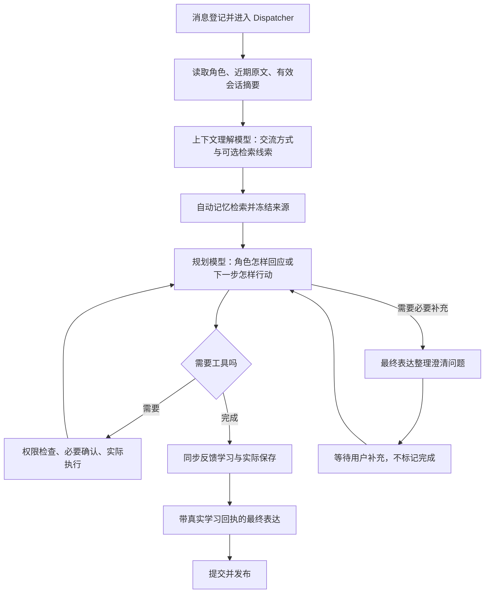

# 2026-11-02 聊天目标与前情承接更新

本次针对“像问答助手，缺少自然交流”的反馈，落实两项已讨论的调整：让模型理解一轮聊天的交流目的，让角色能够使用前文自然接话。没有重写角色卡、增加人格预设或另建互动状态模块。本文记录具体机制、提示词和验证范围；实际自然程度仍需要真实聊天评估。

## 一、请求链路的调整

旧主流程先用当前消息检索记忆，再读取角色和会话历史、理解交流要求。短句“终于解决了”本身缺少检索线索，可能找不到前文指向的事情。新流程先读取当前会话的近期双方原文和有效摘要，用已有的上下文理解模型识别交流要求及可选检索线索，再进行一次自动记忆检索。不增加独立的“聊天分类模型”调用。



普通成功聊天在自动学习启用时，仍通常是上下文理解、规划、反馈学习、最终表达四次主要模型调用。工具会引起进一步规划，学习的既有有限重试也可能增加调用。澄清分支先不运行收尾学习，收到补充后继续原任务；主动任务仍不将后台关注文字当成用户的交流要求。

## 二、改变普通聊天目标

### 1. 上下文理解提示词

文件：`src/deskpal/companion/understanding.py`，标记 `[CONTEXT_UNDERSTANDING]`。

原来主要提取交流要求和用户状态，例如“这次简短一点”。现在明确要求模型理解当前话语在交流中的作用：它可能是在分享、感叹、倾诉、思考或邀请讨论，并不一定是在提出需要解决的问题。这些是解释性例子，不是程序规定的枚举模式。

需要调整时，模型仍返回现有的 `user_understanding` 和 `interaction_approach` 自然语言记录。不需要变化就返回空数组。只针对本轮的回应重点使用 `turn` 范围，不把一次随口感叹变成长久限制；持久要求仍必须有用户明确的长期意图。

新增提示词的主要原文如下：

> Understand the conversational purpose, not just explicit formatting requests. A person may be sharing news, thinking aloud or wanting company rather than asking for a problem to be solved.

> An appropriate response may simply acknowledge, offer a character-grounded perspective, or follow the current topic. Questions and advice are optional, never a mandatory ending.

### 2. 规划提示词

文件：`src/deskpal/planner/llm_planner.py`。

替换原先简短的“普通聊天直接回答”，改为让模型先判断这个角色应怎样参与正在进行的交流，再形成草稿。角色卡不仅决定用词，也应影响它关注什么、怎样看待问题和怎样提出看法。当前互动方式和暂时的用户状态理解继续参与判断。

明确允许简短回应、相关联想和有角色依据的观点；建议、清单、追问和主动提供帮助不是每轮必需。用户换话题就跟随，不强迫续接未完事项。只有需要实际能力或事实查询时才使用工具，既有工具权限规则保留。

> For ordinary chat, decide how this character would participate in the ongoing conversation, then draft a reply without unnecessary tools.

> A brief acknowledgement, a relevant association or a character-grounded opinion can be sufficient. Advice, checklists and follow-up questions are optional; never end every reply with an offer of help.

### 3. 最终表达提示词

文件：`src/deskpal/response/composer.py`，标记 `[EXPRESSION]`。

最终表达不只把草稿改成温柔语气，而要继续遵循同一份交流方式、用户理解和角色背景。短句可以构成完整回复，不要求每轮总结、分点或以问题结束。记忆用于理解和承接，不用来刻意展示“我记得你”，也不主动翻出无关私人细节。

同时说明：助手过去说过的意见和建议，能证明“我们讨论过什么”，不能独自证明外部事件已经发生或用户已同意。允许有角色依据的观点和明确框定的想象，不虚构角色在应用外的生活、共同经历或后台监控。事实、工具结果、授权及学习保存回执的原有约束没有撤除。

> A short acknowledgement or personal perspective can be a complete reply. Give advice only when wanted or useful; questions, summaries, bullet lists and offers of help are not mandatory.

> Assistant history can establish what you previously discussed, proposed or expressed as an opinion; it cannot alone verify an external event, invented biography or user consent.

## 三、让记忆检索理解前文

上下文理解输出保留 `entries`，新增可选的 `retrieval`；旧式只返回 `entries` 的结果仍能被接受。

```json
{
  "entries": [],
  "retrieval": {
    "query": "雪杉项目之前排查的崩溃问题",
    "sources": ["request", "history:0"]
  }
}
```

`retrieval_sources` 由程序提供，含当前消息、实际传入的历史索引及可用摘要。模型只能选择已有来源键；检索文字最多 1024 UTF-8 字节、最多引用八项来源。原句已经足够或指代不清时返回 `null`，程序继续使用原句，不按关键词硬编码猜测对象。这里检查的是结构、范围和来源存在性，语义是否合理仍由模型判断，不能宣称程序已经验证检索文字中的事实。

`InteractionCoordinator` 把线索登记为带来源的 `retrieval_context`，明确标为非指令、非已证实事实，再调用原有检索接口。线索不会被当作工具指令，也不写入角色卡、人格习惯或长期记忆。模型理解或保存失败时，退回原始请求检索并向后续表达传递警告。

理解和检索前后都核对角色修订、会话清空代次和已读消息／记忆来源。失效时停止使用旧背景。已持久化的等待任务或重启续办恢复原上下文和记忆引用，不重新生成线索、替换原依据或重复执行工具。

## 四、规划和最终表达共用会话摘要

之前会话摘要只作为规划参考，没有单独传给上下文理解和最终表达。现在 `PreparedTurn` 保存有效的 `conversation_summary`，三个阶段都能读到同一份冻结摘要，包括它的来源引用、修订和“非指令、非外部事实验证”标记。摘要因记忆更正或学习复核而退出本轮背景时，表达侧的对应字段也会同步撤下。

摘要正文保留 `progress`、`decisions`、`open_questions` 三个既有字段，增加可选 `dialogue_context` 字符串数组。例如：

```json
{
  "progress": [],
  "decisions": [],
  "open_questions": [],
  "dialogue_context": [
    "用户最近在适应新工作，上次是在分享第一周的感受。",
    "助手曾建议先熟悉节奏，这只是当时的建议。"
  ]
}
```

反馈学习提示词 `[MEMORY_FEEDBACK]` 对此增加明确指导：保留普通聊天话题、有意义的近况和未说完的讨论，区分用户自述、暂时推测与角色观点；跟随话题变化，不把每条线索都变成待办或主动关注。摘要仍只总结已发布历史和旧摘要，不把尚未发布的当前草稿编成共同经历。

摘要格式由新的 `conversation/summary.py` 共用校验：保留总量 4096 字节、每个数组最多十六项、每项最多 2000 字节等边界。旧三字段摘要继续可读；已有 JSON 正文列可以保存新增可选字段，不需要新增数据库表或迁移版本。原聊天记录不会被自动重写，新的背景摘要由后续反馈逐步生成。

这是当前会话的工作上下文，不是新增长期记忆类型。同一角色的长期记忆继续按已有规则供各会话检索，但不会把一个会话的聊天摘要直接塞进另一个会话。清空聊天会清理其摘要，长期记忆按既有约定保留。

## 五、澄清回复也经过最终表达

原 `clarify` 分支直接返回规划模型的问题。现在它与正常回答共用最终表达，传入 `response_intent="clarify"`，明确要求保留缺失信息的问题，不能将其改成任务已完成的回答。表达后仍是 `AwaitingInput`；没有提前提交学习或任务完成结果。

调用预算配套改为：没有澄清的正常任务仍只有一次表达；每个已结束的澄清决定允许后续答复获得下一次表达额度，同一个决定不能反复尝试。额度依据持久化决策历史计算，总上限九次，重启不重置。规划二十四次、学习三次及多轮执行的既有预算不因此扩大。授权等待等程序状态提示仍由原状态流程展示，本文不将它们称作已经统一模型润色的正常聊天正文。

## 六、代码落点

| 文件 | 本次变化 |
|---|---|
| `companion/understanding.py` | 自然语言交流目的、摘要输入、可选带来源检索线索及校验。 |
| `application/interaction.py` | 前文理解先于自动检索；冻结和恢复线索、记忆与摘要；补来源核对。 |
| `agent/context.py` | 本轮快照携带实际检索包和摘要。 |
| `agent/core.py` | 采用新准备顺序；传摘要给表达；澄清也表达但不提前学习。 |
| `planner/llm_planner.py` | 普通聊天参与目标、角色观点、自然承接及可选追问。 |
| `response/composer.py` | 接收和校验摘要、识别澄清意图、增加自然交流指导。 |
| `memory/feedback.py` | 生成普通聊天背景摘要，调用共用摘要校验。 |
| `conversation/summary.py` | 共用有界摘要正文格式校验。 |
| `conversation/repository.py` | 接受兼容旧格式的聊天背景字段，保持来源与修订检查。 |
| `workflow/humanization.py` | 澄清和最终答复的持久表达额度。 |
| `llm/providers.py` | 离线演示适配器同步表达输入字段。 |

## 七、验证与实际使用观察

父 Agent 编写代码和定向测试，Luna 执行离线测试，父 Agent 复核失败。测试只使用合成临时目录，不连接真实模型或修改用户角色库、配置和密钥。

验证项目包括：含糊短句的检索时序和来源、旧／新摘要在三个模型阶段的一致传递、摘要不自动生成长期记忆、无效检索线索退回原句、来源中途失效阻断、跨会话与清空隔离、连续澄清后继续原任务、重启恢复和表达次数，以及原有记忆、工具、多轮与主动行为回归。

新增两个测试文件共二十项已全部通过，十一份修改源码严格类型检查通过。首组曾出现一项新测试夹具错误：把工厂已经解析到角色目录的配置再次当成应用根配置，重启后打开了另一个空库。已改为从原合成配置文件重开，并明确断言原任务仍在等待补充；未改变产品的档案选择行为。

扩大回归共 535 项，结果 506 通过、29 失败。对照本轮修改前 `HEAD`（`abc548e4af70b60110bcecf6c8a90f93be8b47fb`）的独立源码快照，实际运行这二十九个失败节点，并在同进程运行前和 pytest 各阶段检查所有已加载 `deskpal` 模块路径：二十八项同样失败，一项旧澄清测试通过。已有失败涉及较早的直接 Agent 入口、记忆流程、工具集成、历史投影／调用预算旧断言，以及记忆有效期边界；不能将它们全部概括成“只是旧测试”，本次也没有修改或删除这些节点。

本次新出现的旧澄清测试失败，是其模型替身对表达调用固定返回完成语的 JSON，无法保留澄清问题。已给该测试加入局部自然语言表达替身，并加强断言：首个回复须为润色后的原问题，暂停再继续保留同一问题，规划和表达各调用一次。没有将“保留澄清问题”改成允许任意回复。

原始日志保留在 `data/validation/chat-continuity-20261102-20261102-151609-a8080c01/`；有效基线对照在 `data/validation/chat-continuity-baseline-20261102-00ff3d80cc/baseline.log`。基线探针也保留了两次无效尝试：一次参数节点转义选取错误，一次只在预检进程使用了快照、实际 pytest 提前加载了当前源码；它们均不能用于认定已有失败。最终单进程来源校验后的对照才是上面的二十八项结论。第一组重启夹具错误日志另保留在 `data/validation/chat-continuity-20261102-20261102-151315-c8e25817/first-group.log`。

最终定向回归 **223/223 通过**（94.02 秒），十一份源码严格 mypy 再次通过；该组覆盖新增二十项测试、修正后的暂停澄清测试及既有角色上下文、多轮、反馈学习、统一复查和表达协议。最终日志是上面验证目录中的 `final-focused.log`、`final-mypy.log`，对应退出码均为零。扩大回归中的二十八项已有失败仍保留，未修复、未删除，不将扩大回归记作整组通过，也不把不同轮次的重复节点相加成通过总数。

实际聊天建议用“分享近况但没提问”“只想倾诉”“先聊一个事情后用短句承接”“中途换话题”“需要明确办事”几类连续交流观察。离线替身能证明上下文和控制链路接通，不能证明真实模型的自然程度。角色卡的丰富度、检索模型是否可用以及所接服务的能力仍会影响表现；本次不自动改写用户角色卡，也不改为固定追问或定时插话。

代码更新后重启应用及后台即可使用，无需新增设置或手动迁移数据库。
