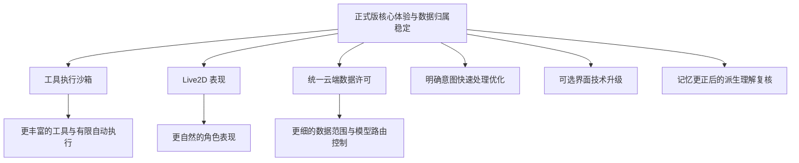

# 正式版后的长期功能扩展规划

更新日期：2026-10-30。状态：长期规划，尚未安排具体版本和开发日期。

本文件记录正式版之后可以继续建设的六个方向：**工具执行沙箱、Live2D 桌宠、云端数据许可、明确意图的快速处理优化、可选的界面技术升级、记忆更正后的派生理解复核**。它们不增加当前正式版的必交功能，也不代表已经实现或通过验收。制定这些后续规划不表示恢复封存实验或启用尚未验证的快捷路径。

## 先把当前产品做好

当前优先把角色卡、模型参与理解与人格学习、连续记忆、聊天体验、执行记录和日程安排理顺。后续能力应接在这些稳定基础上，避免为了未来的完整权限体系，让初期的正常使用处处需要设置和确认。

归属按后续已确认方案更新：角色切换整体切换全部业务数据库与受管形象资源，未激活角色后台不运行。模型连接、凭据、外部工作区和模型缓存继续应用级共用。

“延后高级安全能力”不意味着撤掉现有路径检查、工具权限、密钥保护和执行结果记录。当前可以承诺什么，仍以实际实现和验证结果为准。初期选用远程模型时，应清楚说明回答所需的相关资料会交给该模型处理。

| 方向 | 为什么值得做 | 当前基础与缺口 | 后续目标 |
|---|---|---|---|
| 工具执行沙箱 | 某个工具出错或失控时，减少对文件和应用的影响。 | 已有工作区检查、权限和执行账本；V0.6 有隔离原型，但未通过完整验证、未接入生产执行。 | 独立、限权、可停止的工具执行，并逐步支持更丰富的工具。 |
| Live2D | 让角色通过动作和表情呈现连续状态，增强互动感。 | 当前是静态图片桌宠；旧 Live2D 文件是研究与设计，不是已交付能力。 | 在保留静态图片选择的同时，支持真正的 Live2D 模型与互动。 |
| 云端数据许可 | 有些内容可以交给远程模型，有些只适合留在本地。 | 已有用途标签和部分拦截，但分散、细碎，尚不适合作为完整权限产品。 | 集中、易懂、覆盖所有模型用途的数据外发控制。 |
| 明确意图的快速处理 | 对确实无需推理的请求减少等待和模型开销。 | 普通聊天现已统一进入模型多轮判断；显式管理/演示入口不代表已有可靠语义快速路径。 | 以后在理解正确、行为一致的前提下，有选择地增加快速处理。 |
| 可选的界面技术升级 | 在需要更丰富的角色表现、动画和布局能力时，重新评估界面实现方式。 | 当前使用 PySide6 / Qt Widgets；2026-10-30 选择以 QFluentWidgets 为近期界面改进路线，尚未接入。 | 正式版后按实际需求评估 Qt Quick / QML + Qt Quick Controls 等方案，不预先承诺迁移。 |
| 记忆更正后的派生理解复核 | 原记录变化后，逐步判断哪些相处习惯、情绪或理解应当调整。 | 当前先更正原记忆，依靠后续模型学习纠偏；不按程序猜测并立即重写所有相关理解。 | 研究简单来源关联与模型判断相结合的复核方法，避免漏改和误伤独立理解。 |

## 方向一：继续建设原 V0.6 的工具执行沙箱

### 用户能得到什么

例如，某个文档工具卡住时，可以停止这个工具，而不是只能等整个应用恢复；某个插件只被允许读选定文件，就不应该顺便读取角色数据库或模型密钥。

沙箱要同时处理“工具能访问什么”和“它失控后怎样停下来”。只把工具放到另一个进程，不足以说明它已经被限制。

### 继承的建设目标

- **独立执行。** 工具在受控执行环境中运行，普通工具不拿到整个应用对象、数据库连接或 API 密钥。
- **明确访问范围。** 按实际操作限定文件、目录、网络和宿主能力；读取、覆盖和删除不能混成一种无限授权。
- **能够停止和回收。** 工具超时、用户取消或应用退出时，可以回收相应执行进程，并核对是否还有宿主代理操作未完成。
- **限制资源消耗。** 分别验证运行时间、内存、子进程、输出和可写存储的限制，不能把“清理临时文件”当成已经限制磁盘写入。
- **保留真实执行状态。** 区分尚未执行、执行失败、已经提交和结果未知，避免结果丢失后自动重复危险操作。

用户不必为每次普通查询理解底层权限模型。需要确认的仍应集中在有危险或不可逆影响的操作上；细粒度授权主要是让后台准确执行已经作出的选择。

### 分阶段推进

| 阶段 | 先做什么 | 进入下一步的条件 |
|---|---|---|
| 重新评估 | 重新阅读 V0.6 失败证据，比较适合桌面产品维护和部署的隔离方案。 | 明确能保护哪些资源、依赖什么环境、哪些地方还不能保证；不直接把旧原型当成成品续接。 |
| 小范围验证 | 用合成文件和有限工具验证隔离、取消与清理。 | 在真实 Windows 环境中证明允许的操作可用、禁止的操作确实被挡住；模拟测试不能代替这一步。 |
| 内置工具迁移 | 从少量工具接入，再逐步覆盖文档、调度等能力。 | 新执行路径与现有任务、授权、恢复和退出流程一致，不因失败悄悄退回无限制执行。 |
| 扩展工具能力 | 在已验证的边界上考虑插件、脚本及更丰富的自动任务。 | 为新增能力分别检查权限、联网、数据和资源边界；不因已经有沙箱就默认任意插件可信。 |

原 V0.6 的“有限自动行为”也可在这条路线中继续扩展，但不原样照搬旧版仅靠固定规则的产品体验。模型可以理解目标、决定步骤，沙箱负责约束实际执行；自动记忆和人格理解无需等待沙箱完成。

需要保留一个事实边界：停止进程不能撤回已经写入的文件或已发出的外部操作；取消本地等待也不能证明远程服务停止生成或计费。界面应报告真实情况。

原 V0.6 目前仍处于暂停状态，阶段 0 未通过。制定本规划不代表恢复该实验，后续启动开发时另行确定路线和范围。

## 方向二：在静态图片基础上增加 Live2D

### 用户能得到什么

角色可以呼吸、眨眼、做动作，并按当前交流表现出合适的神态。角色在等待工具时有自然的等待动作，回复结束后回到日常状态，而不是只有一张固定图片。

Live2D 改变角色的表现方式。角色卡、记忆和工具仍属于原角色；换一套模型不等于创建新人，也不清空经历。

### 分阶段推进

| 阶段 | 先做什么 | 进入下一步的条件 |
|---|---|---|
| 模型与技术准备 | 选择可维护的渲染接入方式，核对 SDK、绑定和角色模型的实际使用/分发许可。 | 在正式选型时重新确认版本、兼容性和许可，不直接沿用旧调研结论。 |
| 基础显示 | 加载真实 Live2D 模型，实现缩放、拖动、点击和基础动作。 | 加载失败能回到静态显示，桌面输入、多屏和不同缩放下保持可用。 |
| 角色状态联动 | 将聊天中的表达和任务状态映射到表情、动作。 | 不乱播旧动作、不频繁闪变；动画不能把失败表现成成功。 |
| 交互与稳定性 | 增加自然过渡、低占用、隐藏暂停、减少动画和更完整的资源管理。 | 多次加载/切换/退出后资源能回收；渲染故障不拖垮聊天和工具执行。 |

后端只需要表达“正在思考”“轻松回应”等表现意图，具体动作由渲染适配器转换。模型不应直接生成任意 SDK 调用或模型文件路径。

Live2D 与工具执行沙箱可以分别推进。若采用独立渲染进程，那首先是为了围住渲染故障，不能据此宣称它已经满足工具沙箱的安全保证。

静态图片继续作为正式支持的选择，不要求用户为了聊天必须准备 Live2D 模型。静态原画也不会自动变成可运行模型；拆件、绑定和动作制作是独立工作。

## 方向三：把云端许可做成统一、易用的安全能力

### 为什么仍然需要

选了远程模型，不代表以后任何资料都适合发送。例如日常聊天可以用远程模型，但某份工作材料或某段私人记录，用户可能希望只在本地处理。

这项能力值得长期建设。初期的问题在于不宜一下引入逐条标签、五类开关、派生规则和大量确认，导致正常人格、历史和学习被截断。**初期简化使用，后续完善保护；不是永久放弃数据外发控制。**

### 建议的产品形式

普通使用继续遵循已经选定的模型连接。需要额外限制时，用户能用容易理解的话或少量明确入口表达，例如“这份文件只在本地处理”“这段对话不要发给远程模型”。

高级设置再提供按资料范围或提供方的许可，而不是让每个新用户先理解“人格、cue、affect”等内部分类。普通自动学习继续自动完成；“是否采用一条记忆”和“这条资料能否交给某个模型”是两件事，不能又合成一套逐条记忆审核。

### 分阶段推进

| 阶段 | 先做什么 | 进入下一步的条件 |
|---|---|---|
| 梳理所有外发入口 | 盘点聊天、工具规划、记忆提炼、人格学习、摘要、主动判断，以及可能使用远程服务的检索/插件。 | 明确每种请求发给谁、使用哪些资料；不只检查普通聊天。 |
| 统一发送前检查 | 在集中模型/外部服务边界判断是否允许发送；主业务继续使用统一推理接口。 | 人格、记忆等业务无需到处判断云端/本地，也不能绕过集中检查另发请求。 |
| 清楚的范围控制 | 支持针对一段对话、一组资料或一个提供方设置限制。 | 限制能持久保存、能看懂、能撤销；当前输入和附带记忆都受对应检查。 |
| 本地处理与解释 | 有合适本地模型时使用本地能力；没有时说明当前不能怎样处理。 | 不把“仅本地”请求静默改发远程，不假装一个固定规则演示就是本地大模型。 |
| 派生资料与撤销 | 让摘要、学到的习惯、检索结果继承来源限制；处理缓存、排队任务和晚到结果。 | 不因把私人原文改写成一句总结就失去限制；撤销后后续处理确实停止采用受限资料。 |

例如，某段原文被指定为“仅本地”，模型从它总结出的用户习惯也不能换个名字就发往云端。相关来源需要在后台关联，用户不必逐条手动标记所有派生结果。

模型可以帮助理解“这次别把工作材料交给远程服务”的意思，但真正拦住发送由程序完成。数据许可和工具授权也分别处理：允许模型阅读资料，不自动允许它删除文件；允许工具查看文件，也不自动允许把文件内容发给别的服务。

这条路线同样覆盖角色边界：允许外发只对本来就有权访问的资料生效，不能借由模型请求拿到其他角色的私有聊天和情景记忆。共享工具记录也不应顺便暴露原任务使用的整份角色上下文。

已有 `cloud_allowed` / `local_only` 标签可以作为迁移时的参考，但需要重新检查完整含义与覆盖范围，不把当前分散检查直接包装成已完善的安全系统。迁移旧限制时明确告知处理方式。

撤销许可主要限制后续发送和使用，不能宣称已经把先前发送给远程服务的数据收回。备份、缓存和外部服务记录也需要分别说明。

## 方向四：明确意图的快速处理优化

未来可以研究：有些含义和目标都完全清楚的请求，是否有必要每次都调用完整规划模型。例如明确指定内容的一次操作，经过足够验证后，可能用更轻的处理缩短等待。

这属于正式版后的性能优化。本阶段优先统一由模型理解新请求，不以“命中了记住这个词”作为省略思考的依据。

后续开工先收集实际等待时间和调用成本，再选择少量边界清楚的场景。快速处理必须与正常模型路径遵守同样的角色归属、数据用途、授权、任务记录和错误回执；涉及否定、引用、多个意图、条件或目标不清楚时，回到正常模型判断，不能只完成其中一部分就提前返回。

验证要同时比较理解准确性、遗漏操作和节省效果。不能只证明它更快，却把“解释一下‘记住’这个用法”误当成保存命令。保留关闭快捷处理、统一走模型的方式，避免新优化再次成为难以排查的隐藏分支。

明确的界面管理操作、取消任务和执行已确认原计划，继续按各自确定的控制语义处理，不需要为了统一聊天规划而强行调用模型。

## 方向五：可选的界面技术升级

2026-10-30 确认：近期界面改进选用 **QFluentWidgets 的 PySide6 版本**，沿用 Qt Widgets 与既有 Python 后端；本次决定仅确定路线，接入开发、依赖调整和测试尚未开始。

进一步更换界面实现方式放在正式版后的可选更新方向中。Qt Quick / QML + Qt Quick Controls 是候选之一，用于评估更灵活的布局、角色表现和动画交互；不将它视为当前必须完成的重构，也不将其与 Live2D 或沙箱捆绑交付。若现有 Widgets 与 QFluentWidgets 已能满足体验要求，可以不迁移。

后续评估先明确具体体验缺口，再比较小范围原型与现有界面的效果。聊天内容组织、任务授权、状态反馈和设置归类仍需独立设计，不能仅凭更换渲染技术宣称这些问题已经解决。

如决定迁移，优先复用应用服务、AgentCore、人格、记忆、任务和数据库接口；另行设计显示层与桥接适配。进入整套界面替换前，应验证中文输入法、长列表滚动、窗口缩放、多屏 DPI、桌宠透明窗口与焦点、后台关闭、角色切换、安装分发及资源占用。只有体验收益和维护成本都得到证据支持后，再安排阶段开发与验收。

## 方向六：记忆更正后的派生理解复核

2026-10-30 决定：这一项作为正式版后的待优化课题。近期普通更正先修改原记忆，由后续长期学习中的模型结合新交流修正之前不妥的行为，不建设“更正一次、程序立刻找全并重写所有派生理解”的复杂链路。

后续研究的重点是如何判断真正相关：一条习惯可能来自多次交流，原事实变化不一定使整条习惯失效；另一些理解没有直接引用原记录，却可能受到影响。可利用已有真实来源关联找出有限范围，再由模型决定保留、调整或安排后续复查。理由应可读、有来源，不仅因为编号相连就机械删除，也不要求一次推理找到全部语义影响。

验收应同时检查该纠正的内容有没有遗漏、不相关的习惯有没有被误伤、处理范围能否解释、重试是否重复写入，以及用户明确要求与新信息能否实际影响后续交流。允许理解渐进修正，不把推测强行升级为确定结论。

这项延后仅针对普通更正后的语义派生理解。明确遗忘、当前计划所需来源修订、已有外发限制和摘要失效继续按各自约定处理，不因此重新允许采用已被明确删除的资料。

## 六条路线怎样配合

六条路线可以按需求和资源分别排期，Live2D 不需要等完整沙箱实现，也不以迁移 QML 为前提。沙箱控制工具怎样执行，云端许可控制资料怎样外发；以后增加可以联网的插件时，两者应配合设计，不能认为有其中一个就覆盖了另一个。快速处理优化以普通模型路径的正确性为基线，不负责改变角色或权限规则。界面技术升级只在确有收益时选择，不改变已确认的业务和数据归属；派生理解复核不要求普通学习等待其实现。

正式版后的版本号、时间和采用技术，待每个方向准备开工时再确定。每次先选一个能独立使用、能验证的小范围，稳定后再扩展，不把六条路线捆成一次全部重写。

## 历史依据与关联文档

- [总体路线](../archive/roadmap-before-redesign.md)：V0.6 隔离执行和 Live2D 已有延后记录。
- [原 V0.6 开发计划](../archive/releases/v0.6/planning/development-plan.md)、[验收边界](../archive/releases/v0.6/planning/acceptance-boundaries.md)：保留原安全目标，不据此认定已有能力通过。
- [V0.6 最新暂停检查点](../archive/releases/v0.6/pause-checkpoint-2026-10-19-1457.md)、[执行环境重评](../archive/releases/v0.6/execution-environment-architecture-review-2026-10-19.md)：重启该方向前需重新核对；旧外部项目比较属于当时的研究。
- [原 Live2D 提案](../archive/releases/v0.7/planning/live2d-development-proposal-2026-10-19.md)、[原研究](../archive/releases/v0.7/planning/live2d-research-2026-10-19.md)：作为后续研究输入，版本和许可在实际选型时重查。
- [人格与记忆决定](../design/companion/character-memory-decisions.md)：当前角色采用完整独立档案，本文件只补充正式版后的拓展方向。

本文件最初记录三条长期能力规划，后续补充快速处理、界面技术升级与派生理解复核；各项均以对应小节的当前边界为准，不表示已经开发，也未恢复封存实验。
