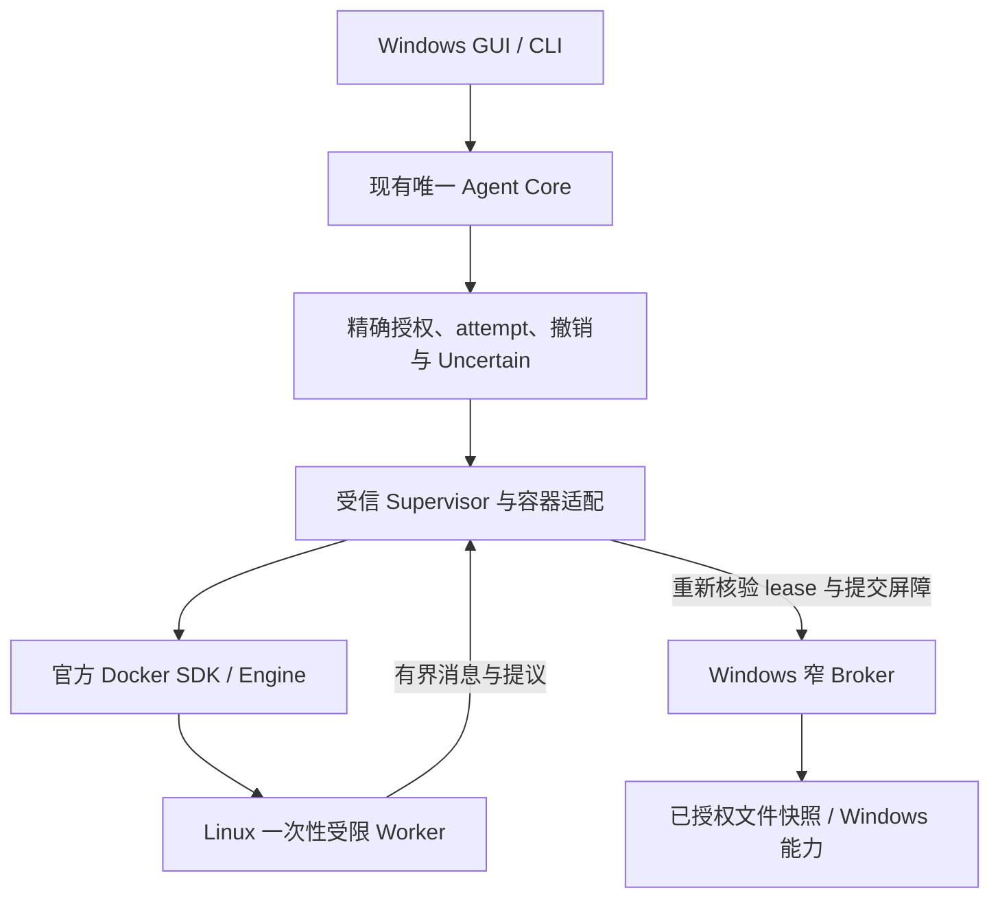

# V0.6 执行环境架构重评

日期：2026-10-19。性质：源码调研和架构建议；不是迁移批准或隔离验收。

## 决策摘要

用户本轮明确允许把“用户另行安装 Docker／WSL2”纳入部署路线。因此，建议将 **Windows 宿主应用 + 窄 Broker + 一次性 Linux 容器 Worker** 提升为首选验证路线，复用 Docker Engine 的容器、命名空间、cgroups、seccomp 和生命周期 API。Python 侧优先使用官方 Docker SDK，通过小型适配层接入现有执行契约。

这与继续自研 Windows Token／profile hive／DACL 隔离不同：成熟运行时承担实际隔离与资源执行机制，本项目只保留自身授权、事实、监督和协议职责。不能因框架有名就整体迁入新的 Agent Core，也不能把 SDK 包装器当成已满足本项目安全要求的后端。

本轮不替换 Worker、不删除正式实现、不安装 Docker/WSL/依赖、不拉镜像、不启动候选框架或安全实验。现有 AppContainer 原型保留为未通过的实验路线；不再默认继续扩展其底层实现。选型结论是**优先进入最小可行性验证**，不是 Docker 已通过阶段0，也不是授权立即重构。

## 已完成的下载清理

已使用 PowerShell 原生命令，仅删除此前明确下载的三个候选源码树及其中归档：

| 已删除路径，均相对仓库根 | 文件数 |
| --- | --- |
| `data/validation/v06/windows-sandbox-review-20261019/source-r1/sandboxrs-windows` | 58 |
| `data/validation/v06/windows-sandbox-review-20261019/source-r3/wincage` | 51 |
| `data/validation/v06/windows-sandbox-review-20261019/source-r3/WABOX` | 64 |

合计173文件。删除前核对解析后的绝对目标均位于指定调研目录内，检查未发现 reparse point 或嵌套 .git，保存逐文件哈希；删除后逐目标确认不存在。原报告、组合下载清单、下载工具和微软 MXC/SandboxSecurityTools 缓存保留，原生实验及旧失败 profile/key/runtime 未触碰。没有重新下载这三个项目。

清理记录：同目录 `candidate-download-cleanup-before-20261019.json`、`candidate-download-cleanup-after-20261019.json`。首份汇总的 total_bytes 因 PowerShell 对字典的聚合方式返回 null；不将它解释为0，逐文件 bytes/hash 和不存在检查仍保留。字节数不是本次清理完成的判断依据。

## 调研方法与证据边界

阅读实际源码、测试、依赖文件与许可证，另核对官方 Docker/WSL 文档。本轮未运行候选测试；文中的测试均指读到的上游测试代码，不能算本项目执行结果。

| 来源 | 固定信息／实际读取范围 | 许可证及兼容性 |
| --- | --- | --- |
| Anthropic sandbox-runtime | commit `626a59671ee2be556d70a290a8036224be996193`；package 0.0.80；TS Windows 适配、Rust srt-win、ACL/state/token/Job、原生 smoke、Windows CI 与 winsrt 测试 | 根 LICENSE Apache-2.0；Node >=22.12；Windows 路径另有 Rust helper，不能只安装 TS 代码就获得隔离 |
| OpenHands/OpenHands | 当前读取的 package 为 Agent Canvas 1.27.1；源码职责已迁为 UI/控制中心；另读 Windows 安装说明 | MIT；Node >=24；其不同 Docker 部署方式支持范围不同，不能混用旧版 Runtime 的结论 |
| OpenHands/software-agent-sdk | 实读 DockerWorkspace/DevWorkspace、workspace 元数据、LICENSE；另在线读取 DockerWorkspace 测试 | MIT；所读 openhands-workspace 1.55.1 要求 Python >=3.12，并依赖 SDK/Agent Server；直接纳入宿主会与本项目 Python3.11 支持冲突 |
| Microsoft AutoGen | 实读 autogen-ext 0.7.5 的 Docker executor、对应测试、依赖、README 和两份许可文件 | 代码 MIT，文档 CC-BY-4.0；Python >=3.10；当前 README 明确声明项目归档、不再由微软维护，建议新项目使用 Agent Framework |
| Hugging Face smolagents | commit `96f33faaf028479119ec8d34507b47694cf14e34`；1.27.0.dev0；local/remote executors、相关测试及许可 | Apache-2.0；Python >=3.10；Docker extra 依赖 docker SDK 和 websocket-client；所读是开发快照，不能冒充稳定发布 |
| E2B | commit `62a17dfc3f11439d1d06bfb9bb515eadc5adfcd3`；Python SDK 2.56.0；create/kill/network/timeout 源码、测试；另读 runtime 的本地部署要求 | 根 LICENSE Apache-2.0，Python SDK 子包 LICENSE 为 MIT，需按组件分辨；SDK Python >=3.11；客户端可在 Windows 使用不代表 microVM 运行在 Windows 原生进程内 |
| Docker 官方 Python SDK，补充候选 | commit `56343ddf8f0c44281e151c2dad016c16cdb8393d`；HostConfig、Container API/model、相关 integration/unit 源码及许可 | Apache-2.0；元数据支持 Python >=3.8，Windows 另依赖 pywin32；它直接控制 Engine，没有要求引入第二套 Agent Core |

源码证据目录：

- `data/validation/v06/execution-framework-review-20261019-r2/`：成功取得 SRT、smolagents、E2B 的固定文本及哈希。
- `data/validation/v06/execution-framework-components-20261019/`：Docker SDK 固定文本及哈希。
- `data/validation/v06/execution-framework-text-20261019/`：补读的明确路径文本及逐文件哈希。

网络限制导致第一轮请求失败；获准联网后，AutoGen 归档传输中断，OpenHands 大归档传输被主动停止，SDK 归档超过读取预算。随后改读少量 raw 文本。GitHub API 提交解析受到限流，所以 **OpenHands 两仓库和 AutoGen 补读使用动态 main，保存的是逐文件内容哈希，不是同一 commit 的完整快照**；在线测试页还可能有缓存时间差。相关结论限于实际所读文件，真正采用前必须冻结同一 release/commit、依赖和镜像 digest，并重审源码/测试对应性。没有把失败的下载记录写成成功，也没有保存新的整仓 ZIP。

## 五个项目各自能复用什么

### 1. Anthropic Sandbox Runtime：真正有 Windows 后端，但部署代价与当前边界不符

不能沿用“只支持 macOS/Linux”的旧印象。当前实际 Windows 源码通过独立 srt-sandbox 本地账户、两跳启动及受限 Token 执行；用账户 SID 匹配 WFP 出站规则，并向选定文件添加该 SID 的 ACE。Host 与 Worker 的 User SID 确实不同，这在结构上避免了当前同 SID deny 同时影响 Host 的问题。

不过，这只证明采用了不同的身份设计。未见与本项目等价的“自身可达注册表全部拒写 + Host 独立 HKEY 核验 + 权限恢复与安全清理”测试。源码中的 registry 保护重点包括机器级安装状态和凭据键，不能把阻止读取 Cred 键等同于任意注册表写入都被禁止。

安装路径还会设置机器级 WFP、账户/组以及 ProgramData/Public/系统临时区等 ambient write-deny；ambient.rs 明确指出，第三方自断继承且赋予 Users 写权的目录并不由这一固定列表全面覆盖。Job 实现主要提供 kill-on-close 和 UI 限制，未见本项目需要的 CPU、进程/Job 总内存硬限额。Windows CI 真的调用 Rust smoke 和 TS integration，但 CI 的管理员环境也不等于本项目普通用户产品验收。

**取舍：**值得借鉴身份分离、持久化 ACE 状态和真实 kill-chain 测试。暂不选择为 V0.6 默认后端；Docker/WSL 的许可不等于批准创建系统账户、改 WFP 或全局 ACL。

证据：[Windows 适配源码](https://github.com/anthropics/sandbox-runtime/blob/626a59671ee2be556d70a290a8036224be996193/src/sandbox/windows-sandbox-utils.ts)、[ambient 范围及缺口](https://github.com/anthropics/sandbox-runtime/blob/626a59671ee2be556d70a290a8036224be996193/vendor/srt-win-src/src/ambient.rs)、[Job](https://github.com/anthropics/sandbox-runtime/blob/626a59671ee2be556d70a290a8036224be996193/vendor/srt-win-src/src/job.rs)、[真实 smoke 调用的 CI](https://github.com/anthropics/sandbox-runtime/blob/626a59671ee2be556d70a290a8036224be996193/.github/workflows/integration-tests.yml)。

### 2. OpenHands：可复用执行组件，不适合整体接管现有产品

当前主仓库是 Agent Canvas，执行相关的 Python SDK、Agent Server 和 workspace 在独立仓库。所审 DockerWorkspace 创建 Linux agent-server 容器，提供 HTTP API、健康检查、日志、pause/resume/cleanup。这比本项目需求更偏向有状态、通用开发会话。

DockerWorkspace 的 run 参数包含 loopback 端口映射、可选 volumes/network，所审路径没有同时配置 CPU/内存/只读根等完整安全策略。cleanup 调用 docker stop 后清空容器 ID，没有在此处把 stop 的返回失败变成持久未清理事实。对应 workspace 测试主要 mock 命令和验证参数，并非恶意 Worker 的 Windows 边界验收。

Windows quickstart 还区分单容器 Canvas 与每会话容器：后者明确要求在 WSL2 Linux 里运行，原生 Windows host 不支持该运行方式的 POSIX UID/GID 假设。直接导入最新 workspace 还提高到 Python3.12。

**取舍：**若未来需要长期 shell、编辑器或开发会话，优先复用固定版本的 Agent Server/workspace 组件并加严格部署策略，避免自建同类服务。对 V0.6 单调用、默认离线、精确 Broker 工具，额外的 HTTP 服务、会话状态和依赖成本较高，列为第二候选，不整套迁入 Canvas/调度器/Agent Core。

证据：[实际 DockerWorkspace](https://github.com/OpenHands/software-agent-sdk/blob/main/openhands-workspace/openhands/workspace/docker/workspace.py)、[测试](https://github.com/OpenHands/software-agent-sdk/blob/main/tests/workspace/test_docker_workspace.py)、[依赖与 Python 下限](https://github.com/OpenHands/software-agent-sdk/blob/main/openhands-workspace/pyproject.toml)、[Windows 部署差异](https://github.com/OpenHands/OpenHands/blob/main/README.windows.md)。以上动态 main 的限制见证据说明。

### 3. AutoGen：可参考 executor 接口，不作为新增长期依赖

Docker executor 源码提供 start/execute/restart/stop，使用官方 docker SDK；默认将工作区以 rw 挂载，镜像缺失时拉取。所读 create 调用没有提供完整资源/网络/只读根策略。执行超时依赖容器内 timeout；取消会排队用 pkill 匹配命令，并在完成整组停止证明前返回取消结果。stop 对部分失败记录日志后仍标记未运行。

对应测试有实际 Docker 执行和取消探针，不能说全是 mock；但“取消后此刻未出现 hello.txt”不等于所有后代已经退出，也不是 Host 硬崩溃回收证明。加上当前归档声明，不建议为节省一小段适配代码而引入整套旧框架及其维护负担。

**取舍：**借鉴 CodeExecutor/结果 DTO 的分层；不采用其默认 executor 作为安全后端。微软推荐的 Agent Framework 解决编排迁移，仍不能直接替代 OS/container 隔离，不因名称更新而再扩大本轮范围。

证据：[executor](https://github.com/microsoft/autogen/blob/main/python/packages/autogen-ext/src/autogen_ext/code_executors/docker/_docker_code_executor.py)、[真实测试及跳过条件](https://github.com/microsoft/autogen/blob/main/python/packages/autogen-ext/tests/code_executors/test_docker_commandline_code_executor.py)、[归档声明](https://github.com/microsoft/autogen/blob/main/README.md)、[代码许可](https://github.com/microsoft/autogen/blob/main/LICENSE-CODE)。

### 4. smolagents：适合代码 Agent，不能把本地解释器当边界

LocalPythonExecutor 是 AST 级限制，不是任意 OS 调用威胁模型下的安全边界；源码的线程 timeout 不能强杀执行线程。DockerExecutor 则运行 Jupyter Kernel Gateway，当前已有随机认证 token，allow_pickle 默认 false，不能把旧版本安全印象套过来。

DockerExecutor 可接受 container_run_kwargs，具备注入硬限制的接口；但默认还会构建镜像、安装包、映射端口、保持 kernel 状态，输出收集及 cleanup 语义仍需适配。相关测试包含 mock 和显式 run-all 的 Docker 集成；它们验证代码执行能力，不证明本项目全部宿主边界。

**取舍：**未来确需 Python notebook/数值计算会话时可作为专用执行插件。当前最小 Worker 不需要引入 Jupyter、Agent 循环和序列化体系；不选择为 V0.6 基座，绝不开启 pickle 返回不可信对象。

证据：[remote executors](https://github.com/huggingface/smolagents/blob/96f33faaf028479119ec8d34507b47694cf14e34/src/smolagents/remote_executors.py)、[local executor](https://github.com/huggingface/smolagents/blob/96f33faaf028479119ec8d34507b47694cf14e34/src/smolagents/local_python_executor.py)、[相关测试](https://github.com/huggingface/smolagents/blob/96f33faaf028479119ec8d34507b47694cf14e34/tests/test_remote_executors.py)、[官方安全说明](https://huggingface.co/docs/smolagents/reference/python_executors)。

### 5. E2B：成熟的远端执行 API，当前本地部署成本偏高

SDK 的 Sandbox 是控制面客户端，提供创建、生命周期、文件、命令、网络策略及 kill；真实测试包含允许/拒绝网络、超时和服务端列表中的消失检查。SDK 在 Windows 跑不代表 Windows 本机生成了 Firecracker microVM。

自托管 runtime 的本地开发说明要求 Linux/KVM，涉及 Firecracker、额外服务和主机准备，并明确提示仍在完善。不能因为允许 Docker/WSL2，就假定其嵌套虚拟化、/dev/kvm、依赖闭包和安全部署已经具备。云服务会改变本地优先和数据流出边界，本轮没有获得使用云执行的授权。

**取舍：**长期可保留显式远端 backend 接口，未来用户需要并授权时采用；不为当前 V0.6 先搭一套 microVM 控制面。API kill 成功和服务端列表消失也不自动提供本机进程/存储清理的独立证据。

证据：[SDK 实现](https://github.com/e2b-dev/E2B/blob/62a17dfc3f11439d1d06bfb9bb515eadc5adfcd3/packages/python-sdk/e2b/sandbox_sync/main.py)、[网络测试](https://github.com/e2b-dev/E2B/blob/62a17dfc3f11439d1d06bfb9bb515eadc5adfcd3/packages/python-sdk/tests/sync/sandbox_sync/test_network.py)、[kill 测试](https://github.com/e2b-dev/E2B/blob/62a17dfc3f11439d1d06bfb9bb515eadc5adfcd3/packages/python-sdk/tests/sync/sandbox_sync/test_kill.py)、[runtime 部署要求](https://github.com/e2b-dev/runtime/blob/main/DEV-LOCAL.md)。

## 为什么补充 Docker Engine + 官方 SDK

Docker SDK 的 HostConfig 已提供只读根、网络模式、cap_drop/security_opt、memory/swap、CPU quota、pids_limit、tmpfs、日志配置；Container API 已有 create/attach/inspect/kill/wait/remove。无需自己重写 OCI、namespace、cgroups、存储驱动或容器进程树回收。上游也有实际 readonly mkdir 拒绝等集成用例，但大量 limit 测试仅回读配置，所以仍需本项目的攻击验证。

这条路线比导入完整 Agent 框架更贴近现有架构和 Python3.11/3.12 支持。需固定 SDK/Engine/Desktop 版本和镜像 digest、独立 dependency extra。Docker Engine/SDK 的开源许可与 Docker Desktop 的使用条款是不同事项，分发或商业部署需分别核对；当前未安装或检查用户已有环境。[SDK 实际 HostConfig](https://github.com/docker/docker-py/blob/56343ddf8f0c44281e151c2dad016c16cdb8393d/docker/types/containers.py)、[API 与模型](https://github.com/docker/docker-py/blob/56343ddf8f0c44281e151c2dad016c16cdb8393d/docker/models/containers.py)、[上游集成测试](https://github.com/docker/docker-py/blob/56343ddf8f0c44281e151c2dad016c16cdb8393d/tests/integration/api_container_test.py)、[Desktop 条款说明](https://docs.docker.com/subscription-billing/desktop-license/)。

Docker Desktop 的 WSL2 backend 是运行 Linux 容器的部署方式；**直接 wsl.exe 执行命令不是替代隔离**。普通 WSL 为互操作设计，不能把 /mnt/c、Windows exe/IPC 或 Docker socket 交给不可信 Worker。[Docker WSL2 支持](https://docs.docker.com/desktop/features/wsl/)、[微软 WSL 配置](https://learn.microsoft.com/en-us/windows/wsl/wsl-config)。

## 建议的职责划分

默认每次调用一个新 Worker，执行完成后整容器停止、核验并清理；预热可以准备只读镜像/空闲基础设施，但不能自动复用有不可信状态的会话。默认完全本地，不把 Core、模型密钥、数据库、记忆缓存或 Qt 放进容器。

优先用 Engine 管理的 attach/control 流承载有界协议，避免为默认离线模式暴露 Jupyter/Agent Server 端口。Docker multiplex framing、API 阻塞、部分输出和背压仍须有界处理。Docker 管理客户端只在受信 Host，拒绝 Worker 提交任意 Docker 配置、镜像、挂载或管理命令。

Windows 文件读取由 Broker 获取已核准身份/内容版本的快照并有界传入；写回由 Broker 在提交屏障后完成。不把完整仓库、用户目录、驱动器、宿主 data 或活动可写 staging 直接 rw 挂载。不可信返回产物不直接按其路径/tar 名称落地，防止链接/路径/解包越权。

截图、桌面、通知、日程、记忆等 Windows/宿主能力继续走经过审核的窄 Broker。不能把“运行任意 PowerShell”包装成 Broker 后宣布已隔离；不能强停的能力单独声明，不允许自动规则绕过。Linux Worker 不是 Windows 二进制执行环境；19个工具的覆盖声明必须重做，未迁能力不得静默回落到普通进程。

## 注册表问题如何变化

原 AppContainer 的注册表 deny/Host restore 矛盾仍未修复，旧失败结论及现场保留。Docker 路线改变的是边界：Linux Worker 不持 Windows Token/HKEY，不需要针对真实 Windows profile hive 施加拒绝 ACE，因此有机会根本避免本次修改和恢复 DACL 的流程。

这是一项待验证的架构推断，**不是“Linux import winreg 失败，所以注册表测试通过”**。新的等价要求必须证明：无宿主盘/命名管道/interop/Wine/管理接口等可利用通路；Windows Host 对全新合成 key/canary 的独立前后核验一致；Broker 不提供未授权 registry 操作；容器可达所有持久存储均拒写或有强制总量限制；Host 能独立停止并清理本轮资源。

若最终保留 Windows 原生 backend，原注册表四项联合门槛仍原样适用；不能用另一后端的结果替它验收。若改用容器，必须先确认新的 backend 验收映射，再改测试，不把旧失败测试直接删除/跳过或标为通过。

## 不能靠默认配置解决的硬缺口

| 门槛 | 成熟运行时可承担 | 本项目必须补充验证／设计 |
| --- | --- | --- |
| 网络拒绝 | 独立 network namespace、none 网络模式和 seccomp 接口 | none 仍保留容器 loopback；若保留当前“socket/bind 也拒绝”的契约，需受审 seccomp 限制及真实探针。不能以不可外联冒充全部 socket 被拒 |
| 文件和存储总量 | 只读根、tmpfs、mount/device/capability 隔离 | 只读根并非所有挂载只读；/tmp、/dev/shm、配置文件挂载、匿名卷、容器/Engine 日志均须核对。镜像构建缓存与整套 VM 磁盘另计，不得让 Worker 增长无界 |
| CPU/内存/进程 | cgroups CPU quota、memory/swap、pids | Linux 口径与 Windows Job 不同；20% Job 不能直接抄为 --cpus=0.2，pids 还涉及线程/受信 init。需明确口径与被计入的完整进程树，不能偷偷提高预算 |
| 真实停止 | Engine kill/wait、容器进程树回收 | 取消一次 exec/HTTP/async task 不等于停容器；必须核验根进程与后代、迟到 Broker 提交和持久状态，失败保持 Stopping/Uncertain |
| Host 硬崩溃 | 运行时可按容器 ID 管理进程 | daemon 可以在客户端死亡后继续运行；atexit/--rm 不能充当 kill-on-host-death。需要独立受信 lease/watchdog 机制，超时必须真实停止；若达不到既有期限，路线不得通过 |
| 日志和失败保留 | attach stream、日志驱动、inspect/events | 上限内持续排空/终止，原始事实先持久化。默认不自动删除失败容器，先停后封存证据；停止失败也不能留活跃恶意执行者而只保留日志 |
| 重启和恢复 | 显式 restart policy、对象生命周期 API | 不自动 restart/unpause/reconnect 旧 attempt；按完整 ID、owner、代次核验本轮对象。禁止按名字删除同名容器，禁止全局 prune 或自动扫描清理其它应用资源 |

官方语义：[none 网络](https://docs.docker.com/engine/network/drivers/none/)、[资源限制默认与口径](https://docs.docker.com/engine/containers/resource_constraints/)、[seccomp](https://docs.docker.com/engine/security/seccomp/)、[Engine 安全边界](https://docs.docker.com/engine/security/)、[容器运行与持久化](https://docs.docker.com/engine/containers/run/)。这些配置存在不等于本机已生效。

## 路线优先级和下一步决策门槛

1. **首选验证：Docker Engine + 官方 SDK + 现有 Core/Broker。** 先验证最难的 Host 硬崩溃停止、所有可写存储硬限额、直接网络 API 拒绝和 Windows 通路封闭；通过后才迁单个 time/echo/快照只读工具。该路线仍未获实际实现/替换批准。
2. **条件候选：OpenHands 固定组件。** 只有确认需要长期开发会话，且可同时满足离线/预算/事实语义时，才引入 Agent Server；不能为了复用而把整个应用改成另一个 Agent 产品。
3. **原生备选：SRT Windows／既有 AC 原型／先前 MXC。** 原生 Win32 执行确有必要时单独评审；SRT 还需要独立的机器级部署许可。暂不继续堆叠 registry deny ACE，也不删除已有原型。
4. **不选为本版基座：AutoGen、smolagents、E2B。** 原因分别是维护状态及默认安全合同、Jupyter/代码 Agent 范围错配、云／自托管成本与本地边界；不否定它们在各自场景的价值。

任何后续实验之前，先冻结 backend 能力合同、依赖/镜像、支持平台与验收映射，并由父 Agent 审查。常规构建、mock、静态检查、真实执行与证据采集交6 Luna，父 Agent 负责权限设计、矛盾证据、关键变更与最终安全结论。没有真实证据前，阶段0保持未通过，A/B 不正式整合。

本轮只完成清理、调研及路线建议。当前生产版本仍0.5.0rc1，未 stage/commit/push，也未修改执行源文件或验收标准。
